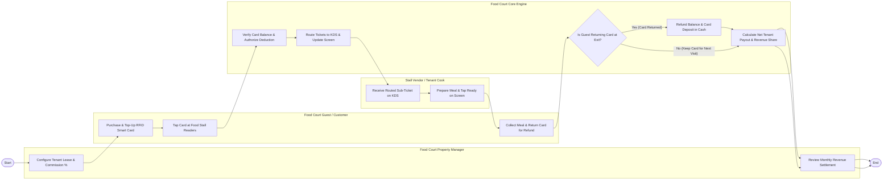

# Swimlane Diagram — Food Court Management System

## Mermaid Code

## Flow Description | Mo ta luong

| Lane | Actor | Role in Flow |
|------|-------|-------------|
| **Lane 1** | Food Court Guest / Customer | Purchases and tops up RFID stored-value card, taps card at stall readers, collects meals using pickup numbers, and returns card for cash refunds. |
| **Lane 2** | Stall Vendor / Tenant Cook | Receives routed order sub-tickets on stall KDS screens, prepares meals, and taps ready to update overhead pickup displays. |
| **Lane 3** | Food Court Property Manager | Configures tenant lease contracts, variable revenue share commission rates (15% GMV), and reviews monthly net tenant revenue payouts. |
| **Lane 4** | Food Court Core Engine | Verifies card balances, authorizes tap-and-pay deductions, routes KDS sub-tickets, updates pickup screens, processes card deposit refunds, and calculates settlements. |

### Process Execution Steps | Cac buoc thuc hien quy trinh

1. **Lease Setup & Card Issuance**: Property Manager configures tenant lease terms (`M1`). Guest purchases and tops up RFID smart card (`C1`).
2. **Order Tap & KDS Routing**: Guest taps RFID card at stall reader (`C2`). Core Engine verifies balance, deducts funds (`S1`), routes sub-ticket to stall KDS, and updates pickup screen (`S2`).
3. **Food Preparation & Pickup**: Stall Cook receives KDS ticket (`K1`), cooks meal, and taps ready (`K2`). Guest collects meal (`C3`).
4. **Exit Refund & Settlement**: Guest decides whether to return RFID card at exit counter (`S3`).
   - If **Yes (Card Returned)**: Core Engine refunds remaining balance and card deposit in cash (`S4`).
   - If **No**: Card balance remains stored on card.
5. Core Engine calculates net tenant payouts and commission shares (`S5`), and Property Manager reviews monthly settlement reports (`M2`), completing execution (`Finish`).
