# Action Tree — Food Court Management System

## Mermaid Code

```mermaid
graph TD
    Root["Food Court Management System"]

    Root --> M1["RFID Stored-Value Card & Top-Up Operations"]
    Root --> M2["Central Kiosk & QR Code Multi-Stall Ordering"]
    Root --> M3["Stall KDS Routing & Pickup Pager Displays"]
    Root --> M4["Tenant Lease & Revenue Share Settlements"]
    Root --> M5["Stall Utility Metering & Hygiene Compliance"]
    Root --> M6["Shared Seating & Tray Return Logistics"]
    Root --> M7["Property Analytics & System Security"]

    M1 --> A11["Issue Encrypted RFID Smart Cards"]
    M1 --> A12["Process Cash & E-Wallet Card Top-Ups"]
    M1 --> A13["Process Tap-and-Pay Stall Reader Deductions"]
    M1 --> A14["Refund Remaining Balances & Card Deposits"]

    M2 --> A21["Process Central Self-Service Kiosk Orders"]
    M2 --> A22["Process QR Code Table Ordering"]
    M2 --> A23["Split Multi-Stall Cart Items"]
    M2 --> A24["Apply Mall-Wide Promo Vouchers"]

    M3 --> A31["Route Sub-Tickets to Stall KDS Displays"]
    M3 --> A32["Update Overhead Pickup Screen Numbers"]
    M3 --> A33["Dispatch SMS Order Ready Notifications"]
    M3 --> A34["Manage Stall Item Sold-Out 86ing"]

    M4 --> A41["Configure Tenant Lease Contract Terms"]
    M4 --> A42["Set Variable Revenue Share Commission %"]
    M4 --> A43["Calculate Monthly Net Tenant Payouts"]
    M4 --> A44["Audit Tenant Cash Bypass & Leakage"]

    M5 --> A51["Track Stall Electricity Sub-Meters"]
    M5 --> A52["Monitor Stall Gas & Water Usage"]
    M5 --> A53["Conduct Weekly Stall Hygiene Audits"]
    M5 --> A54["Issue Food Safety Violation Penalties"]

    M6 --> A61["Monitor Dining Room Table Occupancy"]
    M6 --> A62["Track Central Tray Return Station Volumes"]
    M6 --> A63["Log Dishwashing Tableware Inventory"]
    M6 --> A64["Optimize Peak Dining Hour Turnover"]

    M7 --> A71["Monitor Mall Footfall & Total GMV Sales"]
    M7 --> A72["Compare Tenant Sales Performance Rankings"]
    M7 --> A73["Manage User Roles & Security Permissions"]
    M7 --> A74["Manage RFID Card AES Encryption Keys"]
```

## Module Description | Mo ta Module

| # | Module | Description | Actions |
|---|--------|-------------|---------|
| 1 | RFID Stored-Value Card & Top-Up Operations | Manages RFID smart card issuance, refundable deposits, cash/e-wallet top-ups, tap-and-pay stall reader deductions, and exit card balance refunds. | Issue Encrypted RFID Smart Cards, Process Cash & E-Wallet Card Top-Ups, Process Tap-and-Pay Stall Reader Deductions, Refund Remaining Balances & Card Deposits |
| 2 | Central Kiosk & QR Code Multi-Stall Ordering | Enables multi-stall food ordering via central kiosks or table QR code scans, splitting cart items into individual stall sub-tickets. | Process Central Self-Service Kiosk Orders, Process QR Code Table Ordering, Split Multi-Stall Cart Items, Apply Mall-Wide Promo Vouchers |
| 3 | Stall KDS Routing & Pickup Pager Displays | Dispatches sub-tickets to vendor KDS screens, updates overhead TV pickup numbers, sends SMS alerts, and manages stall 86ing. | Route Sub-Tickets to Stall KDS Displays, Update Overhead Pickup Screen Numbers, Dispatch SMS Order Ready Notifications, Manage Stall Item Sold-Out 86ing |
| 4 | Tenant Lease & Revenue Share Settlements | Configures tenant lease terms, revenue share commissions (15% GMV), calculates monthly net payouts, and audits tenant cash bypass leakage. | Configure Tenant Lease Contract Terms, Set Variable Revenue Share Commission %, Calculate Monthly Net Tenant Payouts, Audit Tenant Cash Bypass & Leakage |
| 5 | Stall Utility Metering & Hygiene Compliance | Tracks sub-metered electricity, gas, and water consumption, conducts weekly food safety audits, and issues hygiene violation penalty tickets. | Track Stall Electricity Sub-Meters, Monitor Stall Gas & Water Usage, Conduct Weekly Stall Hygiene Audits, Issue Food Safety Violation Penalties |
| 6 | Shared Seating & Tray Return Logistics | Monitors dining hall table occupancy, central tray return station volumes, dishwashing machine throughput, and table turnover speed. | Monitor Dining Room Table Occupancy, Track Central Tray Return Station Volumes, Log Dishwashing Tableware Inventory, Optimize Peak Dining Hour Turnover |
| 7 | Property Analytics & System Security | Provides executive reporting on food court footfall, multi-tenant sales rankings, property commission revenue, RFID encryption, and user access rights. | Monitor Mall Footfall & Total GMV Sales, Compare Tenant Sales Performance Rankings, Manage User Roles & Security Permissions, Manage RFID Card AES Encryption Keys |
