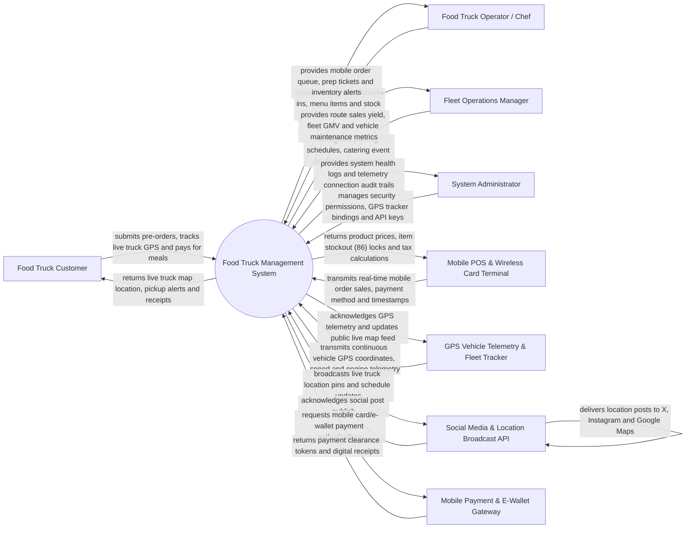

# Context Diagram — Food Truck Management System

## Mermaid Code

## Actor & Interaction Table | Bang Actor & Tuong tac

| # | Actor | Actor Type | Data Sent TO System | Data Received FROM System | Notes |
|---|-------|------------|---------------------|---------------------------|-------|
| 1 | Food Truck Customer | Primary | Pre-orders (skip-the-line), GPS location queries, mobile card/e-wallet payments, SMS notifications | Live food truck map pins, order readiness SMS alerts, digital receipts, menu items | Interacts via customer mobile app or public web map tracker. |
| 2 | Food Truck Operator / Chef | Primary | Shift check-in location, menu item 86 updates, order prep completion, waste logs | Mobile POS queue, compact kitchen prep tickets, low stock alerts, generator fuel status | Operates inside the mobile food truck kitchen. |
| 3 | Fleet Operations Manager | Primary | Weekly parking schedules, municipal permit details, catering event contracts, route assignments | Location sales yield reports, fleet revenue GMV, fuel efficiency analytics, permit alerts | Oversees a fleet of mobile food trucks and central prep kitchen. |
| 4 | System Administrator | Primary | User credentials, security role policies, GPS hardware device bindings, API keys | System health metrics, hardware connection logs, telemetry audit trails | Manages cloud platform infrastructure, GPS device hardware, and permissions. |
| 5 | Mobile POS & Wireless Terminal | Supporting | Real-time offline/online sales line items, cash/card split tenders, order timestamps | Product prices, item 86 stockout locks, tax rates, e-receipt triggers | Handheld cellular/Wi-Fi POS terminal used on the food truck. |
| 6 | GPS Vehicle Telemetry & Fleet Tracker | Supporting | Continuous GPS latitude/longitude coordinates, vehicle speed, generator runtime hours | GPS ping acknowledgments, geofence trigger configurations | Hardware GPS cellular tracker installed on food truck chassis and generator. |
| 7 | Social Media & Location Broadcast API | Supporting | Social media publishing confirmations, map pin index receipts | Automated live location broadcast posts (Twitter/X, Instagram, Google Maps) | Integrates with social platforms to broadcast current truck parking spot. |
| 8 | Mobile Payment & E-Wallet Gateway | Supporting | Cellular card swipe authorizations, Apple Pay, Google Pay, e-wallet tokens | Payment clearance approvals, transaction receipts, refund tokens | Processes wireless mobile payments over 4G/5G cellular networks. |

## System Boundary Description | Mo ta Pham vi He thong

The **Food Truck Management System** manages mobile food truck fleet operations, real-time GPS location tracking, wireless mobile POS transactions, location-based social media broadcasting, and compact kitchen inventory logistics. Inside its boundary, the system handles real-time vehicle GPS telemetry ingestion, public map pin updating, automated social media location broadcasting, skip-the-line pre-ordering, parking permit and event schedule management, onboard generator fuel and water tank monitoring, and route sales yield analytics.

The system boundary excludes physical vehicle driving by operators, physical food cooking on grills, physical generator mechanical repair, and raw credit card clearance (handled by Mobile Payment Gateways).
