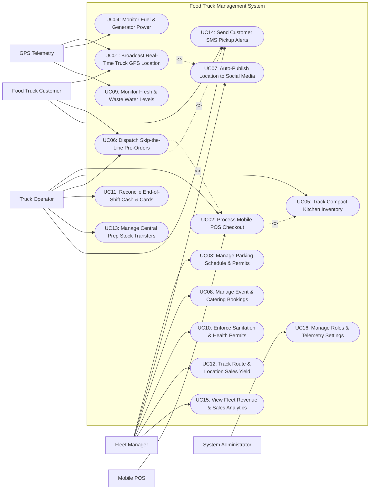

# Use Case Diagram — Food Truck Management System

## Mermaid Code

## Actor Table | Bang Actor

| # | Actor | Actor Type | Role Description | Related Use Cases |
|---|-------|------------|------------------|-------------------|
| 1 | GPS Telemetry | Secondary System | Hardware GPS tracker and utility sensors transmitting real-time vehicle coordinates, generator runtime hours, and tank level logs. | UC01, UC04, UC09 |
| 2 | Food Truck Customer | Primary | Guest tracking live food truck map pins, placing skip-the-line mobile pre-orders, and receiving SMS pickup alerts. | UC01, UC06, UC14 |
| 3 | Mobile POS | Secondary System | Cellular/Wi-Fi handheld POS terminal processing online/offline sales, credit card swipes, contactless taps, and cash tenders. | UC02 |
| 4 | Truck Operator | Primary | Chef/cashier operating inside the food truck kitchen, handling customer orders, managing compact inventory, and reconciling cash shifts. | UC02, UC05, UC06, UC11, UC13, UC14 |
| 5 | Fleet Manager | Primary | Operations manager assigning parking schedules, securing municipal permits, managing catering bookings, and analyzing location sales yields. | UC03, UC07, UC08, UC10, UC12, UC15 |
| 6 | System Administrator | Primary | Technical manager configuring GPS hardware device bindings, user security roles, system parameters, and integration API keys. | UC16 |

## Use Case Table | Bang Use Case

| # | UC ID | Use Case Name | Primary Actor | Secondary Actor | Description | Priority |
|---|-------|---------------|---------------|-----------------|-------------|----------|
| 1 | UC01 | Broadcast Real-Time Truck GPS Location | System | GPS Telemetry | Streams live GPS coordinates of active food trucks to public web maps and mobile apps so customers can find current parking spots. | High |
| 2 | UC02 | Process Mobile POS Checkout | Truck Operator | Mobile POS | Processes fast wireless mobile POS sales transactions over cellular 4G/5G, supporting cash, card swipes, and contactless e-wallets. | High |
| 3 | UC03 | Manage Parking Schedule & Permits | Fleet Manager | None | Manages weekly parking location schedules (e.g., Financial District Mon-Wed; Park Fri), municipal street permits, and meter fees. | High |
| 4 | UC04 | Monitor Fuel & Generator Power | System | GPS Telemetry | Monitors vehicle engine fuel levels and generator runtime hours, triggering alerts when fuel drops below 20% or maintenance is due. | Medium |
| 5 | UC05 | Track Compact Kitchen Inventory | Truck Operator | None | Tracks space-constrained onboard ingredient stock balances in real time, alerting staff when compact storage items run low. | High |
| 6 | UC06 | Dispatch Skip-the-Line Pre-Orders | Customer | Truck Operator | Allows customers to pre-order and pay via mobile app 20 minutes ahead, queueing order tickets for quick pickup without standing in line. | High |
| 7 | UC07 | Auto-Publish Location to Social Media | Fleet Manager | None | Automatically publishes social media posts (X/Twitter, Instagram, Google Maps) with live address pins upon truck parking check-in. | High |
| 8 | UC08 | Manage Event & Catering Bookings | Fleet Manager | None | Manages private event, corporate party, and festival catering bookings, processing booking deposits and custom event menu contracts. | High |
| 9 | UC09 | Monitor Fresh & Waste Water Levels | System | GPS Telemetry | Monitors onboard fresh water holding tank and grey waste water tank levels, alerting staff before tanks reach capacity limits. | Medium |
| 10 | UC10 | Enforce Sanitation & Health Permits | Fleet Manager | None | Tracks mobile food facility health permits, county health department inspection certificates, and commissary sanitation logs. | High |
| 11 | UC11 | Reconcile End-of-Shift Cash & Cards | Truck Operator | None | Reconciles drawer cash balances against mobile POS card transactions at shift end, calculating cash over/short variances. | High |
| 12 | UC12 | Track Route & Location Sales Yield | Fleet Manager | None | Analyzes hourly sales revenue generated per parking location, identifying top-performing street spots vs low-yield routes. | High |
| 13 | UC13 | Manage Central Prep Stock Transfers | Truck Operator | None | Manages raw ingredient inventory restock transfers from central commissary prep kitchens to individual food trucks before shifts. | High |
| 14 | UC14 | Send Customer SMS Pickup Alerts | Truck Operator | Customer | Dispatches automated SMS notifications to pre-order customers when their food is cooked and ready at the truck window. | High |
| 15 | UC15 | View Fleet Revenue & Sales Analytics | Fleet Manager | None | Generates analytical reports on total fleet GMV sales, food truck profitability comparisons, top menu items, and peak hours. | High |
| 16 | UC16 | Manage Roles & Telemetry Settings | System Admin | None | Configures user security access permissions, GPS hardware tracker bindings, cellular data settings, and integration API keys. | High |

## Use Case Specification | Dac ta Use Case

---

### UC01 — Broadcast Real-Time Truck GPS Location

| Field | Detail |
|-------|--------|
| **UC ID** | UC01 |
| **Use Case Name** | Broadcast Real-Time Truck GPS Location |
| **Actor(s)** | Primary: System   Secondary: GPS Telemetry, Food Truck Customer |
| **Description** | Streams continuous 4G/cellular GPS latitude and longitude coordinates from vehicle telemetry trackers to a public live map feed, broadcasting real-time food truck parking spots to customers. |
| **Precondition** | 1. Vehicle hardware GPS tracker is online and calibrated.   2. Public live map tracker service is active. |
| **Main Flow** | 1. Vehicle hardware GPS tracker captures GPS latitude and longitude coordinates (e.g., Lat: 37.7749, Long: -122.4194) every 15 seconds.   2. GPS tracker transmits cellular telemetry payload (Device ID #TRK-01, Coordinates, Speed: 0 mph, Ignition: ON) to System.   3. System ingests payload and evaluates vehicle movement state.   4. When vehicle speed drops to 0 mph at a scheduled parking spot for > 5 minutes, System updates truck status to `Parked & Open for Business`.   5. System updates public live map feed on customer mobile app and website, rendering active truck pin with address (e.g., "Food Truck #01 — Now at 450 Montgomery St until 2:30 PM").   6. System triggers automated social media broadcast engine (executing UC07).   7. Customers browsing app view live truck pin, distance from current location, active menu, and estimated wait time. |
| **Alternative Flow** | **AF1** — Manual location check-in override:   1. GPS tracker signal is obstructed by high-rise buildings.   2. Operator taps "Manual Check-In at Financial District" on mobile POS terminal.   3. System updates public map pin using manual address coordinates. |
| **Exception Flow** | **EX1** — GPS tracker offline signal loss:   1. At step 2, System receives no GPS pings for > 15 minutes while in transit.   2. System flags map status "Location Updating..." and alerts Fleet Manager dashboard. |
| **Postcondition** | Live food truck map pin is updated, status displays `Open for Business`, and location broadcast is published. |
| **Business Rule** | **BR1**: GPS location pins must refresh on public customer maps within 30 seconds of vehicle parking check-in.   **BR2**: Off-duty or transit movements must automatically hide truck location pins from customer maps to prevent invalid visits. |

---

### UC02 — Process Mobile POS Checkout

| Field | Detail |
|-------|--------|
| **UC ID** | UC02 |
| **Use Case Name** | Process Mobile POS Checkout |
| **Actor(s)** | Primary: Truck Operator   Secondary: Mobile POS, Mobile Payment Gateway |
| **Description** | Enables food truck operators to take quick customer orders on handheld cellular POS terminals, supporting cash, credit card swipes/taps, and mobile e-wallets with offline capability. |
| **Precondition** | 1. Mobile POS terminal is logged in by truck operator.   2. Onboard compact kitchen menu and price list are loaded. |
| **Main Flow** | 1. Customer approaches food truck window and orders items (e.g., 2x Tacos, 1x Soda).   2. Operator selects items on handheld mobile POS screen.   3. System calculates subtotal, local sales tax (based on current GPS city jurisdiction), and grand total (e.g., $14.50).   4. Customer selects payment method: Credit Card Tap (Contactless Apple Pay).   5. Operator presents wireless card reader; Customer taps smartphone.   6. POS terminal serializes cellular payment request over 4G/5G data network to Payment Gateway.   7. Payment Gateway approves transaction and returns HTTP 200 Authorization Code.   8. POS reader beeps green approval tone, displays "Approved $14.50", and dispatches SMS/email e-receipt to customer.   9. System deducts ingredient stock from compact kitchen inventory (executing UC05) and routes ticket to compact kitchen prep screen. |
| **Alternative Flow** | **AF1** — Offline payment mode (Cellular dead-zone):   1. Cellular data network is unavailable in rural event area.   2. Mobile POS automatically switches to `Encrypted Store-and-Forward Offline Mode`.   3. Card transaction is encrypted and stored locally; System auto-clears transaction once cellular connection restores. |
| **Exception Flow** | **EX1** — Card decline:   1. At step 7, Payment Gateway returns card decline error.   2. POS displays error "Card Declined", prompting operator to request alternative card or cash. |
| **Postcondition** | Payment is cleared, order ticket is queued for cooking, e-receipt is sent, and compact inventory is decremented. |
| **Business Rule** | **BR1**: Sales tax rates must dynamically update based on current GPS location jurisdiction coordinates.   **BR2**: Wireless mobile POS transactions must complete authorization in under 3 seconds to maintain fast window throughput. |

---

### UC03 — Manage Parking Schedule & Permits

| Field | Detail |
|-------|--------|
| **UC ID** | UC03 |
| **Use Case Name** | Manage Parking Schedule & Permits |
| **Actor(s)** | Primary: Fleet Operations Manager   Secondary: None |
| **Description** | Manages weekly parking location schedules across food trucks, tracks municipal street parking permits, county health licenses, and parking meter fee schedules. |
| **Precondition** | 1. User is authenticated with Fleet Operations Manager privileges.   2. Food truck fleet vehicles and municipal location databases are active. |
| **Main Flow** | 1. Fleet Manager opens "Fleet Location & Permit Scheduler" module.   2. Manager selects Food Truck (e.g., Truck #01 — Taco Truck).   3. Manager configures weekly parking schedule:      - Monday Lunch (11:00 AM - 2:00 PM): Financial District (450 Montgomery St)      - Tuesday Lunch: Tech Park (100 Innovation Way)      - Friday Night (6:00 PM - 10:00 PM): Brewery Park (800 Craft Ave)      - Saturday Event: Food Truck Festival (City Plaza).   4. Manager attaches required Municipal Street Parking Permit and Health Department License documents for each location.   5. System checks permit expiration dates and verifies no double-booking conflicts exist between trucks.   6. Manager saves schedule.   7. System publishes weekly schedule to customer mobile apps, public website, and dispatches location shift rosters to truck operators.   8. System sets automated geofence triggers to verify truck arrival on scheduled dates (executing UC01). |
| **Alternative Flow** | **AF1** — Emergency location shift (Bad weather / Road construction):   1. Manager receives alert that Montgomery St is closed for roadwork.   2. Manager shifts Monday location to 200 Bush St and taps "Broadcast Location Change".   3. System sends push notification to nearby customers and updates public map. |
| **Exception Flow** | **EX1** — Parking permit expiration alert:   1. System detects City Parking Permit for Tech Park expires in 7 days.   2. System flags red alert "Permit Expiring: Tech Park" on Manager dashboard and blocks scheduling past expiration date. |
| **Postcondition** | Weekly parking schedules and permit attachments are saved, shift rosters are dispatched, and customer maps update. |
| **Business Rule** | **BR1**: Food trucks must NOT be scheduled at location spots without active, verified municipal parking permits attached.   **BR2**: Location schedule updates must broadcast to public customer apps at least 24 hours in advance whenever possible. |

---

### UC06 — Dispatch Skip-the-Line Pre-Orders

| Field | Detail |
|-------|--------|
| **UC ID** | UC06 |
| **Use Case Name** | Dispatch Skip-the-Line Pre-Orders |
| **Actor(s)** | Primary: Food Truck Customer, Truck Operator   Secondary: Mobile Payment Gateway |
| **Description** | Allows customers to place and pay for mobile pre-orders 15-30 minutes ahead via app, queuing pre-order tickets for quick window pickup without standing in the walk-up order line. |
| **Precondition** | 1. Food truck status is `Parked & Open for Business` at active location.   2. Mobile pre-ordering is enabled for the truck shift. |
| **Main Flow** | 1. Customer opens food truck mobile app and selects nearby active truck (e.g., Truck #01 at Montgomery St).   2. App displays current menu, prices, estimated prep wait time (e.g., 15 minutes), and distance.   3. Customer selects meal items (1x Burrito, 1x Chips & Guacamole) and inputs target pickup time (e.g., 12:45 PM).   4. Customer pays via Apple Pay / Credit Card; System authorizes payment (executing UC02).   5. System generates Pre-Order Ticket with unique 4-digit Pickup Code (e.g., Code #4099).   6. System dispatches order ticket to Truck Operator's mobile KDS screen, flagged with blue **SKIP-THE-LINE PRE-ORDER** badge.   7. Truck Operator prepares food order 10 minutes prior to target pickup time.   8. When cooked and packed, Operator taps "Order Ready" on screen.   9. System sends automated SMS alert to customer: "Your pre-order #4099 is READY at Truck #01 window! Skip the line and show code 4099" (UC14).   10. Customer approaches pick-up window, shows code #4099, collects food bag, and departs. |
| **Alternative Flow** | **AF1** — Pre-order capacity throttling:   1. Food truck order queue reaches maximum prep capacity (e.g., > 20 active orders in queue).   2. System automatically extends pre-order prep wait time estimate (15 mins -> 35 mins) or temporarily pauses new pre-orders. |
| **Exception Flow** | **EX1** — Unclaimed pre-order past pickup window:   1. Customer fails to pick up pre-order 30 minutes past target pickup time.   2. Operator marks order `Unclaimed / Discarded`; System retains paid charge and logs waste entry. |
| **Postcondition** | Mobile pre-order is paid, queued on truck KDS, customer receives SMS alert, and food is collected at window. |
| **Business Rule** | **BR1**: Skip-the-line pre-orders must be paid in full at order placement to prevent uncollected food waste.   **BR2**: Pre-order pickup notifications must send automated SMS alerts immediately when the operator taps "Order Ready". |

---

### UC08 — Manage Event & Catering Bookings

| Field | Detail |
|-------|--------|
| **UC ID** | UC08 |
| **Use Case Name** | Manage Event & Catering Bookings |
| **Actor(s)** | Primary: Fleet Operations Manager   Secondary: None |
| **Description** | Manages private event, corporate party, wedding, and festival catering bookings for food trucks, processing contract terms, deposit holds, custom event menus, and logistics planning. |
| **Precondition** | 1. User is authenticated with Fleet Operations Manager privileges.   2. Event catering contract module and fleet availability calendar are active. |
| **Main Flow** | 1. Event Host submits catering inquiry via website or Fleet Manager opens "New Event Booking".   2. Manager enters Event Details: Event Name (e.g., Tech Corp Annual Picnic), Date & Time, Event Address, Expected Guest Count (e.g., 200 guests), and Service Style (e.g., Unlimited Menu Catering vs Prepaid Voucher Tickets).   3. Manager selects assigned Food Truck (e.g., Truck #02).   4. Manager configures Custom Event Menu and Pricing Structure (e.g., $20.00 / person minimum guarantee = $4,000.00 Event Total).   5. System checks truck fleet schedule to verify Truck #02 is available and has no parking conflicts (UC03).   6. Manager generates Event Catering Contract PDF specifying 30% non-refundable booking deposit ($1,200.00) and balance payment due 7 days prior.   7. Manager dispatches contract link to Event Host for e-signature and credit card deposit payment.   8. Host signs contract and pays $1,200.00 deposit; System updates booking status to `Confirmed / Deposit Paid`.   9. System locks Truck #02 schedule for event date, generates prep kitchen stock transfer list (UC13), and notifies truck operator. |
| **Alternative Flow** | **AF1** — Prepaid ticket voucher event model:   1. Event Host purchases 200 prepaid voucher tickets for guests.   2. Truck operator scans guest event ticket barcodes at truck window for meal redemption. |
| **Exception Flow** | **EX1** — Event cancellation past refund deadline:   1. Host cancels event 3 days before scheduled date.   2. System applies cancellation penalty clause, retains non-refundable deposit, and releases truck availability. |
| **Postcondition** | Event catering contract is executed, booking deposit is collected, truck schedule is locked, and prep orders generate. |
| **Business Rule** | **BR1**: Private catering bookings require a minimum 30% non-refundable deposit upon contract signing.   **BR2**: Confirmed catering bookings must automatically block food truck availability on public customer location maps. |
