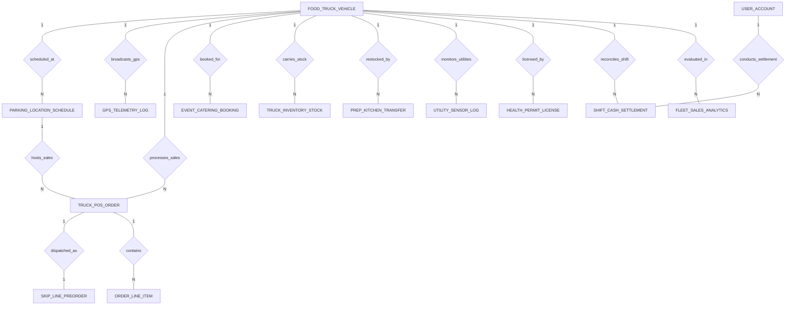

# Conceptual ERD — Food Truck Management System

## Mermaid Code

## Entity Description Table | Bang mo ta Entity

| # | Entity Name | Vietnamese Name | Description | Key Attributes | Main Relationships |
|---|-------------|-----------------|-------------|----------------|-------------------|
| 1 | FOOD_TRUCK_VEHICLE | Xe ban thuc an | Mobile food truck vehicle record, truck code, name, license plate, primary cuisine, and operational status. | truck_id, truck_code, truck_name, license_plate, primary_cuisine, truck_status | One-to-Many with PARKING_LOCATION_SCHEDULE, GPS_TELEMETRY_LOG, TRUCK_POS_ORDER, EVENT_CATERING_BOOKING, TRUCK_INVENTORY_STOCK, PREP_KITCHEN_TRANSFER, UTILITY_SENSOR_LOG, HEALTH_PERMIT_LICENSE, SHIFT_CASH_SETTLEMENT, FLEET_SALES_ANALYTICS |
| 2 | PARKING_LOCATION_SCHEDULE | Lich dau xe va dia diem | Scheduled parking location spot, address, latitude/longitude GPS coordinates, scheduled start/end times, and status. | schedule_id, truck_id, location_name, street_address, latitude, longitude, scheduled_start, parking_status | Belongs to FOOD_TRUCK_VEHICLE; One-to-Many with TRUCK_POS_ORDER |
| 3 | GPS_TELEMETRY_LOG | Nhat ky dinh vi GPS | Continuous GPS telemetry log recording latitude, longitude, vehicle speed mph, generator runtime hours, and timestamp. | log_id, truck_id, latitude, longitude, speed_mph, generator_hours, recorded_at | Belongs to FOOD_TRUCK_VEHICLE |
| 4 | TRUCK_POS_ORDER | Don hang POS xe ban | Point-of-sale order transaction processed on the food truck, order number, grand total, sales tax, payment method, and timestamp. | order_id, truck_id, schedule_id, order_number, grand_total, sales_tax_amount, payment_method, order_time | Belongs to FOOD_TRUCK_VEHICLE, PARKING_LOCATION_SCHEDULE; One-to-Many with ORDER_LINE_ITEM; One-to-One with SKIP_LINE_PREORDER |
| 5 | ORDER_LINE_ITEM | Chi tiet mon hang POS | Line items within a food truck POS order, item name, quantity, unit price, and total line price. | line_id, order_id, item_name, quantity, unit_price, total_line_price | Belongs to TRUCK_POS_ORDER |
| 6 | SKIP_LINE_PREORDER | Don dat truoc khong xep hang | Mobile pre-order ticket record for skip-the-line pickup, unique 4-digit pickup code, target pickup time, phone, and status. | preorder_id, order_id, pickup_code, target_pickup_time, customer_phone, preorder_status | One-to-One with TRUCK_POS_ORDER |
| 7 | EVENT_CATERING_BOOKING | Hop dong tiec su kien | Private event, corporate party, or festival catering booking record, event date, guaranteed amount, deposit paid, and status. | booking_id, truck_id, event_name, host_contact_name, event_date, guaranteed_amount, deposit_paid, booking_status | Belongs to FOOD_TRUCK_VEHICLE |
| 8 | TRUCK_INVENTORY_STOCK | Ton kho tren xe | Compact onboard inventory stock balance, item code, item name, current quantity, minimum safety threshold, and UOM. | stock_id, truck_id, item_code, item_name, current_quantity, min_threshold, unit_of_measure | Belongs to FOOD_TRUCK_VEHICLE |
| 9 | PREP_KITCHEN_TRANSFER | Chuyen kho bep trung tam | Inventory restock transfer log moving pre-prepped raw ingredients from central commissary kitchen to food truck. | transfer_id, truck_id, transfer_date, item_name, transferred_quantity, transfer_status | Belongs to FOOD_TRUCK_VEHICLE |
| 10 | UTILITY_SENSOR_LOG | Nhat ky cam bien tien ich | Onboard utility sensor log tracking fresh water tank %, grey waste water tank %, and generator fuel tank % levels. | utility_id, truck_id, fresh_water_percent, grey_water_percent, generator_fuel_percent, logged_at | Belongs to FOOD_TRUCK_VEHICLE |
| 11 | HEALTH_PERMIT_LICENSE | Giay phep ve sinh an toan | Mobile food facility health department permit, permit number, issuing agency, issue date, and expiration renewal tracking. | permit_id, truck_id, permit_number, issuing_agency, issue_date, expiry_date, is_valid | Belongs to FOOD_TRUCK_VEHICLE |
| 12 | SHIFT_CASH_SETTLEMENT | Quyet toan ca lam viec | End-of-shift cash drawer settlement log, comparing expected drawer cash vs physical count, and recording variance losses. | settlement_id, truck_id, operator_user_id, shift_date, cash_expected, cash_actual, variance_amount | Belongs to FOOD_TRUCK_VEHICLE, USER_ACCOUNT |
| 13 | USER_ACCOUNT | Tai khoan he thong | Core security authentication account holding credentials, password hashes, and user role definitions. | user_id, username, password_hash, role_name | One-to-Many with SHIFT_CASH_SETTLEMENT |
| 14 | FLEET_SALES_ANALYTICS | Thong ke doanh thu doi xe | Executive daily analytics tracking active food trucks, total fleet GMV, average location sales yield, and top spot revenue. | analytics_id, metric_date, active_trucks_count, total_fleet_gmv, avg_location_sales_yield | Evaluates FOOD_TRUCK_VEHICLE |

## Relationship Description | Mo ta Quan he

| # | From Entity | Cardinality | To Entity | Relationship Label | Business Explanation |
|---|-------------|-------------|-----------|-------------------|----------------------|
| 1 | FOOD_TRUCK_VEHICLE | One-to-Many | PARKING_LOCATION_SCHEDULE | scheduled_at | Mot xe ban thuc an duoc len lich dau va ban tai nhieu dia diem khac nhau. |
| 2 | FOOD_TRUCK_VEHICLE | One-to-Many | GPS_TELEMETRY_LOG | broadcasts_gps | Mot xe ban thuc an phat nhieu nhat ky toa do GPS va thong so dong co theo thoi gian. |
| 3 | FOOD_TRUCK_VEHICLE | One-to-Many | TRUCK_POS_ORDER | processes_sales | Mot xe ban thuc an xu ly nhieu don hang qua he thong POS di dong. |
| 4 | PARKING_LOCATION_SCHEDULE | One-to-Many | TRUCK_POS_ORDER | hosts_sales | Mot ca ban tai dia diem ghi nhan cac don hang phat sinh tai khung gio va toa do do. |
| 5 | TRUCK_POS_ORDER | One-to-Many | ORDER_LINE_ITEM | contains | Mot don hang POS chua nhieu mon an va do uong duoc khach dat. |
| 6 | TRUCK_POS_ORDER | One-to-One | SKIP_LINE_PREORDER | dispatched_as | Mot don hang POS co the duoc dat truoc va tao phieu qua tin nhan skip-the-line. |
| 7 | FOOD_TRUCK_VEHICLE | One-to-Many | EVENT_CATERING_BOOKING | booked_for | Mot xe ban thuc an duoc thue de phuc vu cac su kien tiec va festival. |
| 8 | FOOD_TRUCK_VEHICLE | One-to-Many | TRUCK_INVENTORY_STOCK | carries_stock | Mot xe ban thuc an mang theo va quan ly ton kho nguyen lieu tren xe. |
| 9 | FOOD_TRUCK_VEHICLE | One-to-Many | PREP_KITCHEN_TRANSFER | restocked_by | Mot xe ban thuc an nhan nguyen lieu cap cap tu bep trung tam truoc moi ca. |
| 10 | FOOD_TRUCK_VEHICLE | One-to-Many | UTILITY_SENSOR_LOG | monitors_utilities | Mot xe ban thuc an theo doi dung tich binh nuoc sach, nuoc thai va nhien lieu may phat. |
| 11 | FOOD_TRUCK_VEHICLE | One-to-Many | HEALTH_PERMIT_LICENSE | licensed_by | Mot xe ban thuc an so huu cac giay phep an toan ve sinh cua tung quan/thanh pho. |
| 12 | FOOD_TRUCK_VEHICLE | One-to-Many | SHIFT_CASH_SETTLEMENT | reconciles_shift | Mot xe ban thuc an duoc quyet toan tien mat va doanh so the khi ket thuc ca. |
