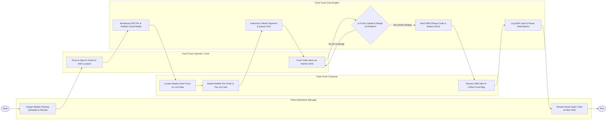

# Swimlane Diagram — Food Truck Management System

## Mermaid Code

## Flow Description | Mo ta luong

| Lane | Actor | Role in Flow |
|------|-------|-------------|
| **Lane 1** | Food Truck Customer | Locates active food truck on live public map, places skip-the-line mobile pre-orders, receives SMS readiness alerts, and collects food at the window. |
| **Lane 2** | Food Truck Operator / Chef | Drives to scheduled spot, checks in shift location on mobile POS, cooks pre-orders and walk-up orders on kitchen KDS, and hands bags to customers. |
| **Lane 3** | Fleet Operations Manager | Configures weekly parking schedules and municipal permits, auto-publishes location broadcasts, and reviews route sales yields. |
| **Lane 4** | Food Truck Core Engine | Ingests real-time GPS telemetry, streams public map pins, publishes social media posts, processes cellular payments, queues KDS tickets, and sends SMS alerts. |

### Process Execution Steps | Cac buoc thuc hien quy trinh

1. **Schedule & Location Check-In**: Fleet Manager assigns weekly parking schedule (`M1`). Truck Operator drives to location and checks in on mobile POS (`K1`). Core Engine ingests GPS telemetry and broadcasts public map pin (`S1`).
2. **Pre-Order Placement & Cellular Payment**: Customer locates nearby truck on live map (`C1`) and submits mobile pre-order (`C2`). Core Engine authorizes cellular payment and queues KDS ticket (`S2`).
3. **Cooking & Readiness Evaluation**: Truck Operator cooks order on compact kitchen KDS (`K2`). Core Engine checks prep readiness (`S3`).
   - If **No (In Cooking)**: Operator continues cooking.
   - If **Yes (Order Ready)**: Core Engine sends SMS pickup alert and deducts compact inventory (`S4`). Customer shows code and collects food (`C3`).
4. **Shift Settlement & Yield Analytics**: Core Engine reconciles shift payments and calculates route sales yields (`S5`). Fleet Manager reviews fleet GMV analytics (`M2`), completing execution (`Finish`).
