# Action Tree — Food Truck Management System

## Mermaid Code

```mermaid
graph TD
    Root["Food Truck Management System"]

    Root --> M1["Fleet GPS Telemetry & Location Broadcast"]
    Root --> M2["Mobile POS & Skip-the-Line Order Processing"]
    Root --> M3["Location Scheduling & Parking Permit Management"]
    Root --> M4["Event & Festival Catering Booking"]
    Root --> M5["Compact Truck Inventory & Prep Kitchen Transfers"]
    Root --> M6["Onboard Utilities & Health Permit Compliance"]
    Root --> M7["Fleet Analytics & Shift Cash Settlement"]

    M1 --> A11["Ingest Real-Time Vehicle GPS Telemetry"]
    M1 --> A12["Update Public Live Map Truck Pins"]
    M1 --> A13["Auto-Publish Location to Social Media"]
    M1 --> A14["Configure Geofence Arrival Triggers"]

    M2 --> A21["Process Cellular Wireless Card Payments"]
    M2 --> A22["Process Skip-the-Line Mobile Pre-Orders"]
    M2 --> A23["Dispatch SMS Order Ready Notifications"]
    M2 --> A24["Enable Offline Store-and-Forward Sales"]

    M3 --> A31["Configure Weekly Parking Location Schedules"]
    M3 --> A32["Attach Municipal Street Parking Permits"]
    M3 --> A33["Track Meter Fees & Location Regulations"]
    M3 --> A34["Broadcast Emergency Route Location Shifts"]

    M4 --> A41["Manage Private Catering Event Inquiries"]
    M4 --> A42["Process Booking Deposit Payments"]
    M4 --> A43["Configure Custom Event Menu Contracts"]
    M4 --> A44["Manage Prepaid Voucher Ticket Redemptions"]

    M5 --> A51["Track Compact Onboard Kitchen Inventory"]
    M5 --> A52["Process Central Commissary Stock Transfers"]
    M5 --> A53["Alert Staff on Low Stock Thresholds"]
    M5 --> A54["Audit Spoilage & Waste Disposals"]

    M6 --> A61["Monitor Generator Runtime & Fuel Levels"]
    M6 --> A62["Track Fresh Water & Waste Water Tanks"]
    M6 --> A63["Manage County Health Department Permits"]
    M6 --> A64["Log Central Commissary Sanitation Checks"]

    M7 --> A71["Reconcile End-of-Shift Cash & Card Tenders"]
    M7 --> A72["Analyze Route Sales Yield per Location"]
    M7 --> A73["Monitor Fleet Revenue GMV Rankings"]
    M7 --> A74["Manage User Roles & GPS Telemetry Settings"]
```

## Module Description | Mo ta Module

| # | Module | Description | Actions |
|---|--------|-------------|---------|
| 1 | Fleet GPS Telemetry & Location Broadcast | Ingests continuous vehicle GPS coordinates, updates public customer live map pins, auto-publishes social media location posts, and sets geofence triggers. | Ingest Real-Time Vehicle GPS Telemetry, Update Public Live Map Truck Pins, Auto-Publish Location to Social Media, Configure Geofence Arrival Triggers |
| 2 | Mobile POS & Skip-the-Line Order Processing | Processes cellular 4G/5G mobile POS transactions, handles skip-the-line mobile pre-orders, dispatches SMS pickup alerts, and enables offline sales mode. | Process Cellular Wireless Card Payments, Process Skip-the-Line Mobile Pre-Orders, Dispatch SMS Order Ready Notifications, Enable Offline Store-and-Forward Sales |
| 3 | Location Scheduling & Parking Permit Management | Configures weekly food truck parking location schedules, attaches municipal street parking permits, tracks meter fees, and broadcasts location shifts. | Configure Weekly Parking Location Schedules, Attach Municipal Street Parking Permits, Track Meter Fees & Location Regulations, Broadcast Emergency Route Location Shifts |
| 4 | Event & Festival Catering Booking | Controls private event catering contracts, booking deposit payment collections, custom event menus, and prepaid voucher ticket redemptions. | Manage Private Catering Event Inquiries, Process Booking Deposit Payments, Configure Custom Event Menu Contracts, Manage Prepaid Voucher Ticket Redemptions |
| 5 | Compact Truck Inventory & Prep Kitchen Transfers | Tracks space-constrained onboard ingredient stock, processes restock transfers from central commissary prep kitchens, and alerts staff on low inventory. | Track Compact Onboard Kitchen Inventory, Process Central Commissary Stock Transfers, Alert Staff on Low Stock Thresholds, Audit Spoilage & Waste Disposals |
| 6 | Onboard Utilities & Health Permit Compliance | Monitors onboard generator fuel, fresh water/grey waste water tank levels, tracks county health department permits, and logs commissary sanitation checks. | Monitor Generator Runtime & Fuel Levels, Track Fresh Water & Waste Water Tanks, Manage County Health Department Permits, Log Central Commissary Sanitation Checks |
| 7 | Fleet Analytics & Shift Cash Settlement | Reconciles end-of-shift cash drawer balances, analyzes location sales revenue yield per spot, tracks fleet GMV rankings, and manages telemetry settings. | Reconcile End-of-Shift Cash & Card Tenders, Analyze Route Sales Yield per Location, Monitor Fleet Revenue GMV Rankings, Manage User Roles & GPS Telemetry Settings |
