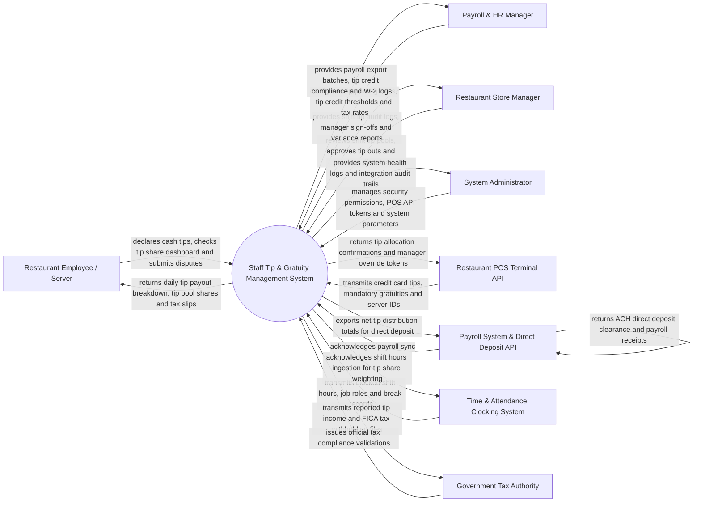

# Context Diagram — Staff Tip & Gratuity Management System

## Mermaid Code

## Actor & Interaction Table | Bang Actor & Tuong tac

| # | Actor | Actor Type | Data Sent TO System | Data Received FROM System | Notes |
|---|-------|------------|---------------------|---------------------------|-------|
| 1 | Restaurant Employee / Server | Primary | Cash tip declarations, dispute submissions, instant payout debit card choices | Daily tip earnings breakdown, tip pool share calculations, tax withholding summary | Front-of-house servers, bussers, bartenders, and kitchen staff. |
| 2 | Payroll & HR Manager | Primary | Tip pooling policy rules, job role percentage weights, tip credit minimum wage rates | Payroll export CSV/API batches, tip credit compliance alerts, W-2 tax files | Manages corporate payroll processing, labor law compliance, and tax filings. |
| 3 | Store Manager | Primary | Shift tip pool approvals, manager overrides, dispute resolutions, tip out sign-offs | Shift tip distribution summaries, un-declared tip warnings, labor cost ratios | Manages daily shift tip allocations and resolves server disputes at store level. |
| 4 | System Administrator | Primary | User credentials, security role permissions, POS API endpoint tokens, system parameters | Integration health metrics, security event logs, data integrity audit logs | Manages platform infrastructure, security policies, and software settings. |
| 5 | Restaurant POS Terminal API | Supporting | Credit card tips, auto-gratuities (large parties), server ID tags, sale subtotals | Tip allocation acknowledgments, manager override validations | Front-of-house POS sending credit card tip and service charge transaction payloads. |
| 6 | Payroll System & Direct Deposit API | Supporting | Direct deposit ACH clearances, payroll run completion statuses | Net tip payout export files, employee direct deposit account allocations | External payroll provider (e.g., ADP, Gusto, Paychex) executing ACH deposits. |
| 7 | Time & Attendance Clocking System | Supporting | Clocked shift hours per employee, job role codes (Server, Busser, Runner) | Shift hours ingestion receipts for weighted tip pool calculations | Time clocking system feeding actual shift hours for tip share formulas. |
| 8 | Government Tax Authority | Regulatory | Tax reporting guidelines, FICA tip credit rules, statutory tax rates | Form 8027 tip reports, Form 4070 employee tip income logs, W-2 tip files | Federal and local tax agencies (e.g., IRS, State Department of Revenue). |

## System Boundary Description | Mo ta Pham vi He thong

The **Staff Tip & Gratuity Management System** automates restaurant tip collection, tip pooling distribution formulas, tip credit minimum wage compliance, same-day digital payouts, and tax reporting. Inside its boundary, the system handles credit card tip ingestion from POS terminals, cash tip declaration capture, shift tip pooling algorithms weighted by job role hours, mandatory service charge allocations, tip credit top-up calculations, same-day debit card disbursements, and payroll API exports.

The system boundary excludes physical cash handling at POS drawers, physical bank wire clearing (handled by Direct Deposit APIs), native payroll check printing (handled by Payroll Systems), and front-of-house guest bill payment clearing.
