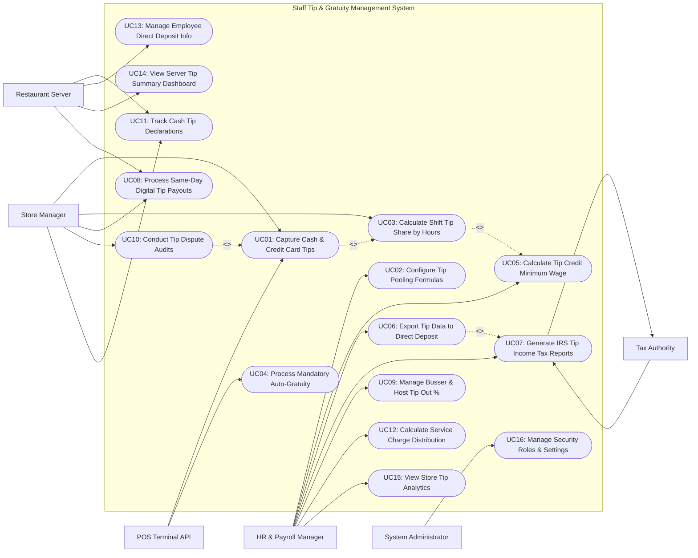

# Use Case Diagram — Staff Tip & Gratuity Management System

## Mermaid Code

## Actor Table | Bang Actor

| # | Actor | Actor Type | Role Description | Related Use Cases |
|---|-------|------------|------------------|-------------------|
| 1 | POS Terminal API | Secondary System | Front-of-house POS terminal transmitting credit card tip line items, server IDs, and mandatory auto-gratuities. | UC01, UC04 |
| 2 | Restaurant Server | Primary | Employee declaring end-of-shift cash tips, viewing daily tip earnings dashboards, managing direct deposit accounts, and choosing instant payouts. | UC08, UC11, UC13, UC14 |
| 3 | Store Manager | Primary | Restaurant manager reviewing shift tip pools, approving tip outs, conducting tip dispute audits, and authorizing same-day payouts. | UC01, UC03, UC08, UC10, UC11 |
| 4 | HR & Payroll Manager | Primary | Corporate HR/payroll manager configuring tip pool formulas, calculating tip credit wage top-ups, exporting payroll files, and generating tax reports. | UC02, UC05, UC06, UC07, UC09, UC12, UC15 |
| 5 | Government Tax Authority | Secondary System | Federal/local tax agency (IRS, State Dept) receiving Form 8027, Form 4070 tip income logs, and FICA tip tax reports. | UC07 |
| 6 | System Administrator | Primary | Technical manager configuring security roles, POS API tokens, direct deposit integration keys, and system audit logs. | UC16 |

## Use Case Table | Bang Use Case

| # | UC ID | Use Case Name | Primary Actor | Secondary Actor | Description | Priority |
|---|-------|---------------|---------------|-----------------|-------------|----------|
| 1 | UC01 | Capture Cash & Credit Card Tips | POS API | Store Manager | Ingests credit card tips from POS and captures manager-verified cash tips per employee shift. | High |
| 2 | UC02 | Configure Tip Pooling Formulas | HR Manager | None | Configures store tip pooling models (Equal Share, Role Points Weighted, Percentage Sales Tip-Out) and eligibility rules. | High |
| 3 | UC03 | Calculate Shift Tip Share by Hours | Store Manager | None | Calculates individual employee tip distributions based on shift hours worked, job role point weights, and tip pool totals. | High |
| 4 | UC04 | Process Mandatory Auto-Gratuity | POS API | None | Processes auto-gratuities (e.g., 18% for parties of 6+) as service charge income vs voluntary tips per labor laws. | High |
| 5 | UC05 | Calculate Tip Credit Minimum Wage | HR Manager | None | Evaluates if employee tips meet state minimum wage requirements; automatically calculates employer tip credit top-ups if deficient. | High |
| 6 | UC06 | Export Tip Data to Direct Deposit | HR Manager | None | Formats and exports net tip payout batches to external payroll systems (ADP, Gusto) for direct deposit processing. | High |
| 7 | UC07 | Generate IRS Tip Income Tax Reports | HR Manager | Tax Authority | Generates IRS Form 8027, Form 4070, and FICA tip tax credit reports for tax compliance. | High |
| 8 | UC08 | Process Same-Day Digital Tip Payouts | Restaurant Server | Store Manager | Disburses daily net tip earnings instantly to employee debit cards (e.g., Visa Direct / Mastercard Send) after shift end. | High |
| 9 | UC09 | Manage Busser & Host Tip Out % | HR Manager | None | Configures automated tip-out percentage rules from primary servers to support staff (e.g., 2% sales to Bussers, 1% to Hosts). | High |
| 10 | UC10 | Conduct Tip Dispute Audits | Store Manager | None | Investigates and resolves employee tip allocation disputes, reviewing POS receipts, shift hours, and manager overrides. | Medium |
| 11 | UC11 | Track Cash Tip Declarations | Restaurant Server | Store Manager | Captures daily employee cash tip declarations (mandatory minimum 8% gross sales threshold) to meet IRS compliance. | High |
| 12 | UC12 | Calculate Service Charge Distribution | HR Manager | None | Distributes mandatory administrative service charges between front-of-house staff, kitchen crew, and house administrative fees. | Medium |
| 13 | UC13 | Manage Employee Direct Deposit Info | Restaurant Server | None | Enables employees to manage bank account routing numbers, debit card details, and tip disbursement preferences. | High |
| 14 | UC14 | View Server Tip Summary Dashboard | Restaurant Server | None | Provides servers with mobile app dashboards displaying daily tip earnings, tip pool contributions, and tax withholdings. | High |
| 15 | UC15 | View Store Tip Analytics | HR Manager | None | Displays store tip distribution heatmaps, average tip percentages per server, tip credit liability, and labor cost ratios. | High |
| 16 | UC16 | Manage Security Roles & Settings | System Admin | None | Configures user security access roles, POS API keys, audit logging settings, and policy parameter definitions. | High |

## Use Case Specification | Dac ta Use Case

---

### UC01 — Capture Cash & Credit Card Tips

| Field | Detail |
|-------|--------|
| **UC ID** | UC01 |
| **Use Case Name** | Capture Cash & Credit Card Tips |
| **Actor(s)** | Primary: Restaurant POS Terminal API, Store Manager   Secondary: None |
| **Description** | Ingests credit card tips directly from POS transaction webhooks and captures manager-verified cash tips at shift checkout, creating immutable tip transaction records. |
| **Precondition** | 1. POS integration webhook is active.   2. Employee shift clock-in records from time clock system are loaded. |
| **Main Flow** | 1. POS Terminal transmits credit card transaction payloads throughout the shift containing: Server ID, Order ID, Net Sales, Tax Amount, and Credit Card Tip Amount (e.g., $18.50).   2. System validates Server ID against active shift roster and records Credit Card Tip line item in shift ledger.   3. At shift end, Server performs shift checkout on POS; POS prompts Server to input Cash Tip Declaration (e.g., $45.00 cash tips).   4. System checks cash declaration against minimum IRS threshold (e.g., 8% of Server's gross cash sales).   5. Store Manager reviews shift tip summary screen on manager app, verifies physical cash drawer drops, and signs off.   6. System creates consolidated Shift Tip Log record detailing: Total Credit Card Tips ($185.00), Total Declared Cash Tips ($45.00), Total Sales ($1,150.00).   7. System dispatches shift tip log to Tip Pooling & Distribution Engine (UC03). |
| **Alternative Flow** | **AF1** — Manager manual tip adjustment:   1. Guest adds a cash tip post-checkout or server inputs incorrect tip amount.   2. Store Manager opens Tip Adjustment screen, enters corrected tip amount, and inputs mandatory audit reason note. |
| **Exception Flow** | **EX1** — Un-declared cash tip below IRS threshold:   1. At step 4, Server declares $10.00 cash tips on $500 cash sales (2% rate < 8% IRS minimum).   2. System flags warning "Under-reported Cash Tip Warning", requiring Server written confirmation and Manager sign-off before closing shift. |
| **Postcondition** | Credit card and cash tips are captured, shift tip log is verified, and data is queued for tip pool distribution. |
| **Business Rule** | **BR1**: Credit card tips captured from POS must be bound to immutable order transaction IDs to prevent tip tampering.   **BR2**: Cash tip declarations must meet or exceed 8% of gross cash sales unless supported by a written employee declaration waiver. |

---

### UC02 — Configure Tip Pooling Formulas

| Field | Detail |
|-------|--------|
| **UC ID** | UC02 |
| **Use Case Name** | Configure Tip Pooling Formulas |
| **Actor(s)** | Primary: HR & Payroll Manager   Secondary: None |
| **Description** | Configures store tip pooling and tip-out distribution formulas (Equal Hour Share, Role Points Weighted, Sales Percentage Tip-Out), setting eligibility rules per job classification. |
| **Precondition** | 1. User is authenticated with HR & Payroll Manager privileges.   2. Store job role classifications (Server, Bartender, Busser, Runner, Host) are active. |
| **Main Flow** | 1. HR Manager opens "Tip Pooling Policy Builder" module on corporate console.   2. Manager selects store location or applies global company policy.   3. Manager selects Tip Pooling Distribution Model:      - Option A: `Proportional Hours Worked` (Tips shared strictly by shift hours).      - Option B: `Role Weighted Points` (Point weighting per job role).      - Option C: `Percentage of Sales Tip-Out` (Server tips out fixed % of sales to support staff).   4. Manager selects `Role Weighted Points` and defines point multipliers:      - Primary Server: 10 Points / Hour      - Bartender: 8 Points / Hour      - Busser / Food Runner: 5 Points / Hour      - Hostess: 3 Points / Hour.   5. Manager configures tip pool inclusion rules: "Include Credit Card Tips (100%) + Mandatory Auto-Gratuities (100%)".   6. Manager configures legal FLSA compliance check: "Enforce Tip Credit Validity (Only FOH staff included in tip pool)".   7. Manager saves policy configuration; System updates automated shift distribution engine (UC03). |
| **Alternative Flow** | **AF1** — Direct Tip-Out percentage formula (Option C):   1. Manager sets: Server tips out 3.0% of Gross Food Sales to Bussers, and 1.5% of Beverage Sales to Bartenders.   2. System calculates direct tip-out deductions per server checkout sheet. |
| **Exception Flow** | **EX1** — FLSA tip pool violation error (BOH staff included):   1. Manager attempts to add Back-of-House "Line Cook" role to a tip pool where employer takes a tip credit.   2. System blocks saving and flags legal error: "FLSA Violation: Employers taking a tip credit cannot include BOH staff in tip pools." |
| **Postcondition** | Tip pooling formula, role point weights, and legal compliance boundaries are saved and published. |
| **Business Rule** | **BR1**: Tip pool formulas must strictly comply with federal (FLSA) and state labor laws regarding valid tip pool participants.   **BR2**: Changes to tip pooling policy formulas take effect on the first day of the upcoming payroll period. |

---

### UC03 — Calculate Shift Tip Share by Hours

| Field | Detail |
|-------|--------|
| **UC ID** | UC03 |
| **Use Case Name** | Calculate Shift Tip Share by Hours |
| **Actor(s)** | Primary: Store Manager   Secondary: None |
| **Description** | Calculates individual employee tip pool share distributions based on actual shift hours worked, job role point weights, and total shift tip pool collections. |
| **Precondition** | 1. Shift credit card tips and cash declarations (UC01) are finalized.   2. Clocked shift hours per employee from time clock system are imported.   3. Active tip pooling formula (UC02) is loaded. |
| **Main Flow** | 1. System receives shift close trigger for ended shift (e.g., Dinner Shift, July 18th).   2. System retrieves total collected tip pool for the shift: $800.00 Total Tips.   3. System retrieves employee shift hours and assigned role point weights:      - Server A: 6.0 Hours x 10 Pts = 60 Weighted Points      - Server B: 5.0 Hours x 10 Pts = 50 Weighted Points      - Busser C: 6.0 Hours x 5 Pts = 30 Weighted Points      - Runner D: 4.0 Hours x 5 Pts = 20 Weighted Points.   4. System calculates Total Shift Weighted Points: `60 + 50 + 30 + 20 = 160 Points`.   5. System calculates Value per Point: `$800.00 / 160 Points = $5.00 per Point`.   6. System calculates individual Net Tip Distribution Shares:      - Server A: 60 Pts x $5.00 = **$300.00**      - Server B: 50 Pts x $5.00 = **$250.00**      - Busser C: 30 Pts x $5.00 = **$150.00**      - Runner D: 20 Pts x $5.00 = **$100.00**.   7. System displays Shift Tip Distribution Table on Manager app for review.   8. Store Manager verifies shift hours, confirms calculation, and taps "Approve Shift Tip Pool".   9. System posts tip earnings to individual employee ledgers and updates server app dashboards (UC14). |
| **Alternative Flow** | **AF1** — Split-shift role calculation:   1. Employee worked 3 hours as Host (3 Pts/hr) and 4 hours as Server (10 Pts/hr) in the same shift.   2. System calculates separate point weights per role period and sums total points (9 + 40 = 49 Pts). |
| **Exception Flow** | **EX1** — Unclocked employee missing shift hours:   1. At step 3, System detects Server E received tips on POS but has no clocked shift hours recorded.   2. System flags red alert "Missing Shift Hours: Server E", requiring Manager to manually enter shift hours before finalizing pool. |
| **Postcondition** | Individual employee tip share amounts are calculated, manager approval is logged, and tip ledgers update. |
| **Business Rule** | **BR1**: Tip share calculations must distribute 100% of the collected shift tip pool without rounding losses (fractional cents allocated to highest-hour employee).   **BR2**: Approved shift tip distribution ledgers become immutable once posted to payroll queues. |

---

### UC05 — Calculate Tip Credit & Minimum Wage Top-Ups

| Field | Detail |
|-------|--------|
| **UC ID** | UC05 |
| **Use Case Name** | Calculate Tip Credit & Minimum Wage Top-Ups |
| **Actor(s)** | Primary: HR & Payroll Manager   Secondary: None |
| **Description** | Evaluates whether employee total direct wages plus earned tips meet statutory minimum wage requirements over the payroll period, automatically calculating employer tip credit top-up payments for deficient shifts. |
| **Precondition** | 1. Payroll period shift tip distribution ledgers (UC03) are complete.   2. Statutory minimum wage rates (e.g., $15.00/hr) and tip credit allowance rates (e.g., Cash Wage $5.00/hr + Tip Credit $10.00/hr) are configured. |
| **Main Flow** | 1. System initiates Tip Credit & Minimum Wage Compliance Audit during payroll batch run.   2. For each tipped employee, System compiles total payroll period metrics:      - Total Hours Worked: 30.0 Hours      - Direct Base Cash Wages Paid: `30.0 hrs x $5.00/hr = $150.00`      - Total Earned Tips: $360.00      - Statutory Minimum Wage Rate: $15.00 / hour.   3. System calculates Total Earnings (Wages + Tips): `$150.00 + $360.00 = $510.00`.   4. System calculates Effective Hourly Pay Rate: `$510.00 / 30.0 hrs = $17.00 / hour`.   5. System compares Effective Pay Rate ($17.00/hr) against Statutory Minimum Wage ($15.00/hr).   6. Effective rate exceeds minimum wage ($17.00 > $15.00); System confirms **Full Employer Tip Credit Claimed ($10.00/hr)** and no makeup pay is required.   7. System logs compliance verification record in payroll audit file. |
| **Alternative Flow** | **AF1** — Minimum wage deficiency top-up required:   1. Employee worked 20 hours on slow shifts, earning only $80.00 in tips (Direct Wages: $100.00; Total: $180.00 -> $9.00/hr).   2. System calculates required minimum wage earnings: `20 hrs x $15.00 = $300.00`.   3. System calculates required Employer Makeup Top-Up: `$300.00 - $180.00 = $120.00`.   4. System automatically appends $120.00 "Tip Credit Makeup Pay" line item to employee pay stub. |
| **Exception Flow** | **EX1** — State law prohibits tip credit:   1. Store location is in a state prohibiting tip credits (e.g., California / Washington).   2. System sets Tip Credit Allowance to $0.00 and forces full state minimum wage payment on all hours. |
| **Postcondition** | Tip credit compliance is verified, makeup top-up pay is automatically calculated for deficient employees, and audit logs are recorded. |
| **Business Rule** | **BR1**: If an employee's direct wages plus earned tips do not equal at least the statutory minimum wage, the employer MUST pay the difference.   **BR2**: Tip credit calculations must be evaluated across the workweek payroll period, not isolated shift by shift. |

---

### UC06 — Export Tip Data to Direct Deposit Payroll

| Field | Detail |
|-------|--------|
| **UC ID** | UC06 |
| **Use Case Name** | Export Tip Data to Direct Deposit Payroll |
| **Actor(s)** | Primary: HR & Payroll Manager   Secondary: Payroll System & Direct Deposit API |
| **Description** | Formats, validates, and exports net tip payout batches, tip credit top-ups, and tax withholding data to external payroll processing systems (ADP, Gusto, Paychex) for direct deposit ACH distribution. |
| **Precondition** | 1. Payroll period tip distributions (UC03) and tip credit compliance checks (UC05) are finalized and approved.   2. External payroll provider API mapping is configured. |
| **Main Flow** | 1. HR Manager opens "Payroll Export & Direct Deposit Dispatch" module at end of pay period.   2. System displays Payroll Batch Summary for all store locations:      - Total Employees: 45 Tipped Staff      - Total Direct Cash Wages: $8,500.00      - Total Credit Card Tips to Disburse: $14,200.00      - Total Declared Cash Tips: $3,100.00      - Total Tip Credit Makeup Pay: $150.00.   3. Manager reviews summary and clicks "Generate Payroll Export File".   4. System formats data into target payroll schema (e.g., ADP API JSON payload / Gusto CSV format) mapping employee SSNs, pay codes (Earning Code: TIPS_CC, TIPS_CASH, WAGE_BASE), and amounts.   5. System executes pre-export validation check (verifying all employees have valid SSNs and bank routing numbers).   6. Manager clicks "Transmit to Payroll System".   7. System transmits payload to Payroll System via secure TLS API endpoint.   8. Payroll System returns HTTP 200 Confirmation and Batch Processing ID (e.g., BATCH-ADP-8891).   9. System updates payroll batch status to `Exported & Locked` and logs dispatch timestamp. |
| **Alternative Flow** | **AF1** — Exclude same-day disbursed tips:   1. Some employees received same-day digital tip payouts during the week (UC08).   2. System deducts already-disbursed tip amounts from direct deposit batch, exporting only taxable income logs to prevent double payment. |
| **Exception Flow** | **EX1** — Missing employee SSN or bank routing error:   1. At step 5, System detects new employee has no direct deposit bank routing number configured.   2. System flags warning "Missing Direct Deposit Info: Employee #108", prompts HR to issue paper check, and continues batch export. |
| **Postcondition** | Net tip payout data is formatted and transmitted to the external payroll system, and batch status is locked. |
| **Business Rule** | **BR1**: Exported payroll batches must be permanently locked against modification once transmitted to external payroll APIs.   **BR2**: Tip payouts previously disbursed via same-day card payments must be reported as non-cash earnings to ensure correct tax withholding without double paying. |
