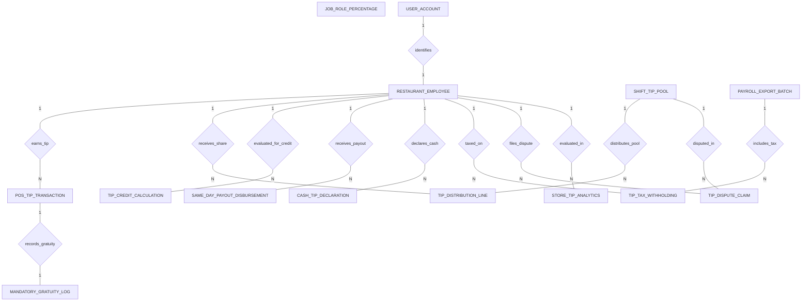

# Conceptual ERD — Staff Tip & Gratuity Management System

## Mermaid Code

## Entity Description Table | Bang mo ta Entity

| # | Entity Name | Vietnamese Name | Description | Key Attributes | Main Relationships |
|---|-------------|-----------------|-------------|----------------|-------------------|
| 1 | RESTAURANT_EMPLOYEE | Nhan vien nha hang | Core employee profile, employee code, name, SSN last 4 digits, primary job role, and tipped status flag. | employee_id, user_id, employee_code, full_name, primary_job_role, is_tipped_employee | Belongs to USER_ACCOUNT; One-to-Many with POS_TIP_TRANSACTION, TIP_DISTRIBUTION_LINE, TIP_CREDIT_CALCULATION, SAME_DAY_PAYOUT_DISBURSEMENT, CASH_TIP_DECLARATION, TIP_TAX_WITHHOLDING, TIP_DISPUTE_CLAIM |
| 2 | JOB_ROLE_PERCENTAGE | Ty le theo chuc danh | Job role configuration (Server, Bartender, Busser, Host), role point weight multipliers, and default tip-out % rules. | role_id, role_name, point_weight_multiplier, default_tipout_percent, is_tip_pool_eligible | Job role reference entity |
| 3 | POS_TIP_TRANSACTION | Giao dich tip POS | Ingested credit card tip transaction from POS, binding POS order ref, credit card tip amount, and timestamp. | tip_trans_id, employee_id, pos_order_ref, cc_tip_amount, auto_gratuity_amount, transaction_time | Belongs to RESTAURANT_EMPLOYEE; One-to-One with MANDATORY_GRATUITY_LOG |
| 4 | SHIFT_TIP_POOL | Quy tip ca lam viec | Shift tip pool container recording shift date, shift type (Lunch/Dinner), CC tips, cash tips, total pool amount, and status. | pool_id, shift_date, shift_type, total_cc_tips, total_cash_tips, total_pool_amount, status | One-to-Many with TIP_DISTRIBUTION_LINE, TIP_DISPUTE_CLAIM |
| 5 | TIP_DISTRIBUTION_LINE | Dong phan chia tien tip | Individual employee tip pool share line item, shift hours worked, weighted points, net tip share amount, and calculation time. | line_id, pool_id, employee_id, shift_hours_worked, weighted_points, net_tip_share_amount | Belongs to SHIFT_TIP_POOL, RESTAURANT_EMPLOYEE |
| 6 | MANDATORY_GRATUITY_LOG | Nhat ky phi phuc vu bat buoc | Mandatory auto-gratuity transaction log for large party bookings, party size, total bill, and service charge classification. | gratuity_id, tip_trans_id, party_size, total_bill_amount, gratuity_amount, is_service_charge | One-to-One with POS_TIP_TRANSACTION |
| 7 | TIP_CREDIT_CALCULATION | Tinh khau tru Tip Credit | Statutory tip credit minimum wage compliance audit record, total hours worked, direct wages paid, earned tips, and makeup pay. | calculation_id, employee_id, pay_period_end, total_hours_worked, total_tips_earned, makeup_pay_required | Belongs to RESTAURANT_EMPLOYEE |
| 8 | SAME_DAY_PAYOUT_DISBURSEMENT | Thanh toan tip trong ngay | Daily digital tip payout disbursement record to employee debit cards via instant push APIs (Visa Direct / Mastercard Send). | payout_id, employee_id, payout_amount, debit_card_token, payout_status, disbursed_at | Belongs to RESTAURANT_EMPLOYEE |
| 9 | CASH_TIP_DECLARATION | Khai bao tien tip tien mat | Mandatory shift cash tip declaration log recorded by servers, cash sales total, declared cash tip amount, and timestamp. | declaration_id, employee_id, shift_date, cash_sales_total, declared_cash_tips, declared_at | Belongs to RESTAURANT_EMPLOYEE |
| 10 | PAYROLL_EXPORT_BATCH | Lo xuat du lieu luong | Exported payroll batch record for pay period, total employees, total tips exported, batch status, and export timestamp. | batch_id, period_start, period_end, total_employees_count, total_tips_exported, batch_status | One-to-Many with TIP_TAX_WITHHOLDING |
| 11 | TIP_TAX_WITHHOLDING | Khau tru thue tien tip | Tip income tax calculation log detailing gross tip income, FICA Medicare tax, and FICA Social Security tax withholdings. | tax_id, employee_id, batch_id, gross_tip_income, fica_medicare_tax, fica_social_security_tax | Belongs to RESTAURANT_EMPLOYEE, PAYROLL_EXPORT_BATCH |
| 12 | TIP_DISPUTE_CLAIM | Khieu nai phan chia tip | Employee tip allocation dispute claim ticket, dispute reason, claimed amount, and manager resolution status. | dispute_id, employee_id, pool_id, dispute_reason, claimed_amount, resolution_status | Belongs to RESTAURANT_EMPLOYEE, SHIFT_TIP_POOL |
| 13 | USER_ACCOUNT | Tai khoan he thong | Core security authentication account holding credentials, password hashes, and security role definitions. | user_id, username, password_hash, role_name | One-to-One with RESTAURANT_EMPLOYEE |
| 14 | STORE_TIP_ANALYTICS | Thong ke tip cua hang | Aggregated daily analytics tracking total sales volume, total tips collected, average tip %, and makeup pay cost totals. | analytics_id, metric_date, total_sales_volume, total_tips_collected, avg_tip_percent_sales, total_makeup_pay_cost | Evaluates RESTAURANT_EMPLOYEE |

## Relationship Description | Mo ta Quan he

| # | From Entity | Cardinality | To Entity | Relationship Label | Business Explanation |
|---|-------------|-------------|-----------|-------------------|----------------------|
| 1 | USER_ACCOUNT | One-to-One | RESTAURANT_EMPLOYEE | identifies | Tai khoan he thong xac thuc ho so nhan vien nhan tien tip. |
| 2 | RESTAURANT_EMPLOYEE | One-to-Many | POS_TIP_TRANSACTION | earns_tip | Nhan vien phuc vu nhan cac giao dich tip the tu he thong POS. |
| 3 | RESTAURANT_EMPLOYEE | One-to-Many | TIP_DISTRIBUTION_LINE | receives_share | Nhan vien nhan chia phan tien tip tu quy tip ca lam viec. |
| 4 | SHIFT_TIP_POOL | One-to-Many | TIP_DISTRIBUTION_LINE | distributes_pool | Quy tip ca phan chia thanh nhieu dong phan phoi cho cac nhan vien. |
| 5 | POS_TIP_TRANSACTION | One-to-One | MANDATORY_GRATUITY_LOG | records_gratuity | Giao dich tip POS ghi nhan phi phuc vu bat buoc cho ban dong nguoi. |
| 6 | RESTAURANT_EMPLOYEE | One-to-Many | TIP_CREDIT_CALCULATION | evaluated_for_credit | Nhan vien duoc danh gia tuan thu Tip Credit va luong toi thieu theo ky luong. |
| 7 | RESTAURANT_EMPLOYEE | One-to-Many | SAME_DAY_PAYOUT_DISBURSEMENT | receives_payout | Nhan vien nhan thanh toan tip trong ngay qua the ghi no di dong. |
| 8 | RESTAURANT_EMPLOYEE | One-to-Many | CASH_TIP_DECLARATION | declares_cash | Nhan vien thuc hien khai bao tien tip tien mat sau moi ca lam viec. |
| 9 | PAYROLL_EXPORT_BATCH | One-to-Many | TIP_TAX_WITHHOLDING | includes_tax | Lo xuat luong bao gom nhat ky khau tru thue FICA tien tip. |
| 10 | RESTAURANT_EMPLOYEE | One-to-Many | TIP_TAX_WITHHOLDING | taxed_on | Nhan vien bi khau tru thue tren tong thu nhap tien tip da bao cao. |
| 11 | RESTAURANT_EMPLOYEE | One-to-Many | TIP_DISPUTE_CLAIM | files_dispute | Nhan vien co the gui phieu khieu nai phan chia tien tip ca. |
| 12 | SHIFT_TIP_POOL | One-to-Many | TIP_DISPUTE_CLAIM | disputed_in | Quy tip ca co the bi khieu nai va duoc quan ly phuc tra. |
