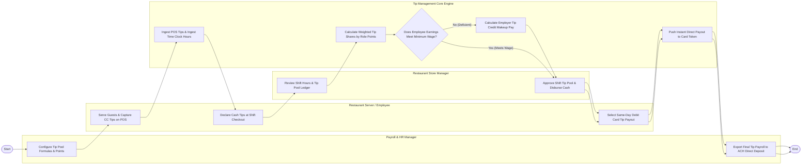

# Swimlane Diagram — Staff Tip & Gratuity Management System

## Mermaid Code

## Flow Description | Mo ta luong

| Lane | Actor | Role in Flow |
|------|-------|-------------|
| **Lane 1** | Restaurant Server / Employee | Captures credit card tips on POS, declares shift cash tips at checkout, views earnings dashboard, and chooses instant debit card payouts. |
| **Lane 2** | Restaurant Store Manager | Reviews shift hours and tip pool totals, verifies cash drops, resolves disputes, and approves shift tip distribution ledgers. |
| **Lane 3** | Payroll & HR Manager | Configures tip pooling formulas, sets role point weights, evaluates tip credit compliance, and exports payroll batches for direct deposit. |
| **Lane 4** | Tip Management Core Engine | Ingests POS tips and time clock pings, calculates weighted tip pool shares, audits minimum wage tip credit compliance, and pushes instant card disbursements. |

### Process Execution Steps | Cac buoc thuc hien quy trinh

1. **Policy Setup & Tip Capture**: HR Manager configures tip pooling formulas (`H1`). Server captures credit card tips on POS (`C1`). Core Engine ingests POS tips and time clock pings (`S1`).
2. **Shift Close & Pool Calculation**: Server declares cash tips at checkout (`C2`). Store Manager reviews shift hours (`M1`). Core Engine calculates weighted tip shares using role points (`S2`).
3. **Tip Credit Compliance Audit**: Core Engine audits minimum wage compliance (`S3`).
   - If **No (Deficient)**: Core Engine automatically calculates required employer tip credit makeup pay (`S4`).
   - If **Yes (Meets Wage)**: Core Engine confirms full tip credit.
4. **Approval & Instant Disbursement**: Store Manager approves shift pool (`M2`). Server selects same-day payout (`C3`). Core Engine pushes instant debit card payment (`S5`). HR Manager exports payroll file to ACH direct deposit (`H2`), completing execution (`Finish`).
