# Action Tree — Staff Tip & Gratuity Management System

## Mermaid Code

```mermaid
graph TD
    Root["Staff Tip & Gratuity Management System"]

    Root --> M1["Tip Capture & POS Sales Integration"]
    Root --> M2["Tip Pooling & Role Share Formulas"]
    Root --> M3["Tip Credit & Minimum Wage Compliance"]
    Root --> M4["Same-Day Digital Payouts & Disbursements"]
    Root --> M5["Payroll Export & Tax Compliance Reporting"]
    Root --> M6["Tip Declarations & Dispute Resolution"]
    Root --> M7["Store Tip Analytics & System Security"]

    M1 --> A11["Ingest Credit Card Tips from POS API"]
    M1 --> A12["Process Mandatory Auto-Gratuities"]
    M1 --> A13["Ingest Clocked Shift Hours from Time Clock"]
    M1 --> A14["Bind Tips to Server Employee IDs"]

    M2 --> A21["Configure Role Point Weight Multipliers"]
    M2 --> A22["Calculate Proportional Shift Tip Shares"]
    M2 --> A23["Automate Busser & Hostess Tip Outs"]
    M2 --> A24["Distribute Administrative Service Charges"]

    M3 --> A31["Audit Period Earnings vs Statutory Minimum Wage"]
    M3 --> A32["Calculate Employer Tip Credit Top-Up Pay"]
    M3 --> A33["Enforce State Tip Credit Prohibition Rules"]
    M3 --> A34["Flag Deficient Minimum Wage Shift Alerts"]

    M4 --> A41["Disburse Daily Tips to Employee Debit Cards"]
    M4 --> A42["Manage Visa Direct & Mastercard Push APIs"]
    M4 --> A43["Configure Instant Payout Fee Preferences"]
    M4 --> A44["Track Digital Disbursement Clearance Logs"]

    M5 --> A51["Export Tip Data to ADP and Gusto Payroll APIs"]
    M5 --> A52["Generate IRS Form 8027 Tip Income Reports"]
    M5 --> A53["Generate IRS Form 4070 Employee Tip Logs"]
    M5 --> A54["Calculate FICA Tip Tax Withholding Totals"]

    M6 --> A61["Capture Daily End-of-Shift Cash Tip Declarations"]
    M6 --> A62["Enforce Minimum 8 Percent Cash Tip Thresholds"]
    M6 --> A63["Process Employee Tip Allocation Dispute Tickets"]
    M6 --> A64["Log Store Manager Override Audit Trails"]

    M7 --> A71["Monitor Store Average Tip Percentages"]
    M7 --> A72["Analyze Tip Credit Employer Liability Costs"]
    M7 --> A73["Manage User Roles & Security Access Levels"]
    M7 --> A74["Manage POS API Tokens & Webhook Keys"]
```

## Module Description | Mo ta Module

| # | Module | Description | Actions |
|---|--------|-------------|---------|
| 1 | Tip Capture & POS Sales Integration | Ingests credit card tips and mandatory auto-gratuities from POS terminals, binding transactions to server IDs and time clock hours. | Ingest Credit Card Tips from POS API, Process Mandatory Auto-Gratuities, Ingest Clocked Shift Hours from Time Clock, Bind Tips to Server Employee IDs |
| 2 | Tip Pooling & Role Share Formulas | Configures job role point weights (Server, Bartender, Busser), calculates weighted tip shares, automates tip-outs, and allocates service charges. | Configure Role Point Weight Multipliers, Calculate Proportional Shift Tip Shares, Automate Busser & Hostess Tip Outs, Distribute Administrative Service Charges |
| 3 | Tip Credit & Minimum Wage Compliance | Evaluates employee earnings against statutory minimum wages, calculating employer tip credit makeup top-up pay for deficient pay periods. | Audit Period Earnings vs Statutory Minimum Wage, Calculate Employer Tip Credit Top-Up Pay, Enforce State Tip Credit Prohibition Rules, Flag Deficient Minimum Wage Shift Alerts |
| 4 | Same-Day Digital Payouts & Disbursements | Pushes net daily tip earnings instantly to employee debit cards via push payment APIs (Visa Direct / Mastercard Send), managing disbursement logs. | Disburse Daily Tips to Employee Debit Cards, Manage Visa Direct & Mastercard Push APIs, Configure Instant Payout Fee Preferences, Track Digital Disbursement Clearance Logs |
| 5 | Payroll Export & Tax Compliance Reporting | Formats and transmits payroll files to external payroll APIs (ADP, Gusto), generating IRS Form 8027, Form 4070, and FICA tip tax credit reports. | Export Tip Data to ADP and Gusto Payroll APIs, Generate IRS Form 8027 Tip Income Reports, Generate IRS Form 4070 Employee Tip Logs, Calculate FICA Tip Tax Withholding Totals |
| 6 | Tip Declarations & Dispute Resolution | Captures daily cash tip declarations, enforces IRS 8% cash sales thresholds, processes employee tip dispute claims, and records manager overrides. | Capture Daily End-of-Shift Cash Tip Declarations, Enforce Minimum 8 Percent Cash Tip Thresholds, Process Employee Tip Allocation Dispute Tickets, Log Store Manager Override Audit Trails |
| 7 | Store Tip Analytics & System Security | Provides executive dashboards on average tip percentages, employer tip credit liability, labor cost ratios, security access roles, and POS API tokens. | Monitor Store Average Tip Percentages, Analyze Tip Credit Employer Liability Costs, Manage User Roles & Security Access Levels, Manage POS API Tokens & Webhook Keys |
