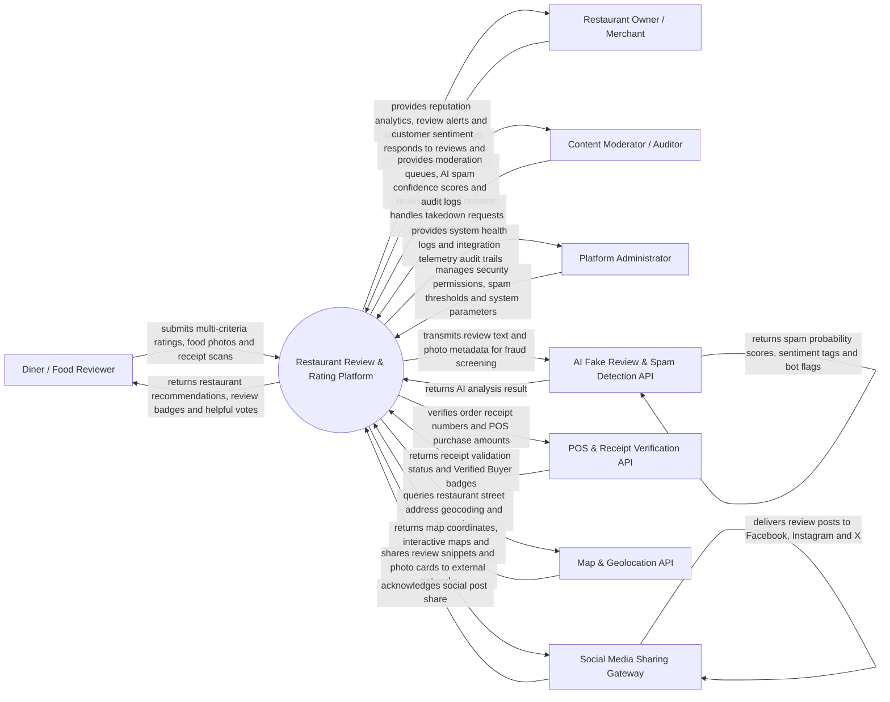

# Context Diagram — Restaurant Review & Rating Platform

## Mermaid Code

## Actor & Interaction Table | Bang Actor & Tuong tac

| # | Actor | Actor Type | Data Sent TO System | Data Received FROM System | Notes |
|---|-------|------------|---------------------|---------------------------|-------|
| 1 | Diner / Food Reviewer | Primary | Multi-criteria ratings (Food, Service, Ambience, Value), text review, food photos, receipt scans | Restaurant search recommendations, Verified Buyer badge, foodie gamification points | Interacts via consumer mobile app or web review portal. |
| 2 | Restaurant Owner / Merchant | Primary | Business listing claim credentials, official merchant responses to reviews, sponsored ad campaigns | Real-time review alerts, overall star rating scores, customer sentiment analytics | Manages restaurant profile, responds to reviews, and runs promotion campaigns. |
| 3 | Content Moderator | Primary | Review moderation actions (Approve, Reject, Quarantine, Remove), dispute resolution decisions | Flagged review queues, AI spam probability scores, user dispute tickets | Reviews reported content and enforces community guidelines. |
| 4 | Platform Administrator | Primary | User security roles, AI spam sensitivity thresholds, system configuration parameters | Platform health metrics, API usage telemetry, security audit logs | Manages platform infrastructure, security policies, and settings. |
| 5 | AI Fake Review & Spam Detection API | Supporting | Spam probability scores, bot detection flags, text sentiment scores | Un-moderated review text, user posting frequency, photo metadata | External NLP/ML service screening reviews for fake astroturfing and spam. |
| 6 | POS & Receipt Verification API | Supporting | POS order receipt clearance tokens, verified purchase amounts, visit timestamps | Receipt verification lookup requests (Receipt QR / Transaction ID) | Validates authentic diner dining receipts to award Verified Buyer badges. |
| 7 | Map & Geolocation API | Supporting | Geocoding map coordinates, street addresses, neighborhood boundaries | Map location query payloads, distance calculations, interactive map renderers | Provides mapping, geocoding, and distance sorting for restaurant search. |
| 8 | Social Media Sharing Gateway | Supporting | Social post publication receipts, engagement metrics | Review snippet preview cards, food photo links, restaurant profile URLs | Allows diners to share their food reviews and photo cards to social channels. |

## System Boundary Description | Mo ta Pham vi He thong

The **Restaurant Review & Rating Platform** automates restaurant discovery, multi-criteria diner reviews, receipt-verified buyer badging, AI-driven fake review detection, and merchant reputation management. Inside its boundary, the system handles restaurant business listing claims, star rating aggregation across multiple criteria (Food Quality, Service, Ambience, Value), POS receipt validation, automated AI spam screening, merchant response publishing, foodie gamification rewards, and reputation analytics dashboards.

The system boundary excludes physical dining experiences inside restaurants, physical cooking of food, POS transaction clearing (handled by POS systems), and native social media network user authentication.
