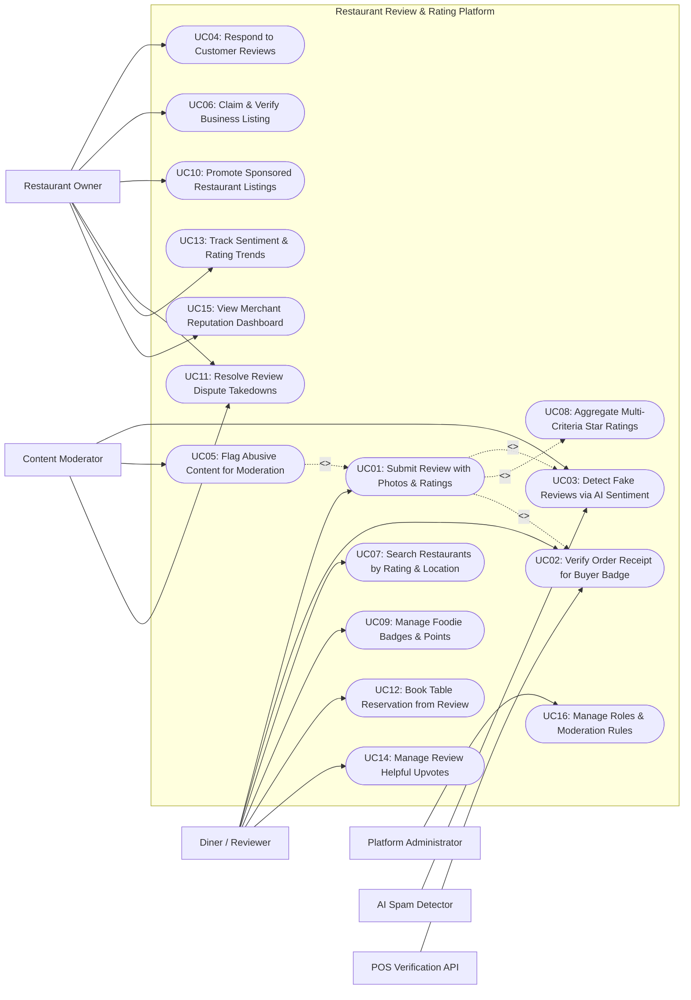

# Use Case Diagram — Restaurant Review & Rating Platform

## Mermaid Code

## Actor Table | Bang Actor

| # | Actor | Actor Type | Role Description | Related Use Cases |
|---|-------|------------|------------------|-------------------|
| 1 | AI Spam Detector | Secondary System | Machine learning NLP engine analyzing review text patterns, posting velocity, and sentiment anomaly scores. | UC03 |
| 2 | POS Verification API | Secondary System | POS integration service validating dining receipt QR codes and transaction IDs to issue Verified Buyer badges. | UC02 |
| 3 | Diner / Reviewer | Primary | Platform user browsing restaurant listings, submitting multi-criteria ratings, uploading food photos, and earning foodie badges. | UC01, UC02, UC07, UC09, UC12, UC14 |
| 4 | Restaurant Owner | Primary | Merchant claiming business profile, responding to customer reviews, running sponsored ad campaigns, and monitoring sentiment. | UC04, UC06, UC10, UC11, UC13, UC15 |
| 5 | Content Moderator | Primary | Quality assurance moderator reviewing flagged reviews, inspecting AI spam alerts, and resolving dispute takedown tickets. | UC03, UC05, UC11 |
| 6 | Platform Administrator | Primary | System admin managing user security roles, AI sensitivity thresholds, community guidelines, and platform settings. | UC16 |

## Use Case Table | Bang Use Case

| # | UC ID | Use Case Name | Primary Actor | Secondary Actor | Description | Priority |
|---|-------|---------------|---------------|-----------------|-------------|----------|
| 1 | UC01 | Submit Review with Photos & Ratings | Diner | None | Enables diners to publish detailed restaurant reviews, upload dish photos, and rate across 4 sub-criteria (Food, Service, Ambience, Value). | High |
| 2 | UC02 | Verify Order Receipt for Buyer Badge | Diner | POS Verification API | Validates uploaded dining receipt photos or QR codes against POS APIs, awarding a green "Verified Buyer / Diner" trust badge. | High |
| 3 | UC03 | Detect Fake Reviews via AI Sentiment | Content Moderator | AI Spam Detector | Automatically screens new reviews for astroturfing, bot spam, and competitor sabotage using ML NLP sentiment anomaly scoring. | High |
| 4 | UC04 | Respond to Customer Reviews | Restaurant Owner | None | Allows verified restaurant owners to publish official public merchant responses to customer reviews to manage brand reputation. | High |
| 5 | UC05 | Flag Abusive Content for Moderation | Diner / Merchant | Content Moderator | Enables users and merchants to flag inappropriate reviews (hate speech, fake reviews, harassment) for moderator team review. | Medium |
| 6 | UC06 | Claim & Verify Business Listing | Restaurant Owner | None | Allows restaurant owners to claim their business page by submitting business license proof, tax IDs, and owner phone verification. | High |
| 7 | UC07 | Search Restaurants by Rating & Location | Diner | None | Filters restaurants by aggregate star rating, cuisine type, price range, distance, and verified review counts. | High |
| 8 | UC08 | Aggregate Multi-Criteria Star Ratings | System | None | Dynamically calculates and updates weighted overall star ratings and sub-scores (Food, Service, Ambience, Value) per restaurant. | High |
| 9 | UC09 | Manage Foodie Badges & Points | Diner | None | Awards gamification points, badges (e.g., Top Foodie, Ramen Master), and status perks to prolific reviewers. | Medium |
| 10 | UC10 | Promote Sponsored Restaurant Listings | Restaurant Owner | None | Enables merchants to run CPC/CPM sponsored placement campaigns, boosting restaurant visibility on search results. | Medium |
| 11 | UC11 | Resolve Review Dispute Takedowns | Content Moderator | Merchant | Processes merchant legal or policy dispute claims requesting removal of defamatory or un-verified review content. | High |
| 12 | UC12 | Book Table Reservation from Review | Diner | None | Allows diners to book table reservations directly from a restaurant's review profile page. | Medium |
| 13 | UC13 | Track Sentiment & Rating Trends | Restaurant Owner | None | Displays analytics on rating trends over time, positive vs negative keyword sentiment clouds, and competitor comparisons. | High |
| 14 | UC14 | Manage Review Helpful Upvotes | Diner | None | Allows diners to vote "Helpful" or "Unhelpful" on customer reviews, ranking top-rated helpful reviews first. | Medium |
| 15 | UC15 | View Merchant Reputation Dashboard | Restaurant Owner | None | Provides merchants with a consolidated dashboard tracking net sentiment, response rates, average ratings, and footfall conversions. | High |
| 16 | UC16 | Manage Roles & Moderation Rules | System Admin | None | Configures user security access roles, AI spam detection thresholds, community guidelines, and platform audit logs. | High |

## Use Case Specification | Dac ta Use Case

---

### UC01 — Submit Review with Photos & Ratings

| Field | Detail |
|-------|--------|
| **UC ID** | UC01 |
| **Use Case Name** | Submit Review with Photos & Ratings |
| **Actor(s)** | Primary: Diner / Reviewer   Secondary: None |
| **Description** | Enables a diner to compose and publish a multi-criteria restaurant review, upload food photos, assign 1-5 star ratings for sub-categories (Food, Service, Ambience, Value), and optionally attach an order receipt. |
| **Precondition** | 1. Diner is logged in with an active user account.   2. Target restaurant listing exists in system directory. |
| **Main Flow** | 1. Diner opens "Write a Review" on target restaurant listing page (e.g., Sakura Sushi Bar).   2. System presents multi-criteria rating interface:      - Overall Star Rating: 5 Stars      - Food Quality: 5 Stars      - Service Efficiency: 4 Stars      - Ambience & Cleanliness: 5 Stars      - Value for Money: 4 Stars.   3. Diner inputs review headline (e.g., "Amazing Omakase Experience!") and detailed review text (minimum 50 characters).   4. Diner uploads food photos (e.g., 3 High-Res JPEG images of sushi platter) and tags dish names.   5. Diner optionally attaches POS receipt scan for Verified Buyer Badging (UC02).   6. Diner clicks "Publish Review".   7. System dispatches review text to AI Fake Review & Spam Detection API (UC03) for real-time screening.   8. AI passes review (Spam Score < 0.15); System publishes review to restaurant page, updates aggregate star ratings (UC08), and awards gamification points to diner (UC09). |
| **Alternative Flow** | **AF1** — Review edit within 24 hours:   1. Diner opens "My Reviews" and clicks "Edit Review #RV-8810".   2. Diner updates rating or text; System re-publishes review and updates aggregate scores. |
| **Exception Flow** | **EX1** — AI flags potential spam or profanity:   1. At step 8, AI returns high spam/profanity score (Spam Score = 0.85).   2. System quarantines review status to `Pending Moderation Review` and routes ticket to Content Moderator queue (UC05). |
| **Postcondition** | Review is published (or queued for moderation), dish photos are uploaded, and aggregate ratings recalculate. |
| **Business Rule** | **BR1**: Review text must contain a minimum of 50 characters to ensure meaningful, substantive feedback.   **BR2**: Users are restricted to publishing a maximum of 1 review per restaurant location every 30 days to prevent review stuffing. |

---

### UC02 — Verify Order Receipt for Buyer Badge

| Field | Detail |
|-------|--------|
| **UC ID** | UC02 |
| **Use Case Name** | Verify Order Receipt for Buyer Badge |
| **Actor(s)** | Primary: Diner / Reviewer   Secondary: POS & Receipt Verification API |
| **Description** | Validates uploaded dining receipt photos or scanned receipt QR codes against POS partner APIs to verify authentic dining visits, awarding a green "Verified Buyer / Diner" trust badge to the review. |
| **Precondition** | 1. Diner is submitting or editing a review (UC01).   2. POS Receipt Verification API endpoint is online. |
| **Main Flow** | 1. During review submission (UC01), Diner selects "Attach Receipt for Verified Buyer Badge".   2. Diner uploads receipt photo or scans POS receipt QR code.   3. System extracts receipt metadata using OCR / QR decoder: POS Merchant ID, Transaction Ref # (e.g., POS-88219), Date, Total Amount ($85.50).   4. System transmits verification request to POS & Receipt Verification API.   5. POS API confirms transaction validity: `Match Found! Merchant ID: #409, Date: 2026-07-18, Total: $85.50`.   6. System awards green **Verified Buyer Badge** to the review card.   7. System appends verified weight multiplier (e.g., 1.5x rating weight) to the review for overall star rating aggregation (UC08).   8. Diner receives +50 Bonus Foodie Gamification Points (UC09). |
| **Alternative Flow** | **AF1** — Manual receipt moderation fallback:   1. POS API is unavailable or receipt is from a non-integrated POS system.   2. System routes receipt image to Content Moderator queue; Moderator inspects receipt text and manually approves Verified Badge. |
| **Exception Flow** | **EX1** — Fake or duplicate receipt submission:   1. At step 5, POS API returns "Transaction ID Not Found" OR receipt was already used by another user account.   2. System rejects receipt verification, flags warning "Invalid or Duplicate Receipt", and publishes review without Verified Badge. |
| **Postcondition** | Dining receipt is verified, "Verified Buyer Badge" is attached to the review, and weighted rating is updated. |
| **Business Rule** | **BR1**: Each POS receipt transaction reference can only be used ONCE to claim a Verified Buyer Badge across the platform.   **BR2**: Verified Buyer reviews receive higher algorithmic weighting in restaurant overall star rating calculations. |

---

### UC03 — Detect Fake Reviews via AI Sentiment

| Field | Detail |
|-------|--------|
| **UC ID** | UC03 |
| **Use Case Name** | Detect Fake Reviews via AI Sentiment |
| **Actor(s)** | Primary: Content Moderator   Secondary: AI Fake Review & Spam Detection API |
| **Description** | Automatically screens newly submitted reviews using machine learning NLP algorithms to detect fake reviews, competitor astroturfing, bot spam, and emotional sentiment anomalies. |
| **Precondition** | 1. A new review has been submitted (UC01).   2. AI Spam Detection NLP engine is online. |
| **Main Flow** | 1. System automatically dispatches review payload (User Account ID, Review Text, IP Address, Device Fingerprint, Rating Sub-scores) to AI Fake Review Detection API.   2. AI engine analyzes review text across 4 fraud detection vectors:      - Linguistic Pattern Anomaly (Generic AI-generated text vs natural human review).      - Behavioral Velocity (User account creating 20 reviews in 10 minutes).      - IP & Geolocation Mismatch (Review posted from foreign IP with no local visit footprint).      - Extreme Sentiment Polarized Bias (1-Star competitor attack or 5-Star astroturfing).   3. AI engine calculates Spam Probability Score (0.00 to 1.00): `Calculated Score = 0.82 (High Fraud Risk)`.   4. If Spam Score < 0.30: System auto-approves review for instant publishing.   5. If Spam Score >= 0.70: System quarantines review, sets status `Suspended - Fraud Alert`, and routes ticket to Content Moderator dashboard.   6. Content Moderator inspects flagged review, AI fraud indicators, user history, and clicks "Confirm Spam / Ban User" OR "Over-rule / Approve Review".   7. If Moderator confirms spam, System permanently suppresses review and flags user account for reputation penalty. |
| **Alternative Flow** | **AF1** — Bulk automated bot sweep:   1. AI engine detects synchronized 1-star review attack originating from a known botnet IP range targeting a specific restaurant.   2. System automatically quarantines all 30 attack reviews instantly and notifies Store Owner. |
| **Exception Flow** | **EX1** — False positive appeal by user:   1. Legitimate user review is quarantined by AI (false positive).   2. User submits appeal; Moderator reviews account history, verifies receipt (UC02), and restores review. |
| **Postcondition** | Fake reviews and bot spam are quarantined or deleted, and platform rating integrity is preserved. |
| **Business Rule** | **BR1**: Reviews flagged with an AI Spam Probability Score >= 0.70 must be quarantined from public view pending human moderator audit.   **BR2**: Account accounts confirmed to operate fake review astroturfing rings must face immediate permanent platform bans. |

---

### UC04 — Respond to Customer Reviews

| Field | Detail |
|-------|--------|
| **UC ID** | UC04 |
| **Use Case Name** | Respond to Customer Reviews |
| **Actor(s)** | Primary: Restaurant Owner / Merchant   Secondary: None |
| **Description** | Enables verified restaurant business owners to compose and publish official merchant responses to customer reviews, managing customer relations and addressing service feedback. |
| **Precondition** | 1. Merchant has successfully claimed and verified business listing ownership (UC06).   2. Customer review is published and active. |
| **Main Flow** | 1. Restaurant Owner logs into Merchant Reputation Dashboard (UC15).   2. Owner views incoming review feed and selects a customer review (e.g., 2-Star Review regarding slow service).   3. Owner clicks "Write Official Merchant Response".   4. Owner inputs response text: "Dear Sarah, thank you for visiting Sakura Sushi. We sincerely apologize for the delay during Saturday's dinner rush. We have addressed this with our kitchen team and would love to invite you back..." (minimum 20 characters).   5. Owner clicks "Publish Response".   6. System screens response text for profanity or guideline violations.   7. System appends response card directly beneath the customer's review with official **Verified Merchant Response** badge.   8. System dispatches email and in-app notification to the diner: "Sakura Sushi Bar responded to your review!". |
| **Alternative Flow** | **AF1** — Private direct message response:   1. Owner selects "Send Private Message to Diner" instead of public response.   2. System sends private message to diner to offer resolution vouchers confidentially. |
| **Exception Flow** | **EX1** — Merchant response contains abusive language:   1. At step 6, System detects profanity or personal attacks in merchant response.   2. System blocks publishing, displays warning "Response violates merchant code of conduct", and prompts edit. |
| **Postcondition** | Official merchant response is published under customer review card, and diner receives response notification. |
| **Business Rule** | **BR1**: Only verified business listing owners (UC06) are authorized to publish Official Merchant Responses.   **BR2**: Merchants may publish maximum ONE official public response per customer review card. |

---

### UC06 — Claim & Verify Business Listing

| Field | Detail |
|-------|--------|
| **UC ID** | UC06 |
| **Use Case Name** | Claim & Verify Business Listing |
| **Actor(s)** | Primary: Restaurant Owner / Merchant   Secondary: Content Moderator |
| **Description** | Enables restaurant business owners to claim ownership of their restaurant listing by providing business registration licenses, tax IDs, and completing automated phone/SMS verification. |
| **Precondition** | 1. Target restaurant listing exists in platform directory.   2. Merchant registers a user account. |
| **Main Flow** | 1. Restaurant Owner searches for their restaurant listing and clicks "Claim This Business".   2. System displays Business Verification Form requiring:      - Business Owner Full Name & Designation (e.g., Owner, General Manager)      - Official Business Registration / Tax ID Number      - Official Business Phone Number & Email.   3. Owner uploads business registration document scan (e.g., State Food Service License).   4. System initiates Automated Phone Verification: System places automated voice call to the official restaurant phone number listed on the profile and dictates a 6-digit PIN.   5. Owner inputs 6-digit PIN into verification screen.   6. System validates PIN match; System routes document scan to Content Moderator queue for final identity check.   7. Content Moderator verifies business registration license match and clicks "Approve Business Claim".   8. System updates restaurant listing status to `Verified Business Listing`, unlocks Merchant Dashboard access (UC15), and grants review response privileges (UC04). |
| **Alternative Flow** | **AF1** — Utility bill verification alternative:   1. Phone verification fails due to landline automated IVR.   2. Owner uploads recent commercial utility bill matching business address; Moderator manually approves claim. |
| **Exception Flow** | **EX1** — Duplicate or fraudulent claim attempt:   1. An unauthorized third party attempts to claim a business that is already claimed by a verified owner.   2. System blocks claim attempt, flags alert "Listing Already Claimed", and opens ownership dispute ticket. |
| **Postcondition** | Business listing is verified, owner receives merchant dashboard privileges, and profile receives `Verified Business` badge. |
| **Business Rule** | **BR1**: Business claim approvals require both automated phone PIN verification AND human moderator document inspection.   **BR2**: Verified business owners gain exclusive access to merchant review response tools and sponsored ad campaigns. |
