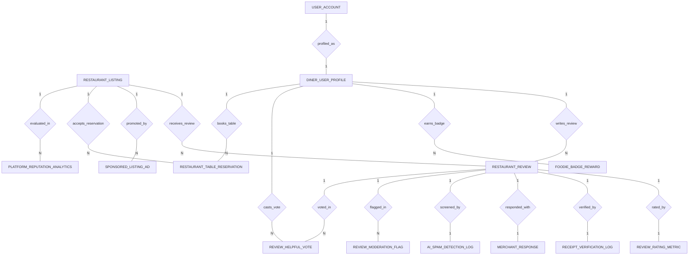

# Conceptual ERD — Restaurant Review & Rating Platform

## Mermaid Code

## Entity Description Table | Bang mo ta Entity

| # | Entity Name | Vietnamese Name | Description | Key Attributes | Main Relationships |
|---|-------------|-----------------|-------------|----------------|-------------------|
| 1 | RESTAURANT_LISTING | Danh sach nha hang | Master restaurant business profile, name, cuisine type, address, overall star rating, total review count, and claimed status. | restaurant_id, restaurant_name, cuisine_type, street_address, overall_star_rating, total_review_count, is_claimed | One-to-Many with RESTAURANT_REVIEW, SPONSORED_LISTING_AD, RESTAURANT_TABLE_RESERVATION, PLATFORM_REPUTATION_ANALYTICS |
| 2 | DINER_USER_PROFILE | Ho so nguoi danh gia | Consumer diner profile tracking display name, foodie level, total reviews posted, and helpful votes received. | profile_id, user_id, display_name, foodie_level, total_reviews_posted, helpful_votes_received | Belongs to USER_ACCOUNT; One-to-Many with RESTAURANT_REVIEW, FOODIE_BADGE_REWARD, REVIEW_HELPFUL_VOTE, RESTAURANT_TABLE_RESERVATION |
| 3 | RESTAURANT_REVIEW | Danh gia nha hang | Customer restaurant review record, review headline, review text, overall rating score, verified buyer flag, and status. | review_id, restaurant_id, profile_id, review_headline, review_text, overall_rating, is_verified_buyer, review_status | Belongs to RESTAURANT_LISTING, DINER_USER_PROFILE; One-to-One with REVIEW_RATING_METRIC, RECEIPT_VERIFICATION_LOG, MERCHANT_RESPONSE, AI_SPAM_DETECTION_LOG; One-to-Many with REVIEW_MODERATION_FLAG, REVIEW_HELPFUL_VOTE |
| 4 | REVIEW_RATING_METRIC | Chi tieu danh gia phan cap | Sub-criteria rating breakdown assigned to a review (Food Quality, Service, Ambience, Value for Money). | metric_id, review_id, food_quality_rating, service_rating, ambience_rating, value_rating | One-to-One with RESTAURANT_REVIEW |
| 5 | RECEIPT_VERIFICATION_LOG | Nhat ky xac thuc hoa don | POS dining receipt validation log storing POS transaction reference, receipt amount, date, and verification status. | receipt_id, review_id, pos_transaction_ref, receipt_amount, receipt_date, verification_status | One-to-One with RESTAURANT_REVIEW |
| 6 | MERCHANT_RESPONSE | Phap hoi cua chu nha hang | Official merchant response published by verified restaurant owners to customer reviews, including response text and timestamp. | response_id, review_id, merchant_user_id, response_text, responded_at | One-to-One with RESTAURANT_REVIEW |
| 7 | REVIEW_MODERATION_FLAG | Co bao cai noi dung | Content moderation flag ticket created when users or merchants report inappropriate or abusive reviews. | flag_id, review_id, flagged_by_role, flag_reason, moderation_status | Belongs to RESTAURANT_REVIEW |
| 8 | AI_SPAM_DETECTION_LOG | Nhat ky AI phat hien spam | Automated machine learning NLP screening log recording spam probability score, sentiment score, and AI decision. | log_id, review_id, spam_probability_score, sentiment_score, ai_flag_decision | One-to-One with RESTAURANT_REVIEW |
| 9 | FOODIE_BADGE_REWARD | Huy chuong nguoi sanh an | Gamification reward badge awarded to active reviewers (e.g., Top Foodie, Ramen Master) with category and timestamp. | badge_id, profile_id, badge_name, badge_category, awarded_at | Belongs to DINER_USER_PROFILE |
| 10 | REVIEW_HELPFUL_VOTE | Luot binh chon huu ich | Upvote/downvote vote cast by diners indicating whether a customer review was helpful. | vote_id, review_id, profile_id, is_helpful, voted_at | Belongs to RESTAURANT_REVIEW, DINER_USER_PROFILE |
| 11 | SPONSORED_LISTING_AD | Quang cao nha hang tai tro | Paid sponsored advertisement placement campaign created by merchants to boost restaurant search ranking. | ad_id, restaurant_id, daily_budget, bid_per_click, campaign_status | Belongs to RESTAURANT_LISTING |
| 12 | RESTAURANT_TABLE_RESERVATION | Dat ban nha hang | Table reservation booking placed by a diner directly through the restaurant review listing profile page. | reservation_id, restaurant_id, profile_id, reservation_datetime, party_size, reservation_status | Belongs to RESTAURANT_LISTING, DINER_USER_PROFILE |
| 13 | USER_ACCOUNT | Tai khoan he thong | Core security authentication account holding credentials, password hashes, and user role definitions. | user_id, username, password_hash, role_name | One-to-One with DINER_USER_PROFILE |
| 14 | PLATFORM_REPUTATION_ANALYTICS | Thong ke uy tin nha hang | Executive daily analytics tracking net sentiment scores, monthly page views, and competitor market rank percentiles. | analytics_id, restaurant_id, metric_date, net_sentiment_score, total_monthly_views, competitor_rank_percentile | Belongs to RESTAURANT_LISTING |

## Relationship Description | Mo ta Quan he

| # | From Entity | Cardinality | To Entity | Relationship Label | Business Explanation |
|---|-------------|-------------|-----------|-------------------|----------------------|
| 1 | USER_ACCOUNT | One-to-One | DINER_USER_PROFILE | profiled_as | Tai khoan he thong dinh danh ho so nguoi dung danh gia thuc pham. |
| 2 | RESTAURANT_LISTING | One-to-Many | RESTAURANT_REVIEW | receives_review | Mot nha hang nhan duoc nhieu bai danh gia tu cac thuc khach. |
| 3 | DINER_USER_PROFILE | One-to-Many | RESTAURANT_REVIEW | writes_review | Mot nguoi dung co thể dang nhieu bai danh gia cho cac nha hang khac nhau. |
| 4 | RESTAURANT_REVIEW | One-to-One | REVIEW_RATING_METRIC | rated_by | Mot bai danh gia di kem voi bang diem chi tiet (Mon an, Phuc vu, Khong gian, Gia ca). |
| 5 | RESTAURANT_REVIEW | One-to-One | RECEIPT_VERIFICATION_LOG | verified_by | Mot bai danh gia duoc xac thuc qua nhat ky hoa don POS de cap huy chuong Verified Buyer. |
| 6 | RESTAURANT_REVIEW | One-to-One | MERCHANT_RESPONSE | responded_with | Mot bai danh gia duoc chu nha hang phan hoi chinh thuc. |
| 7 | RESTAURANT_REVIEW | One-to-Many | REVIEW_MODERATION_FLAG | flagged_in | Mot bai danh gia co the bi cắm co bao cao vi pham nhieu lan. |
| 8 | RESTAURANT_REVIEW | One-to-One | AI_SPAM_DETECTION_LOG | screened_by | Mot bai danh gia duoc AI kiem duyet va tinh diem xac suat fake/spam. |
| 9 | DINER_USER_PROFILE | One-to-Many | FOODIE_BADGE_REWARD | earns_badge | Nguoi dung tich luy va dat duoc nhieu huy chuong sanh an gamification. |
| 10 | RESTAURANT_REVIEW | One-to-Many | REVIEW_HELPFUL_VOTE | voted_in | Mot bai danh gia nhan duoc nhieu luot binh chon huu ich tu cong dong. |
| 11 | DINER_USER_PROFILE | One-to-Many | REVIEW_HELPFUL_VOTE | casts_vote | Nguoi dung binh chon huu ich cho cac bai danh gia cua nguoi khac. |
| 12 | RESTAURANT_LISTING | One-to-Many | SPONSORED_LISTING_AD | promoted_by | Mot nha hang co the chay cac dien chien dich quang cao tai tro de tang hien thi. |
| 13 | RESTAURANT_LISTING | One-to-Many | RESTAURANT_TABLE_RESERVATION | accepts_reservation | Mot nha hang nhan cac luot dat ban truc tuyen qua trang danh gia. |
| 14 | RESTAURANT_LISTING | One-to-Many | PLATFORM_REPUTATION_ANALYTICS | evaluated_in | Mot nha hang duoc thong ke chi so uy tin, luot xem va diem sentiment hang ngay. |
