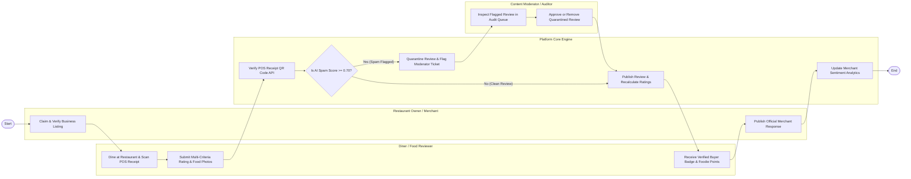

# Swimlane Diagram — Restaurant Review & Rating Platform

## Mermaid Code

## Flow Description | Mo ta luong

| Lane | Actor | Role in Flow |
|------|-------|-------------|
| **Lane 1** | Diner / Food Reviewer | Dines at restaurant, scans POS receipt, submits multi-criteria ratings (Food, Service, Ambience, Value) with photos, and earns Verified Buyer badges. |
| **Lane 2** | Restaurant Owner / Merchant | Claims and verifies business listing ownership, receives review notifications, and publishes official public merchant responses. |
| **Lane 3** | Content Moderator / Auditor | Inspects quarantined review tickets flagged by AI or users, evaluates guidelines, and approves or permanently removes reviews. |
| **Lane 4** | Platform Core Engine | Validates POS receipt QR codes, runs AI NLP spam screening, calculates aggregate star ratings, awards gamification points, and updates sentiment analytics. |

### Process Execution Steps | Cac buoc thuc hien quy trinh

1. **Merchant Listing Claim & Review Submission**: Merchant claims business listing (`M1`). Diner dines and submits multi-criteria rating, text, photos, and receipt scan (`C1`, `C2`).
2. **Receipt & AI Spam Verification**: Core Engine verifies POS receipt QR code (`S1`) and evaluates AI spam probability score (`S2`).
   - If **Yes (Spam Score >= 0.70)**: Core Engine quarantines review (`S3`). Moderator inspects ticket (`K1`) and approves or removes review (`K2`).
   - If **No (Clean Review)**: Core Engine publishes review immediately (`S4`).
3. **Badge Award & Merchant Response**: Diner receives green Verified Buyer badge and foodie points (`C3`). Merchant publishes official response (`M2`).
4. **Analytics Update**: Core Engine updates aggregate star ratings and merchant sentiment analytics (`S5`), completing execution (`Finish`).
