# Action Tree — Restaurant Review & Rating Platform

## Mermaid Code

```mermaid
graph TD
    Root["Restaurant Review & Rating Platform"]

    Root --> M1["Restaurant Listing & Location Directory"]
    Root --> M2["Multi-Criteria Review & Photo Submission"]
    Root --> M3["Receipt Verification & Verified Buyer Badging"]
    Root --> M4["AI Spam Detection & Content Moderation"]
    Root --> M5["Merchant Reputation & Response Management"]
    Root --> M6["Gamification & Foodie Influencer Rewards"]
    Root --> M7["Reputation Analytics & System Security"]

    M1 --> A11["Search Restaurants by Rating & Cuisine"]
    M1 --> A12["Display Interactive Map Geolocation Pins"]
    M1 --> A13["Manage Restaurant Operating Hours & Menus"]
    M1 --> A14["Book Table Reservations from Profile"]

    M2 --> A21["Submit Multi-Criteria Star Ratings"]
    M2 --> A22["Upload High-Res Food & Ambience Photos"]
    M2 --> A23["Aggregate Sub-Scores Food Service Value"]
    M2 --> A24["Vote Helpful on User Review Cards"]

    M3 --> A31["Scan POS Receipt QR Codes & Photos"]
    M3 --> A32["Validate Receipt Ref via POS APIs"]
    M3 --> A33["Award Verified Buyer Badges to Reviews"]
    M3 --> A34["Apply Higher Rating Weight to Verified Reviews"]

    M4 --> A41["Screen Text via AI NLP Sentiment Engine"]
    M4 --> A42["Flag Astroturfing & Bot Spam Anomaly Scores"]
    M4 --> A43["Process User Abusive Content Flag Tickets"]
    M4 --> A44["Resolve Legal Dispute Takedown Requests"]

    M5 --> A51["Claim & Verify Business Listing Ownership"]
    M5 --> A52["Publish Official Merchant Responses"]
    M5 --> A53["Promote Sponsored Listing Ad Campaigns"]
    M5 --> A54["Send Real-Time Review Alert Notifications"]

    M6 --> A61["Award Foodie Gamification Level Points"]
    M6 --> A62["Issue Top Foodie & Cuisine Specialist Badges"]
    M6 --> A63["Rank Community Reviewer Leaderboards"]
    M6 --> A64["Share Review Cards to Social Media Networks"]

    M7 --> A71["Track Net Sentiment Score & Rating Trends"]
    M7 --> A72["Compare Competitor Market Rank Percentiles"]
    M7 --> A73["Manage Security Roles & Community Guidelines"]
    M7 --> A74["Manage AI Spam Sensitivity Thresholds"]
```

## Module Description | Mo ta Module

| # | Module | Description | Actions |
|---|--------|-------------|---------|
| 1 | Restaurant Listing & Location Directory | Enables diners to search restaurants by ratings, cuisine, price, view geocoded map pins, operational hours, and book table reservations. | Search Restaurants by Rating & Cuisine, Display Interactive Map Geolocation Pins, Manage Restaurant Operating Hours & Menus, Book Table Reservations from Profile |
| 2 | Multi-Criteria Review & Photo Submission | Captures detailed reviews, high-res food photos, calculates sub-criteria ratings (Food, Service, Ambience, Value), and collects helpful votes. | Submit Multi-Criteria Star Ratings, Upload High-Res Food & Ambience Photos, Aggregate Sub-Scores Food Service Value, Vote Helpful on User Review Cards |
| 3 | Receipt Verification & Verified Buyer Badging | Validates POS dining receipts via QR codes/APIs, awards green Verified Buyer badges, and assigns higher rating weights to verified reviews. | Scan POS Receipt QR Codes & Photos, Validate Receipt Ref via POS APIs, Award Verified Buyer Badges to Reviews, Apply Higher Rating Weight to Verified Reviews |
| 4 | AI Spam Detection & Content Moderation | Screens text using ML NLP engines to flag fake astroturfing, bot spam, quarantines suspicious reviews, and resolves dispute takedown tickets. | Screen Text via AI NLP Sentiment Engine, Flag Astroturfing & Bot Spam Anomaly Scores, Process User Abusive Content Flag Tickets, Resolve Legal Dispute Takedown Requests |
| 5 | Merchant Reputation & Response Management | Controls business listing claims, official merchant responses, sponsored listing ad campaigns, and real-time review alert notifications. | Claim & Verify Business Listing Ownership, Publish Official Merchant Responses, Promote Sponsored Listing Ad Campaigns, Send Real-Time Review Alert Notifications |
| 6 | Gamification & Foodie Influencer Rewards | Awards gamification points, badges (Top Foodie, Cuisine Specialist), tracks reviewer leaderboards, and enables social media review sharing. | Award Foodie Gamification Level Points, Issue Top Foodie & Cuisine Specialist Badges, Rank Community Reviewer Leaderboards, Share Review Cards to Social Media Networks |
| 7 | Reputation Analytics & System Security | Provides executive reporting on sentiment trends, competitor market ranks, user security roles, community guidelines, and AI spam sensitivity settings. | Track Net Sentiment Score & Rating Trends, Compare Competitor Market Rank Percentiles, Manage Security Roles & Community Guidelines, Manage AI Spam Sensitivity Thresholds |
