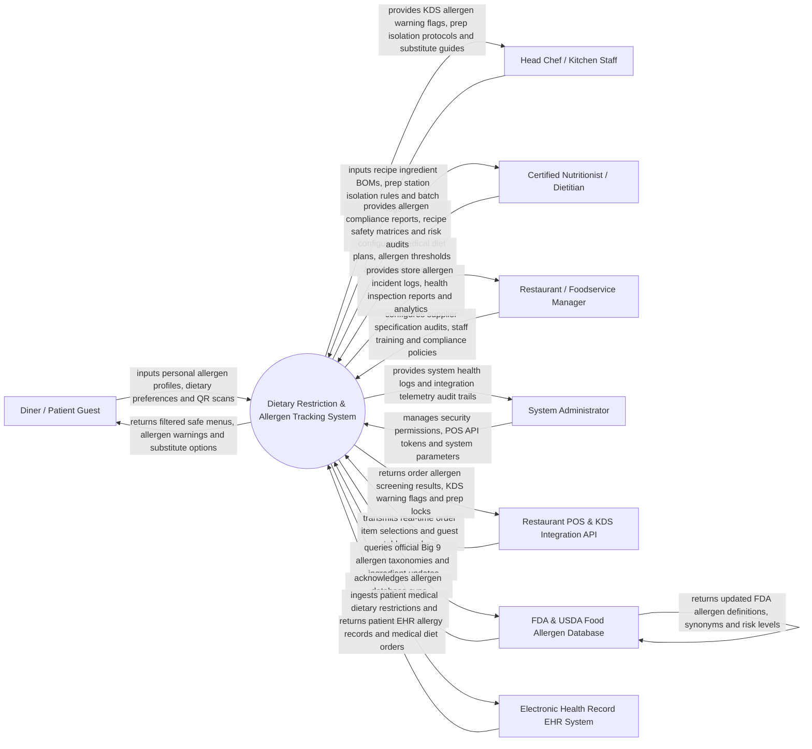

# Context Diagram — Dietary Restriction & Allergen Tracking System

## Mermaid Code

## Actor & Interaction Table | Bang Actor & Tuong tac

| # | Actor | Actor Type | Data Sent TO System | Data Received FROM System | Notes |
|---|-------|------------|---------------------|---------------------------|-------|
| 1 | Diner / Patient Guest | Primary | Allergen profile selections (Big 9: Peanuts, Tree Nuts, Milk, Eggs, Fish, Crustaceans, Wheat, Soy, Sesame), medical dietary preferences (Celiac, Low-FODMAP, Halal, Vegan), QR code scans | Filtered allergen-safe menu items, dish ingredient warnings, safe substitute suggestions | Interacts via mobile app, digital table menu QR, or hospital kiosk. |
| 2 | Head Chef / Kitchen Staff | Primary | Recipe ingredient BOMs, sub-ingredient breakdowns, prep station isolation statuses, batch cooking logs | KDS allergen warning flags, station isolation protocols, safe substitution instructions | Manages kitchen prep stations, cook lines, and cross-contact prevention. |
| 3 | Certified Nutritionist / Dietitian | Primary | Medical diet specifications, allergen threshold rules, supplier specification approvals | Allergen compliance reports, recipe safety matrices, nutritional analysis | Oversees menu health safety, medical nutrition therapy, and recipe audits. |
| 4 | Restaurant / Foodservice Manager | Primary | Supplier ingredient specification sheets (SDS/CoA), staff training logs, incident management policies | Store allergen risk analytics, health inspector compliance reports, incident logs | Manages foodservice operations, supplier compliance, and legal liability. |
| 5 | System Administrator | Primary | User credentials, security role policies, POS API tokens, system parameters | System health metrics, integration telemetry logs, data security audit trails | Manages software infrastructure, system settings, and security permissions. |
| 6 | Restaurant POS & KDS Integration API | Supporting | Real-time order line item selections, guest table numbers, server IDs | Order allergen screening results, high-risk item flags, KDS warning tickets | Front-of-house POS sending order selections for real-time allergen screening. |
| 7 | FDA & USDA Food Allergen Database | Supporting | Official Big 9 food allergen taxonomies, ingredient scientific names, cross-contact rules | Allergen database sync queries, taxonomy update requests | External regulatory database defining official food allergens and synonyms. |
| 8 | Electronic Health Record EHR System | Supporting | Patient medical allergy history, anaphylaxis alerts, physician diet orders | Dietary intake logs, allergen screening acknowledgments | Hospital EHR system (e.g., Epic, Cerner) feeding medical diet restrictions. |

## System Boundary Description | Mo ta Pham vi He thong

The **Dietary Restriction & Allergen Tracking System** automates food allergen identification, recipe ingredient mapping, real-time order cross-contamination screening, allergen-safe substitution generation, and regulatory health compliance. Inside its boundary, the system handles Big 9 food allergen taxonomy tracking, recipe sub-ingredient BOM decomposition, supplier specification sheet audits, real-time POS order screening, kitchen KDS red-flag warning tickets, prep station cross-contact isolation protocols, patient EHR medical diet synchronization, and health inspection compliance reporting.

The system boundary excludes physical cooking of food, physical sanitization of kitchen equipment, direct medical emergency treatment (handled by first responders), and raw POS payment clearing.
