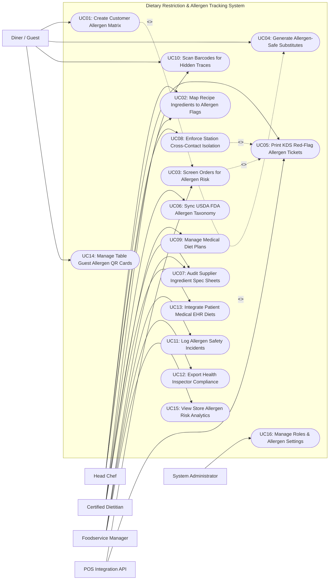

# Use Case Diagram — Dietary Restriction & Allergen Tracking System

## Mermaid Code

## Actor Table | Bang Actor

| # | Actor | Actor Type | Role Description | Related Use Cases |
|---|-------|------------|------------------|-------------------|
| 1 | POS Integration API | Secondary System | Front-of-house POS sending real-time order selections and table IDs for allergen screening. | UC03, UC05 |
| 2 | Diner / Guest | Primary | Customer configuring personal allergen matrices (Big 9), scanning dish QR codes, and receiving safe menu recommendations. | UC01, UC04, UC10, UC14 |
| 3 | Head Chef | Primary | Kitchen lead mapping recipe ingredient BOMs, monitoring red-flag KDS allergen tickets, and enforcing prep station isolation protocols. | UC02, UC05, UC08, UC10 |
| 4 | Certified Dietitian | Primary | Medical nutrition expert auditing supplier specification sheets, configuring medical diet plans, and validating allergen taxonomy. | UC02, UC06, UC07, UC09, UC13 |
| 5 | Foodservice Manager | Primary | Restaurant/hospital manager managing supplier compliance, auditing safety incidents, and exporting health inspector reports. | UC07, UC11, UC12, UC15 |
| 6 | System Administrator | Primary | Technical manager configuring security access roles, POS integration tokens, EHR API bindings, and system parameters. | UC16 |

## Use Case Table | Bang Use Case

| # | UC ID | Use Case Name | Primary Actor | Secondary Actor | Description | Priority |
|---|-------|---------------|---------------|-----------------|-------------|----------|
| 1 | UC01 | Create Customer Allergen Matrix | Diner | None | Allows guests to build a digital profile flagging specific food allergies (Big 9: Peanuts, Tree Nuts, Milk, Eggs, Fish, Crustaceans, Wheat, Soy, Sesame) and severe reactions. | High |
| 2 | UC02 | Map Recipe Ingredients to Allergen Flags | Head Chef | Certified Dietitian | Decomposes master recipes into raw sub-ingredients, automatically tagging FDA/USDA allergen flags down to 0.1ppm trace levels. | High |
| 3 | UC03 | Screen Orders for Allergen Risk | POS Integration API | None | Real-time screening of POS order line items against table guest allergen profiles, detecting direct allergen matches and cross-contact risks. | High |
| 4 | UC04 | Generate Allergen-Safe Substitutes | Diner | Head Chef | Algorithmically suggests safe ingredient substitutions (e.g., Almond Milk -> Oat Milk, Wheat Flour -> Gluten-Free Blend) for restricted dishes. | High |
| 5 | UC05 | Print KDS Red-Flag Allergen Tickets | Head Chef | POS Integration API | Triggers high-priority red-banner warning tickets on kitchen KDS displays when an allergen-restricted dish is ordered. | High |
| 6 | UC06 | Sync USDA FDA Allergen Taxonomy | Certified Dietitian | None | Synchronizes official USDA/FDA allergen taxonomy databases, scientific ingredient synonyms, and emerging allergen risk classifications. | Medium |
| 7 | UC07 | Audit Supplier Spec Sheets | Certified Dietitian | Foodservice Manager | Audits supplier ingredient Certificate of Analysis (CoA) and Safety Data Sheets (SDS) for hidden cross-contact allergen risks in commercial supply chains. | High |
| 8 | UC08 | Enforce Station Cross-Contact Isolation | Head Chef | None | Defines strict kitchen prep station isolation protocols (e.g., Dedicated Gluten-Free Fryer / Peanut-Free Prep Bench) for allergen order execution. | High |
| 9 | UC09 | Manage Medical Diet Plans | Certified Dietitian | None | Configures structured medical dietary restriction plans (Celiac Disease, Renal Low-Sodium, Low-FODMAP, Diabetic Carbohydrate Counting). | High |
| 10 | UC10 | Scan Barcodes for Hidden Traces | Diner / Head Chef | None | Uses mobile camera barcode scanning to instantly decode commercial packaged ingredient labels and flag hidden allergen warnings. | Medium |
| 11 | UC11 | Log Allergen Safety Incidents | Foodservice Manager | None | Records detailed logs of food allergen reaction incidents, near-misses, and anaphylaxis emergency responses for safety compliance auditing. | High |
| 12 | UC12 | Export Health Inspector Compliance | Foodservice Manager | None | Exports formatted menu allergen matrix compliance reports and kitchen sanitation verification logs for government health inspectors. | High |
| 13 | UC13 | Integrate Patient Medical EHR Diets | Certified Dietitian | None | Ingests patient medical allergy history and physician diet orders directly from hospital Electronic Health Record (EHR) systems via HL7/FHIR APIs. | High |
| 14 | UC14 | Manage Table Guest Allergen QR Cards | Diner | None | Generates digital QR code allergen summary cards that diners present to restaurant servers or table tablets to communicate diet restrictions. | Medium |
| 15 | UC15 | View Store Allergen Risk Analytics | Foodservice Manager | None | Displays analytical dashboards on allergen order frequency, top restricted ingredients, kitchen prep compliance, and risk incident trends. | High |
| 16 | UC16 | Manage Roles & Allergen Settings | System Admin | None | Configures user security roles, POS API tokens, EHR connection keys, system parameters, and audit logging policies. | High |

## Use Case Specification | Dac ta Use Case

---

### UC01 — Create Customer Allergen Matrix

| Field | Detail |
|-------|--------|
| **UC ID** | UC01 |
| **Use Case Name** | Create Customer Allergen Matrix |
| **Actor(s)** | Primary: Diner / Guest   Secondary: None |
| **Description** | Enables diners or patients to create a digital allergen matrix specifying food allergies (covering the FDA Big 9 allergens and custom triggers), severity levels (Anaphylaxis, Severe, Mild), and medical dietary restrictions. |
| **Precondition** | 1. Diner opens mobile app or scans table QR menu.   2. FDA/USDA allergen taxonomy database (UC06) is active. |
| **Main Flow** | 1. User opens "Dietary & Allergen Profile Builder".   2. System displays FDA Big 9 Allergen Selector:      - Peanuts, Tree Nuts (Almonds, Walnuts, Cashews), Milk / Dairy, Eggs, Fish, Shellfish / Crustaceans, Wheat / Gluten, Soy, Sesame.   3. User selects applicable allergens (e.g., Severe Peanut Allergy + Wheat/Gluten Intolerance).   4. For each selected allergen, User specifies Severity Level:      - `Anaphylactic (Life Threatening - Zero Trace Tolerance)`      - `Severe (Digestive Distress / Hives)`      - `Intolerance / Preference (Mild Reaction)`.   5. User selects broader Dietary Restrictions: `Celiac Disease`, `Dairy-Free`, `Halal`, `Vegan`.   6. User saves profile.   7. System generates encrypted **Allergen Matrix Token** and produces a personal Allergen Summary QR Code Card (UC14).   8. System automatically filters active restaurant menus, displaying green checkmarks on safe dishes and red hazard icons on unsafe dishes. |
| **Alternative Flow** | **AF1** — Child / Dependent profile creation:   1. Parent creates sub-profile "Tommy (Age 6)" with Severe Egg & Milk Allergy.   2. System links sub-profile to primary parent account. |
| **Exception Flow** | **EX1** — Un-saved profile warning during order:   1. User attempts to submit POS order without saving allergen profile.   2. System prompts "Save Allergen Profile to enable cross-contamination protection?". |
| **Postcondition** | Customer allergen matrix is created, severity levels are defined, menu items are filtered, and QR card is generated. |
| **Business Rule** | **BR1**: Anaphylactic severity classifications MUST trigger zero-trace cross-contamination screening (< 0.1ppm threshold).   **BR2**: Customer allergen profiles must be stored with HIPAA-compliant encryption standards. |

---

### UC02 — Map Recipe Ingredients to Allergen Flags

| Field | Detail |
|-------|--------|
| **UC ID** | UC02 |
| **Use Case Name** | Map Recipe Ingredients to Allergen Flags |
| **Actor(s)** | Primary: Head Chef, Certified Dietitian   Secondary: None |
| **Description** | Decomposes master menu recipes into raw sub-ingredients and commercial supplier components, automatically mapping each ingredient to official FDA Big 9 allergen flags down to sub-component levels. |
| **Precondition** | 1. Master recipe items and supplier ingredient specification sheets (UC07) are loaded.   2. Official allergen taxonomy database (UC06) is active. |
| **Main Flow** | 1. Head Chef or Dietitian opens "Recipe Allergen Mapping Matrix".   2. User selects a menu item (e.g., House Pesto Pasta).   3. System displays multi-level Recipe Bill of Materials (BOM) decomposition:      - Component 1: Fresh Basil      - Component 2: Extra Virgin Olive Oil      - Component 3: Pine Nuts (Sub-ingredient: Tree Nuts)      - Component 4: Parmesan Cheese (Sub-ingredient: Pasteurized Milk, Enzymes)      - Component 5: Fettuccine Pasta (Sub-ingredient: Semolina Wheat, Eggs).   4. System automatically scans ingredient sub-components against FDA/USDA taxonomy and maps Allergen Flags:      - `TREE_NUTS` (from Pine Nuts)      - `MILK` (from Parmesan Cheese)      - `WHEAT` (from Fettuccine Pasta)      - `EGGS` (from Fettuccine Pasta).   5. User verifies mapping, specifies potential cross-contact risks (e.g., "Prepared on equipment shared with Soy"), and approves recipe mapping.   6. System saves recipe allergen matrix and updates customer-facing menu filters (UC01) and order screening engines (UC03). |
| **Alternative Flow** | **AF1** — Supplier component substitution update:   1. Chef switches Butter brand to a new commercial brand containing Soy Lecithin.   2. System updates all recipes using that butter brand, auto-adding `SOY` allergen flags across affected menu items. |
| **Exception Flow** | **EX1** — Un-mapped raw ingredient warning:   1. Chef adds new exotic spice blend without sub-component specification.   2. System flags red warning "Unmapped Ingredient: Unknown Allergen Risk" and blocks recipe approval until ingredient spec is uploaded (UC07). |
| **Postcondition** | Recipe BOM is fully decomposed, sub-ingredient allergen flags are mapped, and menu safety matrices are updated. |
| **Business Rule** | **BR1**: Recipe allergen mapping MUST decompose composite commercial ingredients down to their base sub-ingredients.   **BR2**: Any recipe with unmapped ingredients must default to `HIGH ALLERGEN RISK` until verified by a Certified Dietitian. |

---

### UC03 — Screen Orders for Allergen Risk

| Field | Detail |
|-------|--------|
| **UC ID** | UC03 |
| **Use Case Name** | Screen Orders for Allergen Risk |
| **Actor(s)** | Primary: POS Integration API   Secondary: Head Chef |
| **Description** | Performs real-time automated screening of POS order line items against table guest allergen profiles, detecting direct allergen collisions and cross-contamination risks before kitchen prep begins. |
| **Precondition** | 1. Customer allergen matrix (UC01) and recipe allergen mappings (UC02) are active.   2. Order line items are sent via POS Integration API. |
| **Main Flow** | 1. POS API transmits new order payload: `Table #T-04, Guest 02, Ordered Item: House Pesto Pasta`.   2. System queries active Customer Allergen Matrix for Table #T-04, Guest 02: `Severe Tree Nut Allergy + Wheat Intolerance`.   3. System retrieves Recipe Allergen Flags for House Pesto Pasta: `[TREE_NUTS, MILK, WHEAT, EGGS]`.   4. System executes Allergen Collision Matching Algorithm:      - Collision 1: Guest Allergen `TREE_NUTS` MATCHES Recipe Flag `TREE_NUTS` (Pine Nuts) -> **DIRECT SEVERE ALLERGEN HAZARD!**      - Collision 2: Guest Allergen `WHEAT` MATCHES Recipe Flag `WHEAT` (Fettuccine) -> **DIRECT ALLERGEN HAZARD!**   5. System blocks POS order confirmation and returns HTTP 409 Conflict Payload to POS terminal screen: **ALLERGEN HAZARD ALERT: Guest 02 has SEVERE TREE NUT ALLERGY. House Pesto Pasta contains Pine Nuts (Tree Nuts)!**   6. System dispatches Allergen-Safe Substitution Options (UC04) to POS screen (e.g., "Substitute Nut-Free Basil Oil + Gluten-Free Penne").   7. Server/Guest confirms substitution; System updates order payload to `House Pesto Pasta (Nut-Free Basil Oil, Gluten-Free Penne)`.   8. System approves modified order, prints Red-Flag Allergen Warning Ticket on Kitchen KDS (UC05), and logs screening approval. |
| **Alternative Flow** | **AF1** — Cross-contact prep equipment risk screening:   1. Dish has no direct allergen ingredients, but uses a shared deep fryer used for Breaded Fish (Fish/Wheat).   2. System flags **Cross-Contact Warning: Prepared in Shared Fryer (Fish/Wheat)**. |
| **Exception Flow** | **EX1** — Manager override for customer insistence:   1. Customer insists on ordering dish despite mild allergy warning.   2. POS requires Manager Override PIN, records customer liability waiver note, and proceeds with explicit warning ticket. |
| **Postcondition** | POS order is screened, direct allergen collisions are blocked, safe substitutions are applied, and KDS warning ticket is printed. |
| **Business Rule** | **BR1**: Real-time order screening MUST execute and return collision results within 300 milliseconds of POS order entry.   **BR2**: Orders containing Anaphylactic allergen collisions CANNOT be overridden by servers without Manager PIN and signed liability waiver. |

---

### UC04 — Generate Allergen-Safe Substitutes

| Field | Detail |
|-------|--------|
| **UC ID** | UC04 |
| **Use Case Name** | Generate Allergen-Safe Substitutes |
| **Actor(s)** | Primary: Diner / Guest, Head Chef   Secondary: None |
| **Description** | Algorithmically generates ingredient substitution recommendations to modify restricted menu recipes into allergen-safe versions without compromising culinary quality or safety. |
| **Precondition** | 1. Allergen collision screening (UC03) detects restricted ingredients in an ordered dish.   2. Master substitution matrix rules and kitchen inventory balances are loaded. |
| **Main Flow** | 1. System receives Allergen Collision Event: `Dish: Creamy Mushroom Pasta; Restricted Allergen: MILK (Dairy Allergy)`.   2. System queries Master Allergen Substitution Engine for `MILK` in `Cream Sauce Base`.   3. Engine evaluates candidate substitution rules:      - Candidate 1: Oat Milk Cream Base (Allergens: None; Stock: Available)      - Candidate 2: Coconut Cream (Allergens: Tree Nut risk; Excluded)      - Candidate 3: Extra Virgin Olive Oil & Garlic Base (Allergens: None; Stock: Available).   4. Engine filters candidates against Guest's complete Allergen Matrix (verifying Candidate 1 contains no secondary allergens for Guest).   5. System presents Top Safe Substitution Recommendations on diner tablet / POS screen:      - `Option A: Modify with Oat Milk Cream (Dairy-Free / Vegan)`      - `Option B: Modify with Olive Oil & Garlic Aglio Olio Style`.   6. User selects `Option A: Oat Milk Cream`.   7. System modifies recipe sub-BOM payload, recalculates nutrition/cost, and formats kitchen prep modification ticket: **PREPARE: Creamy Mushroom Pasta — MOD: OAT MILK CREAM (DAIRY-FREE)**.   8. System dispatches modified recipe card to Kitchen KDS (UC05). |
| **Alternative Flow** | **AF1** — No safe substitution possible:   1. Dish sauce is pre-made offsite containing peanut paste (cannot be modified).   2. Engine outputs "Cannot modify pre-made sauce. Recommend Alternative Dish: Grilled Salmon with Rice (Peanut-Free)". |
| **Exception Flow** | **EX1** — Substitute ingredient out-of-stock:   1. Chef selects Oat Milk Cream, but inventory is 0 kg.   2. System grays out candidate option and displays "Oat Milk Out of Stock — Select Olive Oil Base". |
| **Postcondition** | Safe ingredient substitution is generated, verified against diner profile, and appended to kitchen order ticket. |
| **Business Rule** | **BR1**: Substitute ingredients MUST be cross-screened against the customer's ENTIRE allergen profile to prevent introducing secondary allergens.   **BR2**: Modifications to pre-batched sauces or pre-packaged items must be blocked if individual allergen components cannot be physically omitted. |

---

### UC08 — Enforce Station Cross-Contact Isolation

| Field | Detail |
|-------|--------|
| **UC ID** | UC08 |
| **Use Case Name** | Enforce Station Cross-Contact Isolation |
| **Actor(s)** | Primary: Head Chef   Secondary: None |
| **Description** | Establishes and enforces physical kitchen prep station isolation protocols (e.g., dedicated Gluten-Free prep bench, separate fryers, purple allergen color-coded utensils) for processing allergen-sensitive orders. |
| **Precondition** | 1. Kitchen layout and prep station hardware configurations are mapped in system.   2. Allergen order screening (UC03) identifies a high-risk allergen order. |
| **Main Flow** | 1. System receives high-risk allergen order: `Table #T-08 — Gluten-Free / Celiac Burger`.   2. System queries Kitchen Station Mapping for `GLUTEN_FREE_ISOLATION_ZONE`.   3. System routes order ticket exclusively to **Prep Station #04 (Dedicated Allergen & Gluten-Free Station)** equipped with:      - Dedicated Purple Cutting Board & Knives      - Separate Dedicated Gluten-Free Fryer #2      - Cleaned & Sanitized Grill Section #B.   4. Kitchen KDS at Station #04 flashes prominent **PURPLE ALLERGEN ISOLATION PROTOCOL**:      - `1. Wash Hands & Don Fresh Gloves`      - `2. Use Purple Color-Coded Utensils Only`      - `3. Fry French Fries in Dedicated Fryer #2 ONLY`      - `4. Cover Plate with Allergen Dome Flag`.   5. Line Cook completes prep following isolation protocol and taps "Protocol Confirmed & Sanitized" on KDS.   6. System attaches a digital **Allergen Isolation Safety Seal** to the kitchen ticket.   7. Expediter inspects purple allergen flag dome on plate and dispatches meal directly to table. |
| **Alternative Flow** | **AF1** — Dedicated station offline / occupied:   1. Station #04 KDS is occupied with 5 orders.   2. System flags "Sanitization Lockdown Protocol Required for Station #01", requiring line cook to execute a 3-minute surface sanitization check before preparing order. |
| **Exception Flow** | **EX1** — Cross-contact breach reported:   1. Cook accidentally uses standard wheat tongs on gluten-free bun.   2. Cook taps "Cross-Contact Breach — Remake Dish"; System logs waste item and triggers fresh remake ticket. |
| **Postcondition** | High-risk allergen order is processed at isolated prep station using dedicated utensils, and safety protocol compliance is logged. |
| **Business Rule** | **BR1**: Celiac and Anaphylactic allergen orders MUST be prepared using color-coded dedicated utensils and isolated prep surfaces.   **BR2**: Shared fryers or shared toaster equipment CANNOT be used for gluten-free or severe allergen order execution. |
