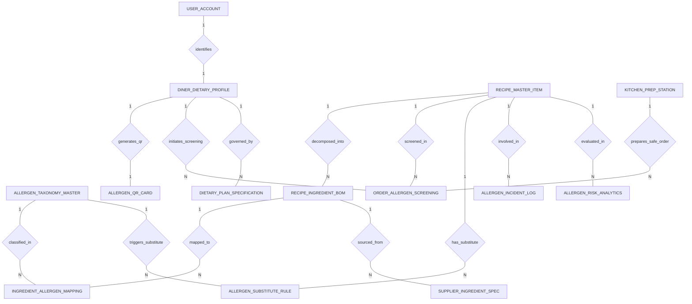

# Conceptual ERD — Dietary Restriction & Allergen Tracking System

## Mermaid Code

## Entity Description Table | Bang mo ta Entity

| # | Entity Name | Vietnamese Name | Description | Key Attributes | Main Relationships |
|---|-------------|-----------------|-------------|----------------|-------------------|
| 1 | DINER_DIETARY_PROFILE | Ho so di ung thuc khach | Customer dietary profile recording food allergies, severity levels (Anaphylactic, Severe), medical categories, and timestamp. | profile_id, user_id, guest_name, severity_level, Medical_diet_category, updated_at | Belongs to USER_ACCOUNT; One-to-Many with ORDER_ALLERGEN_SCREENING, DIETARY_PLAN_SPECIFICATION; One-to-One with ALLERGEN_QR_CARD |
| 2 | ALLERGEN_TAXONOMY_MASTER | Danh muc di ung FDA Big9 | Master taxonomy defining official Big 9 food allergens (Peanuts, Tree Nuts, Milk, Eggs, Fish, Crustaceans, Wheat, Soy, Sesame) and safety thresholds ppm. | allergen_id, allergen_code, allergen_name, fda_big9_category, safety_threshold_ppm | One-to-Many with INGREDIENT_ALLERGEN_MAPPING, ALLERGEN_SUBSTITUTE_RULE |
| 3 | RECIPE_MASTER_ITEM | Mon an va cong thuc master | Master recipe item record, recipe code, dish name, menu category, and allergen risk indicator flag. | recipe_id, recipe_code, dish_name, menu_category, has_allergen_risk | One-to-Many with RECIPE_INGREDIENT_BOM, ORDER_ALLERGEN_SCREENING, ALLERGEN_SUBSTITUTE_RULE, ALLERGEN_INCIDENT_LOG, ALLERGEN_RISK_ANALYTICS |
| 4 | RECIPE_INGREDIENT_BOM | Dinh muc nguyen lieu raw | Recipe Bill of Materials (BOM) decomposition breaking dishes into raw ingredients, quantities in grams, and optional flags. | bom_id, recipe_id, raw_ingredient_name, quantity_grams, is_optional | Belongs to RECIPE_MASTER_ITEM; One-to-Many with INGREDIENT_ALLERGEN_MAPPING, SUPPLIER_INGREDIENT_SPEC |
| 5 | INGREDIENT_ALLERGEN_MAPPING | Anh xa nguyen lieu voi di ung | Mapping record associating raw ingredients with specific allergen taxonomy IDs, trace concentrations ppm, and cross-contact risk flags. | mapping_id, bom_id, allergen_id, trace_concentration_ppm, is_cross_contact_risk | Belongs to RECIPE_INGREDIENT_BOM, ALLERGEN_TAXONOMY_MASTER |
| 6 | SUPPLIER_INGREDIENT_SPEC | Giay chung nhan nha cung cap | Supplier ingredient specification sheet auditing Certificate of Analysis (CoA) document refs, Big 9 contents, and expiry dates. | spec_id, supplier_name, product_code, coa_document_ref, contains_big9, spec_expiry_date | Belongs to RECIPE_INGREDIENT_BOM |
| 7 | ORDER_ALLERGEN_SCREENING | Nhat ky quet di ung don hang | Real-time POS order screening log matching guest profiles with recipe allergen flags, recording collision status and timestamp. | screening_id, profile_id, recipe_id, pos_order_ref, collision_status, screened_at | Belongs to DINER_DIETARY_PROFILE, RECIPE_MASTER_ITEM, KITCHEN_PREP_STATION |
| 8 | ALLERGEN_SUBSTITUTE_RULE | Quy tac thay the nguyen lieu | Safe ingredient substitution rules defining replacement ingredient names and cost adjustments for restricted allergens. | rule_id, recipe_id, allergen_id, substitute_ingredient_name, cost_adjustment | Belongs to RECIPE_MASTER_ITEM, ALLERGEN_TAXONOMY_MASTER |
| 9 | KITCHEN_PREP_STATION | Tram che bien cach ly | Kitchen prep station configuration record detailing dedicated allergen-free status, color-code protocols (Purple), and status. | station_id, station_name, is_dedicated_allergen_free, color_code_protocol, station_status | One-to-Many with ORDER_ALLERGEN_SCREENING |
| 10 | ALLERGEN_INCIDENT_LOG | Nhat ky su co di ung | Safety audit log capturing food allergen reaction incidents, reaction severity, root cause notes, and corrective actions. | incident_id, recipe_id, incident_date, reaction_severity, root_cause_notes, corrective_action | Belongs to RECIPE_MASTER_ITEM |
| 11 | DIETARY_PLAN_SPECIFICATION | Quy tac che do an y te | Structured medical dietary plan parameters defining sodium limits, carbohydrate limits, and strict Celiac rules. | plan_id, profile_id, plan_name, max_sodium_mg, max_carbs_g, is_celiac_strict | Belongs to DINER_DIETARY_PROFILE |
| 12 | ALLERGEN_QR_CARD | The QR di ung khach | Encrypted digital QR code token card generated for diners to present to servers or table tablets to communicate allergy profiles. | card_id, profile_id, qr_token_hash, expires_at, is_active | One-to-One with DINER_DIETARY_PROFILE |
| 13 | USER_ACCOUNT | Tai khoan he thong | Core security authentication account holding credentials, password hashes, and user role definitions. | user_id, username, password_hash, role_name | One-to-One with DINER_DIETARY_PROFILE |
| 14 | ALLERGEN_RISK_ANALYTICS | Thong ke rui ro di ung | Executive daily analytics tracking total order screenings, allergen collisions blocked, safety incidents logged, and compliance scores. | analytics_id, metric_date, total_screenings_count, allergen_collisions_blocked, compliance_score_percent | Evaluates RECIPE_MASTER_ITEM |

## Relationship Description | Mo ta Quan he

| # | From Entity | Cardinality | To Entity | Relationship Label | Business Explanation |
|---|-------------|-------------|-----------|-------------------|----------------------|
| 1 | USER_ACCOUNT | One-to-One | DINER_DIETARY_PROFILE | identifies | Tai khoan he thong dinh danh ho so di ung va che do an y te cua khach. |
| 2 | DINER_DIETARY_PROFILE | One-to-Many | ORDER_ALLERGEN_SCREENING | initiates_screening | Ho so di ung thuc khach duoc dua vao thuat toan quet don hang POS thoi gian thuc. |
| 3 | DINER_DIETARY_PROFILE | One-to-Many | DIETARY_PLAN_SPECIFICATION | governed_by | Ho so khach duoc quan ly bang cac quy tac che do an y te (Celiac, Low-Sodium). |
| 4 | DINER_DIETARY_PROFILE | One-to-One | ALLERGEN_QR_CARD | generates_qr | Ho so di ung tao ra mot the QR ky thuat so ma hoa de truyen tai thong tin di ung. |
| 5 | RECIPE_MASTER_ITEM | One-to-Many | RECIPE_INGREDIENT_BOM | decomposed_into | Mot mon an master duoc bieu dien thanh bang dinh muc nguyen lieu raw chi tiet. |
| 6 | RECIPE_INGREDIENT_BOM | One-to-Many | INGREDIENT_ALLERGEN_MAPPING | mapped_to | Nguyen lieu raw duoc anh xa voi cac ma di ung trong danh muc FDA Big 9. |
| 7 | ALLERGEN_TAXONOMY_MASTER | One-to-Many | INGREDIENT_ALLERGEN_MAPPING | classified_in | Danh muc di ung FDA Big 9 phan loai va dinh nghia cac ma di ung nguyen lieu. |
| 8 | RECIPE_INGREDIENT_BOM | One-to-Many | SUPPLIER_INGREDIENT_SPEC | sourced_from | Nguyen lieu raw duoc doi chieu voi giay phan tich (CoA) cua nha cung cap. |
| 9 | RECIPE_MASTER_ITEM | One-to-Many | ORDER_ALLERGEN_SCREENING | screened_in | Mon an duoc quet va doi chieu rui ro di ung trong don hang POS. |
| 10 | RECIPE_MASTER_ITEM | One-to-Many | ALLERGEN_SUBSTITUTE_RULE | has_substitute | Mon an co cac quy tac thay the nguyen lieu an toan khi khach bi di ung. |
| 11 | ALLERGEN_TAXONOMY_MASTER | One-to-Many | ALLERGEN_SUBSTITUTE_RULE | triggers_substitute | Ma di ung bi cấm kich hoat quy tac tim nguyen lieu thay the tuong ung. |
| 12 | RECIPE_MASTER_ITEM | One-to-Many | ALLERGEN_INCIDENT_LOG | involved_in | Mon an co the duoc ghi nhan trong cac nhat ky su co va phan ứng di ung. |
| 13 | KITCHEN_PREP_STATION | One-to-Many | ORDER_ALLERGEN_SCREENING | prepares_safe_order | Tram che bien cach ly an toan thuc hien che bien don hang di ung theo quy trinh. |
| 14 | RECIPE_MASTER_ITEM | One-to-Many | ALLERGEN_RISK_ANALYTICS | evaluated_in | Cac mon an va luot quet duoc thong ke va danh gia rui ro an toan dinh ky. |
