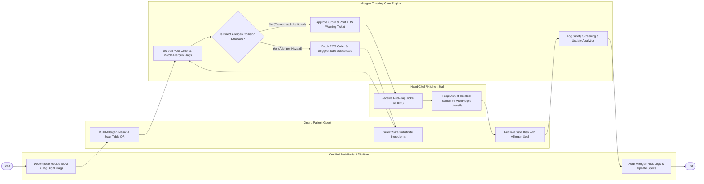

# Swimlane Diagram — Dietary Restriction & Allergen Tracking System

## Mermaid Code

## Flow Description | Mo ta luong

| Lane | Actor | Role in Flow |
|------|-------|-------------|
| **Lane 1** | Diner / Patient Guest | Builds personal allergen profile (Big 9), scans table QR code menu, selects safe ingredient substitutes, and receives allergen-sealed dishes. |
| **Lane 2** | Head Chef / Kitchen Staff | Receives red-flag warning tickets on kitchen KDS displays, prepares allergen orders at dedicated isolated stations using purple utensils, and attaches safety seals. |
| **Lane 3** | Certified Nutritionist / Dietitian | Decomposes recipe BOMs into sub-ingredients, tags FDA/USDA allergen flags, audits supplier specification sheets, and updates safety matrices. |
| **Lane 4** | Allergen Tracking Core Engine | Performs real-time order screening against diner allergen profiles, detects collisions, blocks unsafe orders, generates safe substitutes, and prints KDS warning tickets. |

### Process Execution Steps | Cac buoc thuc hien quy trinh

1. **Recipe Mapping & Profile Setup**: Dietitian maps recipe BOMs to FDA Big 9 allergen flags (`H1`). Diner builds allergen profile and scans table QR code (`C1`).
2. **Real-Time Screening & Collision Check**: Core Engine screens POS order selections against diner profile (`S1`) and evaluates allergen collision status (`S2`).
   - If **Yes (Allergen Hazard)**: Core Engine blocks order and returns safe substitution options (`S3`). Diner selects safe substitute (`C2`), and Core Engine re-screens order (`S1`).
   - If **No (Cleared or Substituted)**: Core Engine approves order and prints red-flag KDS warning ticket (`S4`).
3. **Isolated Kitchen Execution**: Kitchen Chef receives KDS warning ticket (`K1`), cooks meal at dedicated isolated Station #4 using purple color-coded utensils (`K2`), and hands safe dish to diner (`C3`).
4. **Compliance Logging & Audit**: Core Engine logs safety screening data (`S5`), and Dietitian audits allergen compliance reports (`H2`), completing execution (`Finish`).
