# Action Tree — Dietary Restriction & Allergen Tracking System

## Mermaid Code

```mermaid
graph TD
    Root["Dietary Restriction & Allergen Tracking System"]

    Root --> M1["Diner Profiles & Medical Dietary Plans"]
    Root --> M2["Recipe Ingredient Allergen Mapping & BOMs"]
    Root --> M3["Real-Time Order Screening & Cross-Contamination Alerts"]
    Root --> M4["Allergen-Safe Substitutions & Station Isolation"]
    Root --> M5["Supplier Spec Audits & Barcode Scanner Integration"]
    Root --> M6["Incident Logging & Regulatory Compliance Reports"]
    Root --> M7["Allergen Risk Analytics & System Security"]

    M1 --> A11["Build FDA Big 9 Allergen Matrices"]
    M1 --> A12["Configure Medical Dietary Plans Celiac Low-FODMAP"]
    M1 --> A13["Generate Encrypted Allergen QR Code Cards"]
    M1 --> A14["Ingest Patient Medical Allergy Data from EHR APIs"]

    M2 --> A21["Decompose Master Recipes into Sub-Ingredient BOMs"]
    M2 --> A22["Tag FDA Big 9 Allergen Flags down to 0.1ppm"]
    M2 --> A23["Sync USDA FDA Allergen Taxonomy Databases"]
    M2 --> A24["Identify Shared Equipment Cross-Contact Risks"]

    M3 --> A31["Screen POS Order Lines against Guest Profiles"]
    M3 --> A32["Block POS Orders with Direct Allergen Collisions"]
    M3 --> A33["Print Red-Flag Allergen Tickets on Kitchen KDS"]
    M3 --> A34["Require Manager Override for High-Risk Orders"]

    M4 --> A41["Generate Allergen-Safe Substitute Recipes"]
    M4 --> A42["Cross-Screen Substitutes against Complete Profiles"]
    M4 --> A43["Enforce Dedicated Isolated Prep Stations"]
    M4 --> A44["Mandate Purple Utensil Color-Code Protocols"]

    M5 --> A51["Audit Supplier Certificate of Analysis CoA Specs"]
    M5 --> A52["Scan Packaged Product Barcodes for Hidden Traces"]
    M5 --> A53["Flag Supplier Spec Expiration Alerts"]
    M5 --> A54["Track Supply Chain Sub-Ingredient Changes"]

    M6 --> A61["Log Food Allergen Reaction Safety Incidents"]
    M6 --> A62["Export Menu Matrix Compliance for Health Inspectors"]
    M6 --> A63["Track Anaphylaxis Emergency Response Protocols"]
    M6 --> A64["Generate Kitchen Sanitation Verification Logs"]

    M7 --> A71["Monitor Store Allergen Collision Block Trends"]
    M7 --> A72["Analyze Kitchen Prep Station Compliance Scores"]
    M7 --> A73["Manage User Roles & Security Access Levels"]
    M7 --> A74["Manage POS API Tokens & EHR Gateway Keys"]
```

## Module Description | Mo ta Module

| # | Module | Description | Actions |
|---|--------|-------------|---------|
| 1 | Diner Profiles & Medical Dietary Plans | Manages customer allergen matrices (FDA Big 9), medical diet plans (Celiac, Low-FODMAP, Renal), digital QR cards, and hospital EHR API integrations. | Build FDA Big 9 Allergen Matrices, Configure Medical Dietary Plans Celiac Low-FODMAP, Generate Encrypted Allergen QR Code Cards, Ingest Patient Medical Allergy Data from EHR APIs |
| 2 | Recipe Ingredient Allergen Mapping & BOMs | Decomposes master recipes into sub-ingredient BOMs, maps FDA Big 9 allergen flags, syncs USDA taxonomies, and identifies shared equipment risks. | Decompose Master Recipes into Sub-Ingredient BOMs, Tag FDA Big 9 Allergen Flags down to 0.1ppm, Sync USDA FDA Allergen Taxonomy Databases, Identify Shared Equipment Cross-Contact Risks |
| 3 | Real-Time Order Screening & Cross-Contamination Alerts | Screens POS order items against guest profiles, blocks direct allergen collisions, prints red-flag KDS tickets, and enforces manager overrides. | Screen POS Order Lines against Guest Profiles, Block POS Orders with Direct Allergen Collisions, Print Red-Flag Allergen Tickets on Kitchen KDS, Require Manager Override for High-Risk Orders |
| 4 | Allergen-Safe Substitutions & Station Isolation | Generates safe ingredient substitution options, enforces dedicated isolated kitchen prep stations, and mandates purple color-coded utensils. | Generate Allergen-Safe Substitute Recipes, Cross-Screen Substitutes against Complete Profiles, Enforce Dedicated Isolated Prep Stations, Mandate Purple Utensil Color-Code Protocols |
| 5 | Supplier Spec Audits & Barcode Scanner Integration | Audits supplier ingredient Certificate of Analysis (CoA) sheets, scans commercial barcodes for hidden allergens, and tracks supply chain changes. | Audit Supplier Certificate of Analysis CoA Specs, Scan Packaged Product Barcodes for Hidden Traces, Flag Supplier Spec Expiration Alerts, Track Supply Chain Sub-Ingredient Changes |
| 6 | Incident Logging & Regulatory Compliance Reports | Logs food allergen reaction incidents, exports menu compliance reports for health inspectors, and records kitchen sanitization logs. | Log Food Allergen Reaction Safety Incidents, Export Menu Matrix Compliance for Health Inspectors, Track Anaphylaxis Emergency Response Protocols, Generate Kitchen Sanitation Verification Logs |
| 7 | Allergen Risk Analytics & System Security | Provides executive reporting on allergen collision trends, prep station compliance scores, user security roles, and POS/EHR integration API keys. | Monitor Store Allergen Collision Block Trends, Analyze Kitchen Prep Station Compliance Scores, Manage User Roles & Security Access Levels, Manage POS API Tokens & EHR Gateway Keys |
