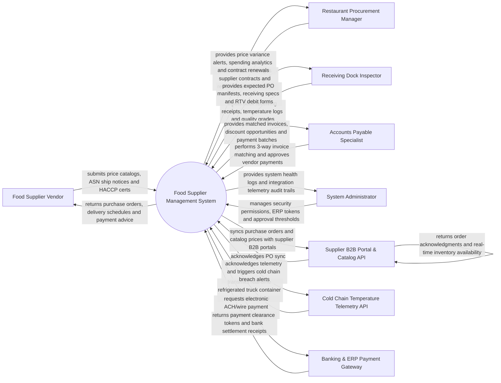

# Context Diagram — Food Supplier Management System

## Mermaid Code

## Actor & Interaction Table | Bang Actor & Tuong tac

| # | Actor | Actor Type | Data Sent TO System | Data Received FROM System | Notes |
|---|-------|------------|---------------------|---------------------------|-------|
| 1 | Food Supplier Vendor | Primary | Wholesale price catalogs, Advance Shipping Notices (ASN), HACCP/ISO food safety certificates, invoices | Electronic Purchase Orders (PO), delivery slot confirmations, remittance advice | External commercial food distributor (e.g., Sysco, US Foods, Local Organic Farms). |
| 2 | Restaurant Procurement Manager | Primary | Purchase orders, supplier contract terms, RFP bidding requests, SLA evaluation criteria | Supplier performance scorecards, purchase price variance alerts, procurement analytics | Oversees corporate sourcing, supplier negotiations, and purchasing contracts. |
| 3 | Receiving Dock Inspector | Primary | Receiving dock receipts, delivered temperature logs, freshness inspections, RTV claims | Expected PO delivery manifests, receiving quality specifications, RTV debit forms | Inspects incoming food shipments at warehouse/restaurant receiving docks. |
| 4 | Accounts Payable Specialist | Primary | Supplier invoices, payment approvals, 3-way match overrides, early payment discount selections | Matched PO-Receiving-Invoice batches, vendor aging reports, payment disbursement files | Manages vendor billing reconciliation, invoice matching, and AP disbursements. |
| 5 | System Administrator | Primary | User credentials, security role policies, ERP integration tokens, approval limits | System health metrics, integration telemetry logs, security audit trails | Manages software infrastructure, system settings, and security permissions. |
| 6 | Supplier B2B Portal & Catalog API | Supporting | Electronic catalog price matrices, stock availability feeds, PO acknowledgments | Automated purchase orders (EDI 850 / API), PO revision requests | Integrates with supplier ERP/EDI systems for automated purchase order routing. |
| 7 | Cold Chain Temperature Telemetry API | Supporting | Continuous transit container temperature logs (e.g., 2°C - 4°C), GPS transit coordinates | Telemetry acknowledgments, temperature breach thresholds | Ingests IoT temperature sensor pings from refrigerated delivery trucks. |
| 8 | Banking & ERP Payment Gateway | Supporting | Electronic ACH clearance tokens, wire transfer confirmations, bank receipts | Vendor payment disbursement batches, electronic remittance instructions | Executes electronic funds transfers (ACH, Wire) to vendor bank accounts. |

## System Boundary Description | Mo ta Pham vi He thong

The **Food Supplier Management System** manages wholesale food procurement, supplier onboarding, food safety compliance, receiving dock inspections, cold chain tracking, 3-way invoice matching, and supplier performance scorecards. Inside its boundary, the system handles purchase order creation, wholesale price matrix management, HACCP certificate expiration tracking, dock receiving temperature validation, Return-to-Vendor (RTV) debit memo generation, automated 3-way matching (PO vs Receiving Receipt vs Invoice), and supplier SLA performance rating (On-Time Delivery, Quality Yield, Price Compliance).

The system boundary excludes physical unloading of trucks, physical food cooking, bank wire clearing (handled by Banking Gateways), and physical farming operations.
