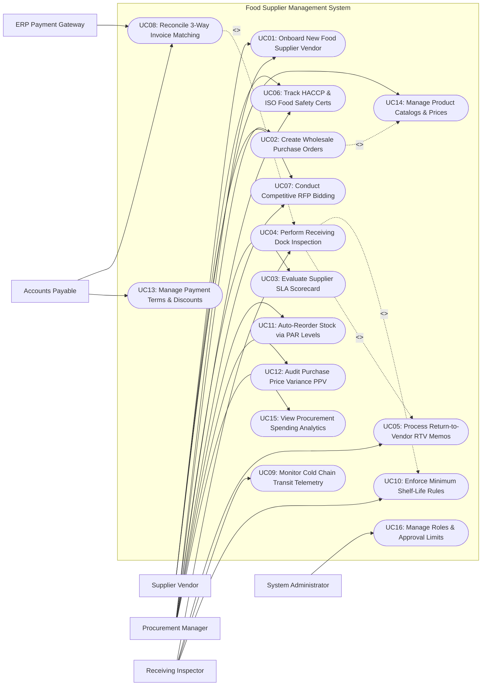

# Use Case Diagram — Food Supplier Management System

## Mermaid Code

## Actor Table | Bang Actor

| # | Actor | Actor Type | Role Description | Related Use Cases |
|---|-------|------------|------------------|-------------------|
| 1 | ERP Payment Gateway | Secondary System | External banking and enterprise payment system executing ACH/wire disbursements for matched vendor invoices. | UC08 |
| 2 | Supplier Vendor | Primary | Commercial food distributor submitting wholesale price catalogs, HACCP certificates, RFP quotes, and Advance Shipping Notices. | UC01, UC06, UC07, UC14 |
| 3 | Receiving Inspector | Primary | Warehouse dock staff inspecting incoming food deliveries, measuring food temperatures, verifying PO quantities, and issuing RTV claims. | UC04, UC05, UC09, UC10 |
| 4 | Procurement Manager | Primary | Sourcing lead managing vendor onboarding, PO generation, RFP bidding, SLA performance scorecards, and price variance audits. | UC01, UC02, UC03, UC06, UC07, UC11, UC12, UC15 |
| 5 | Accounts Payable | Primary | Financial specialist performing 3-way invoice matching, managing vendor payment terms, and authorizing AP disbursements. | UC08, UC13 |
| 6 | System Administrator | Primary | Technical manager configuring security roles, procurement authorization dollar thresholds, API keys, and audit logs. | UC16 |

## Use Case Table | Bang Use Case

| # | UC ID | Use Case Name | Primary Actor | Secondary Actor | Description | Priority |
|---|-------|---------------|---------------|-----------------|-------------|----------|
| 1 | UC01 | Onboard New Food Supplier Vendor | Procurement Manager | Supplier Vendor | Onboards new food vendors, verifying business licenses, tax IDs, banking details, insurance coverage, and food safety credentials. | High |
| 2 | UC02 | Create Wholesale Purchase Orders | Procurement Manager | None | Generates electronic purchase orders (PO) specifying item SKUs, ordered quantities, contracted unit prices, and delivery dates. | High |
| 3 | UC03 | Evaluate Supplier SLA Scorecard | Procurement Manager | None | Automatically calculates supplier performance ratings (On-Time Delivery %, Quality Acceptance Rate %, Price Compliance %). | High |
| 4 | UC04 | Perform Receiving Dock Inspection | Receiving Inspector | None | Inspects incoming food shipments at receiving dock, measuring food temperatures (e.g., Cold <= 4°C), expiration dates, and physical condition. | High |
| 5 | UC05 | Process Return-to-Vendor RTV Memos | Receiving Inspector | None | Generates Return-to-Vendor (RTV) debit memos for damaged, warm, expired, or rejected food items, deducting charges from invoices. | High |
| 6 | UC06 | Track HACCP & ISO Food Safety Certs | Procurement Manager | Supplier Vendor | Tracks supplier food safety certifications (HACCP, ISO 22000, GlobalGAP), flagging alerts before certificates expire. | High |
| 7 | UC07 | Conduct Competitive RFP Bidding | Procurement Manager | Supplier Vendor | Issues electronic Request for Proposals (RFP) to multiple suppliers, comparing competitive bids for key raw food categories. | Medium |
| 8 | UC08 | Reconcile 3-Way Invoice Matching | Accounts Payable | ERP Payment Gateway | Performs automated 3-way matching between Purchase Order, Receiving Dock Receipt, and Supplier Invoice before approving payment. | High |
| 9 | UC09 | Monitor Cold Chain Transit Telemetry | Receiving Inspector | None | Monitors real-time refrigerated delivery truck container temperature sensor logs, flagging temperature breaches in transit. | High |
| 10 | UC10 | Enforce Minimum Shelf-Life Rules | Receiving Inspector | None | Rejects incoming packaged food items failing the "70% Remaining Shelf-Life" rule upon receiving dock inspection. | High |
| 11 | UC11 | Auto-Reorder Stock via PAR Levels | Procurement Manager | None | Automatically triggers purchase order requisitions when warehouse ingredient inventory levels drop below minimum PAR safety thresholds. | High |
| 12 | UC12 | Audit Purchase Price Variance PPV | Procurement Manager | None | Compares actual invoiced prices against contracted PO master prices, detecting supplier price inflation or unauthorized cost spikes. | High |
| 13 | UC13 | Manage Payment Terms & Discounts | Accounts Payable | None | Manages vendor payment terms (e.g., Net 30, 2/10 Net 30) and calculates early payment cash discount opportunities. | Medium |
| 14 | UC14 | Manage Product Catalogs & Prices | Supplier Vendor | None | Maintains vendor wholesale product catalogs, unit of measure conversions (Cases vs Lbs), and tiered volume pricing matrices. | High |
| 15 | UC15 | View Procurement Spending Analytics | Procurement Manager | None | Displays analytical dashboards on total category spending, supplier market concentration, price inflation trends, and SLA compliance. | High |
| 16 | UC16 | Manage Roles & Approval Limits | System Admin | None | Configures user security roles, PO approval dollar limits (e.g., Buyer <= $5k, Manager <= $50k), and system audit logging policies. | High |

## Use Case Specification | Dac ta Use Case

---

### UC01 — Onboard New Food Supplier Vendor

| Field | Detail |
|-------|--------|
| **UC ID** | UC01 |
| **Use Case Name** | Onboard New Food Supplier Vendor |
| **Actor(s)** | Primary: Procurement Manager   Secondary: Supplier Vendor |
| **Description** | Onboards a new food supplier vendor into the system, capturing company profiles, tax IDs (W-9 / FEIN), bank ACH details, product category coverage, liability insurance, and mandatory food safety certifications. |
| **Precondition** | 1. Procurement Manager has user account with Vendor Management privileges.   2. Supplier onboarding portal module is active. |
| **Main Flow** | 1. Procurement Manager dispatches an "Online Vendor Onboarding Invitation" link to the supplier contact email.   2. Supplier Vendor opens portal link and completes Business Registration Profile:      - Legal Company Name & DBA      - Federal Tax ID (FEIN / W-9 Form)      - Corporate Address & Warehouse Distribution Locations      - Key Contacts: Sales Manager, Accounts Receivable, Quality Assurance      - Banking Details for Direct ACH Payment (Bank Name, Routing Number, Account Number).   3. Vendor uploads mandatory Compliance Certificates:      - Commercial General Liability Insurance Certificate (Minimum $2.0 Million Coverage)      - HACCP / ISO 22000 / GFSI Food Safety Audit Certificate (UC06)      - Organic / Halal / Kosher Certificates (if applicable).   4. Vendor inputs offered Product Categories (Produce, Dairy, Seafood, Meats, Dry Goods) and default payment terms (e.g., Net 30).   5. System performs automated validation checks (verifying FEIN format, insurance expiration dates, and bank routing numbers).   6. Procurement Manager reviews vendor submission, inspects food safety documents, and taps "Approve Vendor Onboarding".   7. System assigns unique Vendor ID (e.g., #VEN-409), activates supplier status to `Active / Qualified`, and issues B2B portal login credentials (UC14). |
| **Alternative Flow** | **AF1** — Provisional onboarding for emergency supplier:   1. Manager selects "Provisional 30-Day Onboarding" for an urgent spot-market ingredient purchase.   2. System activates vendor for 30 days while full insurance documentation is processed. |
| **Exception Flow** | **EX1** — Expired food safety certificate submission:   1. At step 5, System detects uploaded HACCP Certificate expired 30 days prior.   2. System flags validation error "Expired HACCP Certificate", blocks approval, and dispatches correction request to vendor. |
| **Postcondition** | Food supplier vendor is onboarded, verified compliance documents are archived, and Vendor ID is activated. |
| **Business Rule** | **BR1**: Food suppliers CANNOT be approved for PO issuance without an active, verified food safety audit certificate (HACCP/GFSI) and current liability insurance.   **BR2**: Supplier banking ACH details require mandatory secondary approval by Accounts Payable before first payment execution. |

---

### UC02 — Create Wholesale Purchase Orders

| Field | Detail |
|-------|--------|
| **UC ID** | UC02 |
| **Use Case Name** | Create Wholesale Purchase Orders |
| **Actor(s)** | Primary: Procurement Manager   Secondary: None |
| **Description** | Generates formal electronic Purchase Orders (PO) specifying ordered raw food items, case quantities, contracted wholesale unit prices, delivery dock locations, and required delivery dates. |
| **Precondition** | 1. Active, qualified food supplier vendor (UC01) is selected.   2. Master product price catalog (UC14) is active. |
| **Main Flow** | 1. Procurement Manager opens "Purchase Order Workbench" or approves automated PAR reorder requisition (UC11).   2. Manager selects Target Vendor (e.g., Sysco Foods #VEN-102) and Receiving Warehouse Dock (e.g., Central Kitchen Dock #1).   3. Manager sets Requested Delivery Date & Time Window (e.g., July 20th between 6:00 AM - 9:00 AM).   4. Manager adds PO Line Items:      - Line 1: USDA Choice Beef Ribeye (SKU #MEAT-881) — 20 Cases @ $180.00/case = $3,600.00      - Line 2: Heavy Whipping Cream 40% (SKU #DAIRY-402) — 15 Cases @ $45.00/case = $675.00      - Line 3: Organic Hass Avocados (SKU #PROD-109) — 30 Lug Crates @ $32.00/crate = $960.00.   5. System calculates PO Total Amount: `$3,600.00 + $675.00 + $960.00 = $5,235.00`.   6. System checks Manager's Approval Dollar Limit (e.g., Manager Limit = $10,000.00 >= $5,235.00).   7. Manager clicks "Approve & Transmit PO".   8. System generates Purchase Order Document (PO #PO-90221) and transmits electronic payload via API / EDI 850 / Email to Supplier B2B Portal.   9. System records PO status as `Issued / Awaiting Supplier Confirmation` and dispatches expected delivery manifest to Receiving Dock (UC04). |
| **Alternative Flow** | **AF1** — High-dollar PO requiring secondary approval:   1. PO Total Amount is $65,000.00 (exceeds Manager Limit $10,000.00).   2. System routes PO to VP of Supply Chain queue for secondary digital approval. |
| **Exception Flow** | **EX1** — Discrepancy with contracted catalog price:   1. At step 4, Manager inputs Ribeye price as $195.00/case, but contracted catalog price is $180.00/case (UC12).   2. System flags Purchase Price Variance warning "Exceeds Contract Price by +8.3%", requiring price variance justification note. |
| **Postcondition** | Electronic PO is generated, approved, transmitted to supplier, and expected delivery manifest is logged. |
| **Business Rule** | **BR1**: Purchase orders must enforce system user authorization dollar limits before electronic transmission.   **BR2**: Contracted wholesale catalog prices must automatically default on PO line items to prevent unauthorized price inflation. |

---

### UC03 — Evaluate Supplier SLA Scorecard

| Field | Detail |
|-------|--------|
| **UC ID** | UC03 |
| **Use Case Name** | Evaluate Supplier SLA Scorecard |
| **Actor(s)** | Primary: Procurement Manager   Secondary: None |
| **Description** | Automatically calculates monthly supplier performance SLA scorecards based on empirical receiving data across 3 weighted metrics: On-Time Delivery %, Quality Acceptance Rate %, and Contract Price Compliance %. |
| **Precondition** | 1. Receiving dock inspection logs (UC04) and RTV debit memos (UC05) for evaluation period are complete.   2. Supplier SLA weighting parameters are defined. |
| **Main Flow** | 1. System executes automated monthly "Supplier SLA Scorecard Batch" at end of month.   2. For each active supplier vendor (e.g., Sysco Foods #VEN-102), System compiles performance data across 3 core metrics:      - Metric 1: **On-Time Delivery Performance (Weight: 40%)**        * Total Deliveries Expected: 50 Shipments        * Delivered On-Time within Time Window: 47 Shipments -> Score: 94.0%.      - Metric 2: **Quality & Condition Acceptance Rate (Weight: 40%)**        * Total Cases Received: 1,500 Cases        * Cases Accepted without RTV Defect: 1,470 Cases -> Score: 98.0%.      - Metric 3: **Contract Price Compliance Rate (Weight: 20%)**        * Invoiced Prices Matching PO Contract: 100% -> Score: 100.0%.   3. System calculates Weighted Overall Supplier SLA Score: `(94.0% * 0.40) + (98.0% * 0.40) + (100.0% * 0.20) = 37.6% + 39.2% + 20.0% = 96.8% (Grade A - Preferred Supplier)`.   4. System assigns SLA Performance Tier Grade:      - Grade A (>= 95.0%): Preferred Supplier (Eligible for contract renewal & volume bonuses)      - Grade B (85.0% - 94.9%): Satisfactory Supplier      - Grade C (< 85.0%): Underperforming (Triggers mandatory Quality Corrective Action Request).   5. System generates Supplier SLA Scorecard PDF and dispatches report to Supplier B2B Portal and Procurement Manager dashboard. |
| **Alternative Flow** | **AF1** — Automated probation flag for Grade C suppliers:   1. Vendor receives Grade C score (78.5%) for 2 consecutive months.   2. System automatically flags vendor status as `Probationary / Hold New POs` and prompts manager audit. |
| **Exception Flow** | **EX1** — Supplier SLA score appeal:   1. Vendor disputes On-Time Delivery score, citing documented severe blizzard weather delay.   2. Procurement Manager reviews weather exception waiver, adjusts delivery window timestamp, and recalculates SLA score. |
| **Postcondition** | Supplier monthly SLA scorecard is calculated, performance grade is assigned, and vendor status is updated. |
| **Business Rule** | **BR1**: Supplier SLA scorecards must be calculated using 100% empirical receiving dock inspection and invoice matching data.   **BR2**: Suppliers falling below 85.0% SLA score for 2 consecutive cycles must trigger mandatory Corrective Action Plan (CAP) reviews. |

---

### UC04 — Perform Receiving Dock Inspection

| Field | Detail |
|-------|--------|
| **UC ID** | UC04 |
| **Use Case Name** | Perform Receiving Dock Inspection |
| **Actor(s)** | Primary: Receiving Dock Inspector   Secondary: None |
| **Description** | Inspects incoming raw food shipments upon arrival at receiving dock, measuring internal food temperatures, verifying expiration dates against 70% shelf-life rules, checking case counts against PO, and logging quality approvals or rejections. |
| **Precondition** | 1. Expected PO delivery manifest (UC02) is loaded on receiving dock tablet.   2. Calibrated digital probe thermometer and barcode scanner are active. |
| **Main Flow** | 1. Delivery truck arrives at warehouse dock; Receiving Inspector opens expected PO record (e.g., PO #PO-90221 from Sysco Foods).   2. Inspector checks delivery truck container temperature telemetry and verifies clean, odor-free trailer condition.   3. Inspector scans case barcodes and inspects delivered items line by line:      - Line 1: USDA Choice Beef Ribeye (Expected: 20 Cases)        * Inspector inserts calibrated probe thermometer into 3 sample cases: Temperatures = 2.8°C, 3.1°C, 2.9°C (**PASSED: Cold Holding <= 4.0°C**).        * Inspector checks Expiration Date: Expiry = Sept 30, 2026 (75 days remaining > 70% requirement -> **PASSED**).        * Quantity Delivered: 20 Cases (**PASSED**).      - Line 2: Heavy Whipping Cream (Expected: 15 Cases)        * Inspector measures temperature: Temp = 8.5°C (**FAILED: Temperature Danger Zone > 4.0°C!**).   4. Inspector marks Line 2 Whipping Cream as `REJECTED — Temperature Danger Zone Breach (8.5°C)`.   5. System automatically generates Return-to-Vendor (RTV) Debit Memo for 15 Cases of Whipping Cream ($675.00) (UC05).   6. Inspector accepts Line 1 (Ribeye) and Line 3 (Avocados), captures digital driver signature on tablet, and taps "Complete Dock Receiving".   7. System updates inventory stock balances for accepted items and posts Receiving Dock Receipt to Accounts Payable for 3-way matching (UC08). |
| **Alternative Flow** | **AF1** — Short shipment receipt:   1. Vendor delivers 15 cases of Avocados instead of 30 cases ordered.   2. Inspector logs "Partial Receipt: 15 Received, 15 Short", and System updates PO line status to `Partial Delivery`. |
| **Exception Flow** | **EX1** — Severe pest damage or rotten product:   1. Inspector discovers severe mold / pest contamination in fresh produce pallets.   2. Inspector rejects entire shipment, takes photo evidence on tablet, logs `CRITICAL QUALITY REJECTION`, and dispatches urgent alert to Procurement Manager. |
| **Postcondition** | Accepted items are added to inventory stock, rejected items generate RTV debit memos, and Receiving Dock Receipt is posted. |
| **Business Rule** | **BR1**: Perishable refrigerated food items exceeding 4.0°C internal temperature upon dock arrival MUST be rejected.   **BR2**: Received packaged goods MUST have at least 70% of total manufacturer shelf-life remaining upon dock inspection date. |

---

### UC08 — Reconcile 3-Way Invoice Matching

| Field | Detail |
|-------|--------|
| **UC ID** | UC08 |
| **Use Case Name** | Reconcile 3-Way Invoice Matching |
| **Actor(s)** | Primary: Accounts Payable Specialist   Secondary: ERP Payment Gateway |
| **Description** | Performs automated 3-way reconciliation comparing Purchase Order details, Receiving Dock Receipts, and Supplier Invoices, verifying price and quantity matches before approving electronic payment disbursements. |
| **Precondition** | 1. Approved PO (UC02) and Receiving Dock Receipt (UC04) are loaded in system.   2. Supplier Invoice has been ingested via EDI, OCR, or B2B portal. |
| **Main Flow** | 1. Supplier Invoice (Invoice #INV-77102 from Sysco Foods) is ingested into system.   2. System initiates Automated 3-Way Match Algorithm comparing 3 documents:      - Document 1: Original Purchase Order (#PO-90221)      - Document 2: Receiving Dock Receipt (#REC-4099)      - Document 3: Supplier Invoice (#INV-77102).   3. System matches line items across 3 dimensions:      - Item SKU & Description Match: `100% Match`      - Quantity Match: PO Ordered 20 Cases Ribeye; Dock Received 20 Cases; Invoice Billed 20 Cases (`100% Match`).      - Price Match: PO Unit Price $180.00/case; Invoice Billed Price $180.00/case (`100% Match`).   4. System checks RTV Debit Deductions: RTV Debit Memo #RTV-102 (-$675.00 for rejected whipping cream) is automatically subtracted from invoice subtotal.   5. All 3 dimensions fall within configured tolerance limits (Quantity Tolerance: 0%; Price Tolerance: 0.5%).   6. System flags invoice status as **3-Way Match Perfect — Approved for Payment**.   7. System calculates optimal payment execution date based on vendor payment terms (e.g., Net 30 with 2/10 Early Payment Discount -> Pay on Day 9 to earn 2% cash discount) (UC13).   8. Accounts Payable Specialist reviews batch and clicks "Authorize Disbursement".   9. System transmits payment instruction to ERP Payment Gateway for ACH direct deposit. |
| **Alternative Flow** | **AF1** — Quantity mismatch (Billed for unreceived goods):   1. Invoice bills for 30 cases of Avocados, but Dock Receipt confirms only 15 cases were received.   2. System flags **Quantity Discrepancy Exception: Billed 30, Received 15**, adjusts approved invoice amount down to 15 cases ($480.00), and alerts vendor. |
| **Exception Flow** | **EX1** — Price variance exception (Over-billed unit price):   1. Invoice bills Ribeye at $195.00/case, but PO contract price was $180.00/case (Price Variance +$15.00/case).   2. System flags red exception **Unauthorized Price Variance**, blocks auto-approval, and routes ticket to Procurement Manager for resolution. |
| **Postcondition** | 3-way match is validated, RTV deductions are applied, payment date is scheduled, and ACH disbursement instruction is queued. |
| **Business Rule** | **BR1**: Supplier invoices CANNOT be approved for payment disbursement without a verified 3-way match between PO, Dock Receipt, and Invoice.   **BR2**: Approved invoice payment amounts must automatically deduct any outstanding RTV debit memos associated with the delivery. |
