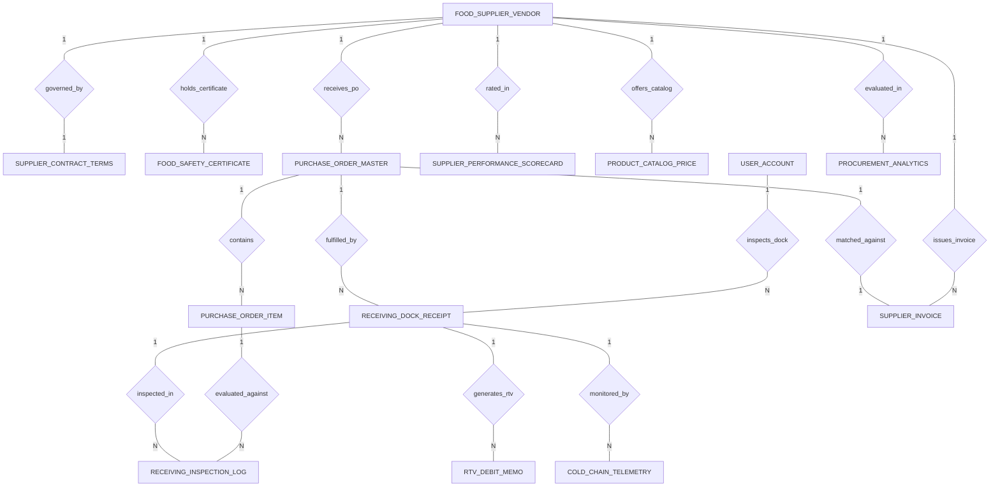

# Conceptual ERD — Food Supplier Management System

## Mermaid Code

## Entity Description Table | Bang mo ta Entity

| # | Entity Name | Vietnamese Name | Description | Key Attributes | Main Relationships |
|---|-------------|-----------------|-------------|----------------|-------------------|
| 1 | FOOD_SUPPLIER_VENDOR | Nha cung cap thuc pham | Commercial food distributor vendor profile, vendor code, legal company name, FEIN tax ID, contact email, and status. | vendor_id, vendor_code, vendor_name, tax_id_fein, contact_email, vendor_status | One-to-One with SUPPLIER_CONTRACT_TERMS; One-to-Many with FOOD_SAFETY_CERTIFICATE, PURCHASE_ORDER_MASTER, SUPPLIER_INVOICE, SUPPLIER_PERFORMANCE_SCORECARD, PRODUCT_CATALOG_PRICE, PROCUREMENT_ANALYTICS |
| 2 | SUPPLIER_CONTRACT_TERMS | Dieu khoan hop dong | Master contract terms for vendor detailing payment terms code (Net 30, 2/10 Net 30), early payment discounts, and contract dates. | contract_id, vendor_id, payment_terms_code, early_discount_percent, contract_start_date | One-to-One with FOOD_SUPPLIER_VENDOR |
| 3 | FOOD_SAFETY_CERTIFICATE | Giay phep an toan thuc pham | Food safety audit accreditation record (HACCP, ISO 22000, GFSI, GlobalGAP), issuing body, issue/expiry dates, and verification status. | cert_id, vendor_id, cert_type, issuing_body, issue_date, expiry_date, is_verified | Belongs to FOOD_SUPPLIER_VENDOR |
| 4 | PURCHASE_ORDER_MASTER | Don hang mua si master | Electronic Purchase Order (PO) master record, PO number, order date, requested delivery date, total PO amount, and status. | po_id, vendor_id, po_number, order_date, requested_delivery_date, total_po_amount, po_status | Belongs to FOOD_SUPPLIER_VENDOR; One-to-Many with PURCHASE_ORDER_ITEM, RECEIVING_DOCK_RECEIPT; One-to-One with SUPPLIER_INVOICE |
| 5 | PURCHASE_ORDER_ITEM | Chi tiet mon hang PO | Line item details within a Purchase Order specifying product SKU, ordered quantity, unit price, and line subtotal. | item_id, po_id, product_sku, ordered_quantity, unit_price, line_total | Belongs to PURCHASE_ORDER_MASTER; One-to-Many with RECEIVING_INSPECTION_LOG |
| 6 | RECEIVING_DOCK_RECEIPT | Phieu nhan hang kho | Receiving dock delivery receipt recording receiving date, inspector user ID, total cases received, and dock status. | receipt_id, po_id, receiving_date, inspector_user_id, total_cases_received, dock_status | Belongs to PURCHASE_ORDER_MASTER, USER_ACCOUNT; One-to-Many with RECEIVING_INSPECTION_LOG, RTV_DEBIT_MEMO, COLD_CHAIN_TELEMETRY |
| 7 | RECEIVING_INSPECTION_LOG | Nhat ky kiem tra kho | Detailed receiving line item inspection log recording measured food temperature °C, accepted quantity, rejected quantity, and reason. | inspection_id, receipt_id, item_id, measured_temp_celsius, accepted_quantity, rejected_quantity | Belongs to RECEIVING_DOCK_RECEIPT, PURCHASE_ORDER_ITEM |
| 8 | RTV_DEBIT_MEMO | Phieu tru tien hang loi RTV | Return-to-Vendor (RTV) debit memo generated for rejected/damaged food items, total debit amount, return reason, and credit status. | rtv_id, receipt_id, rtv_number, total_debit_amount, return_reason, credit_memo_status | Belongs to RECEIVING_DOCK_RECEIPT |
| 9 | SUPPLIER_INVOICE | Hoa don nha cung cap | Commercial supplier invoice record, vendor ID, PO ID, invoice number, subtotal, RTV deductions, net payable, and 3-way match status. | invoice_id, vendor_id, po_id, invoice_number, invoice_subtotal, rtv_deduction_amount, net_payable_amount | Belongs to FOOD_SUPPLIER_VENDOR; One-to-One with PURCHASE_ORDER_MASTER |
| 10 | COLD_CHAIN_TELEMETRY | Nhat ky chuoi cung ứng lanh | In-transit cold chain telemetry record capturing refrigerated container sensor IDs, min/max temperatures, and breach flags. | telemetry_id, receipt_id, sensor_device_id, min_container_temp, max_container_temp, is_temp_breached | Belongs to RECEIVING_DOCK_RECEIPT |
| 11 | SUPPLIER_PERFORMANCE_SCORECARD | Bang diem danh gia nha cung cap | Monthly supplier SLA scorecard tracking On-Time Delivery %, Quality Acceptance %, Price Compliance %, overall score, and tier grade. | scorecard_id, vendor_id, evaluation_period, on_time_delivery_score, quality_acceptance_score, overall_sla_score | Belongs to FOOD_SUPPLIER_VENDOR |
| 12 | PRODUCT_CATALOG_PRICE | Danh muc gia san pham | Supplier wholesale catalog price matrix binding product SKUs, product names, contracted unit prices, and unit of measure (Case/Lb). | catalog_id, vendor_id, product_sku, product_name, contracted_unit_price, unit_of_measure | Belongs to FOOD_SUPPLIER_VENDOR |
| 13 | USER_ACCOUNT | Tai khoan he thong | Core security authentication account holding credentials, password hashes, and user role definitions. | user_id, username, password_hash, role_name | One-to-Many with RECEIVING_DOCK_RECEIPT |
| 14 | PROCUREMENT_ANALYTICS | Thong ke mua hang va chi phi | Executive daily analytics tracking total procurement spend, price variance savings, total RTV claims, and average fleet SLA scores. | analytics_id, metric_date, total_procurement_spend, price_variance_savings, total_rtv_claim_amount | Evaluates FOOD_SUPPLIER_VENDOR |

## Relationship Description | Mo ta Quan he

| # | From Entity | Cardinality | To Entity | Relationship Label | Business Explanation |
|---|-------------|-------------|-----------|-------------------|----------------------|
| 1 | FOOD_SUPPLIER_VENDOR | One-to-One | SUPPLIER_CONTRACT_TERMS | governed_by | Mot nha cung cap duoc quan ly bang mot hop dong dieu khoan thanh toan va chiet khau. |
| 2 | FOOD_SUPPLIER_VENDOR | One-to-Many | FOOD_SAFETY_CERTIFICATE | holds_certificate | Mot nha cung cap so huu nhieu giay phep an toan thuc pham (HACCP, ISO 22000). |
| 3 | FOOD_SUPPLIER_VENDOR | One-to-Many | PURCHASE_ORDER_MASTER | receives_po | Mot nha cung cap nhan va thuc hien nhieu don hang mua si (PO). |
| 4 | PURCHASE_ORDER_MASTER | One-to-Many | PURCHASE_ORDER_ITEM | contains | Mot don hang PO chua nhieu chi tiet danh muc nguyen lieu thuc pham. |
| 5 | PURCHASE_ORDER_MASTER | One-to-Many | RECEIVING_DOCK_RECEIPT | fulfilled_by | Mot don hang PO duoc giao va ghi nhan qua cac phieu nhan hang tai kho. |
| 6 | RECEIVING_DOCK_RECEIPT | One-to-Many | RECEIVING_INSPECTION_LOG | inspected_in | Mot phieu nhan hang duoc kiem tra chi tiet nhiet do va chat luong tung lo hang. |
| 7 | PURCHASE_ORDER_ITEM | One-to-Many | RECEIVING_INSPECTION_LOG | evaluated_against | Tung mon hang trong PO duoc doi chieu voi ket qua kiem tra thuc te tai kho. |
| 8 | RECEIVING_DOCK_RECEIPT | One-to-Many | RTV_DEBIT_MEMO | generates_rtv | Phieu nhan kho tao ra cac phieu tru tien RTV neu hang bi loi hoac khong dat nhiet do. |
| 9 | FOOD_SUPPLIER_VENDOR | One-to-Many | SUPPLIER_INVOICE | issues_invoice | Mot nha cung cap xuat cac hoa don tai chinh de yeu cau thanh toan. |
| 10 | PURCHASE_ORDER_MASTER | One-to-One | SUPPLIER_INVOICE | matched_against | Mot don hang PO duoc doi chieu 3 ben (3-Way Match) voi hoa don cua nha cung cap. |
| 11 | RECEIVING_DOCK_RECEIPT | One-to-Many | COLD_CHAIN_TELEMETRY | monitored_by | Chuyen hang nhan kho duoc kiem tra nhat ky nhiet do container trong suot qua trinh van chuyen. |
| 12 | FOOD_SUPPLIER_VENDOR | One-to-Many | SUPPLIER_PERFORMANCE_SCORECARD | rated_in | Mot nha cung cap duoc thong ke va danh gia hieu suat SLA (Giao hang, Chat luong, Gia) hang thang. |
