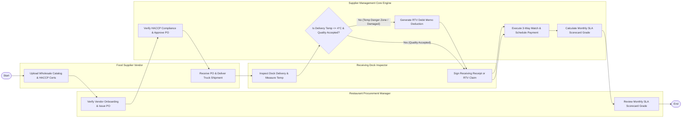

# Swimlane Diagram — Food Supplier Management System

## Mermaid Code

## Flow Description | Mo ta luong

| Lane | Actor | Role in Flow |
|------|-------|-------------|
| **Lane 1** | Food Supplier Vendor | Uploads wholesale price catalogs, HACCP food safety certificates, receives purchase orders, and delivers refrigerated truck shipments. |
| **Lane 2** | Restaurant Procurement Manager | Verifies vendor onboarding credentials, issues electronic purchase orders, and reviews monthly supplier SLA performance scorecards. |
| **Lane 3** | Receiving Dock Inspector | Inspects incoming truck shipments at warehouse receiving dock, measures food temperatures with probe thermometers, and signs dock receipts or RTV claims. |
| **Lane 4** | Supplier Management Core Engine | Verifies HACCP compliance, validates receiving temperatures, generates RTV debit memos, executes 3-way invoice matching, and calculates SLA scorecards. |

### Process Execution Steps | Cac buoc thuc hien quy trinh

1. **Vendor Onboarding & PO Issuance**: Vendor uploads price catalogs and HACCP certificates (`V1`). Procurement Manager verifies credentials and issues PO (`P1`). Core Engine checks HACCP compliance and approves PO (`S1`).
2. **Shipment Delivery & Dock Inspection**: Vendor delivers truck shipment (`V2`). Receiving Inspector inspects dock arrival and measures internal food temperatures (`R1`). Core Engine evaluates quality acceptance (`S2`).
   - If **No (Temperature Danger Zone / Damaged)**: Core Engine generates RTV debit memo deduction (`S3`). Inspector logs rejection (`R2`).
   - If **Yes (Quality Accepted)**: Inspector signs clean receiving receipt (`R2`).
3. **3-Way Matching & Settlement**: Core Engine performs 3-way matching (PO vs Receiving Receipt vs Invoice) and schedules ACH payment (`S4`).
4. **SLA Scorecard Evaluation**: Core Engine calculates monthly supplier SLA scorecard grade (`S5`), and Procurement Manager reviews performance metrics (`P2`), completing execution (`Finish`).
