# Action Tree — Food Supplier Management System

## Mermaid Code

```mermaid
graph TD
    Root["Food Supplier Management System"]

    Root --> M1["Supplier Onboarding & Certificate Compliance"]
    Root --> M2["Purchase Order Creation & RFP Bidding"]
    Root --> M3["Receiving Dock Inspection & Cold Chain Tracking"]
    Root --> M4["Return-to-Vendor RTV & Quality Rejections"]
    Root --> M5["3-Way Invoice Matching & AP Payments"]
    Root --> M6["Supplier Performance Scorecards & SLA Audits"]
    Root --> M7["Procurement Analytics & System Security"]

    M1 --> A11["Onboard New Commercial Food Vendors"]
    M1 --> A12["Track HACCP ISO 22000 & GFSI Certificates"]
    M1 --> A13["Verify Vendor Liability Insurance Coverage"]
    M1 --> A14["Maintain Supplier ACH Banking Profiles"]

    M2 --> A21["Generate Electronic Wholesale Purchase Orders"]
    M2 --> A22["Issue Competitive Request for Proposals RFP"]
    M2 --> A23["Auto-Reorder Stock via PAR Safety Levels"]
    M2 --> A24["Enforce PO User Dollar Approval Limits"]

    M3 --> A31["Perform Dock Inspection & Temperature Logging"]
    M3 --> A32["Enforce 70 Percent Remaining Shelf-Life Rule"]
    M3 --> A33["Monitor In-Transit Cold Chain Sensor Telemetry"]
    M3 --> A34["Scan Delivered Case Barcodes against PO"]

    M4 --> A41["Generate Return-to-Vendor RTV Debit Memos"]
    M4 --> A42["Log Temperature Danger Zone Rejections"]
    M4 --> A43["Attach Quality Defect Photo Evidence"]
    M4 --> A44["Track Vendor Credit Memo Reconciliations"]

    M5 --> A51["Reconcile 3-Way Match PO Receipt Invoice"]
    M5 --> A52["Deduct RTV Memos from Invoice Subtotals"]
    M5 --> A53["Calculate Early Payment Cash Discounts"]
    M5 --> A54["Export ACH Wire Payment Batches to ERP"]

    M6 --> A61["Calculate Monthly Supplier SLA Scorecards"]
    M6 --> A62["Measure On-Time Delivery Percentage Rates"]
    M6 --> A63["Measure Quality Acceptance & Defect Rates"]
    M6 --> A64["Issue Corrective Action Requests for Grade C Vendors"]

    M7 --> A71["Audit Purchase Price Variance Inflation Spikes"]
    M7 --> A72["Monitor Total Category Procurement Spending"]
    M7 --> A73["Manage User Roles & Approval Thresholds"]
    M7 --> A74["Manage Supplier B2B API & EDI Integration Tokens"]
```

## Module Description | Mo ta Module

| # | Module | Description | Actions |
|---|--------|-------------|---------|
| 1 | Supplier Onboarding & Certificate Compliance | Controls supplier onboarding, business tax verification, HACCP/ISO food safety tracking, liability insurance audits, and ACH banking profiles. | Onboard New Commercial Food Vendors, Track HACCP ISO 22000 & GFSI Certificates, Verify Vendor Liability Insurance Coverage, Maintain Supplier ACH Banking Profiles |
| 2 | Purchase Order Creation & RFP Bidding | Manages electronic PO creation, competitive RFP bidding, automated PAR safety reordering, and PO dollar approval threshold enforcement. | Generate Electronic Wholesale Purchase Orders, Issue Competitive Request for Proposals RFP, Auto-Reorder Stock via PAR Safety Levels, Enforce PO User Dollar Approval Limits |
| 3 | Receiving Dock Inspection & Cold Chain Tracking | Inspects incoming truck shipments, logs internal probe temperatures, enforces 70% shelf-life rules, and ingests in-transit cold chain sensor telemetry. | Perform Dock Inspection & Temperature Logging, Enforce 70 Percent Remaining Shelf-Life Rule, Monitor In-Transit Cold Chain Sensor Telemetry, Scan Delivered Case Barcodes against PO |
| 4 | Return-to-Vendor RTV & Quality Rejections | Generates RTV debit memos for damaged or warm food items, logs temperature danger zone rejections, attaches photo evidence, and tracks credit memos. | Generate Return-to-Vendor RTV Debit Memos, Log Temperature Danger Zone Rejections, Attach Quality Defect Photo Evidence, Track Vendor Credit Memo Reconciliations |
| 5 | 3-Way Invoice Matching & AP Payments | Reconciles 3-way matching (PO vs Receiving Receipt vs Invoice), deducts RTV debit memos, calculates early payment discounts, and exports ACH payment batches. | Reconcile 3-Way Match PO Receipt Invoice, Deduct RTV Memos from Invoice Subtotals, Calculate Early Payment Cash Discounts, Export ACH Wire Payment Batches to ERP |
| 6 | Supplier Performance Scorecards & SLA Audits | Calculates monthly supplier SLA scorecards (On-Time Delivery %, Quality Acceptance %, Price Compliance %), assigning tier grades (A/B/C) and CAP requests. | Calculate Monthly Supplier SLA Scorecards, Measure On-Time Delivery Percentage Rates, Measure Quality Acceptance & Defect Rates, Issue Corrective Action Requests for Grade C Vendors |
| 7 | Procurement Analytics & System Security | Provides executive dashboards on purchase price variances, category spending, supplier market concentration, user security roles, and B2B API tokens. | Audit Purchase Price Variance Inflation Spikes, Monitor Total Category Procurement Spending, Manage User Roles & Approval Thresholds, Manage Supplier B2B API & EDI Integration Tokens |
