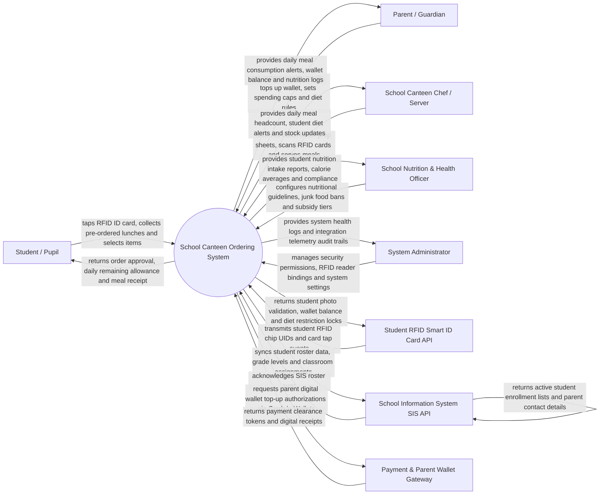

# Context Diagram — School Canteen Ordering System

## Mermaid Code

## Actor & Interaction Table | Bang Actor & Tuong tac

| # | Actor | Actor Type | Data Sent TO System | Data Received FROM System | Notes |
|---|-------|------------|---------------------|---------------------------|-------|
| 1 | Student / Pupil | Primary | RFID smart card tap events, counter meal selections, fast-lane pre-order pickup claims | Order approval confirmation, remaining daily spending allowance, meal receipts | Taps RFID card or campus wristband at school canteen counters. |
| 2 | Parent / Guardian | Primary | Weekly lunch pre-orders, digital wallet top-ups, daily spending caps, allergen restriction rules | Daily meal consumption alerts, real-time wallet balances, nutrient intake reports | Interacts via parent mobile app or school web portal. |
| 3 | School Canteen Chef / Server | Primary | Daily batch cooking confirmations, counter RFID scans, item 86 sold-out updates | Daily lunch prep headcounts, student allergen warning flags, prep sheets | Prepares bulk school lunches and operates canteen serving lines. |
| 4 | School Nutrition & Health Officer | Primary | USDA/School nutritional guidelines, junk food restriction rules, meal subsidy tiers | Student caloric intake analytics, nutritional compliance reports, subsidy logs | Oversees school meal health compliance and student nutrition. |
| 5 | System Administrator | Primary | User credentials, security role policies, RFID reader bindings, system parameters | System health metrics, integration telemetry logs, security audit trails | Manages IT platform infrastructure, RFID hardware, and permissions. |
| 6 | Student RFID Smart ID Card API | Supporting | Student RFID chip UIDs, turnstile/canteen tap timestamps | Student photo validation, active meal entitlements, diet restriction flags | Campus RFID card readers and turnstiles deployed at canteen lines. |
| 7 | School Information System SIS API | Supporting | Student enrollment rosters, grade levels, classroom assignments, parent contacts | Roster synchronization acknowledgments, student status updates | Central school database (e.g., PowerSchool, Canvas, Infinite Campus). |
| 8 | Payment & Parent Wallet Gateway | Supporting | Electronic top-up authorizations (Credit Cards, Bank Transfer, MoMo) | Payment clearance tokens, transaction receipts, refund tokens | Processes parent credit card and e-wallet top-ups into student meal accounts. |

## System Boundary Description | Mo ta Pham vi He thong

The **School Canteen Ordering System** manages campus meal pre-ordering, RFID smart ID card cashless payments, parent dietary controls, nutritional intake tracking, and school meal subsidies. Inside its boundary, the system handles parent weekly lunch pre-orders, cashless RFID card tap deductions at canteen counters, automated daily spending cap enforcement, parent-configured allergen/junk food restriction blocks, batch kitchen prep scheduling, free/reduced-price meal subsidy management, and student nutrient intake analytics.

The system boundary excludes physical cooking of food, physical wiping of cafeteria tables, academic grade management (handled by SIS systems), and raw credit card clearance (handled by Payment Gateways).
