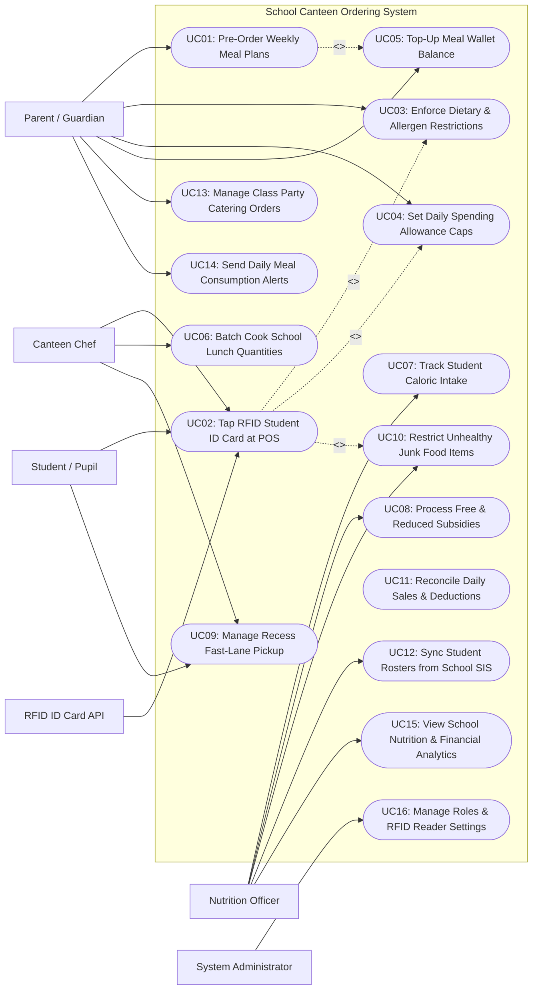

# Use Case Diagram — School Canteen Ordering System

## Mermaid Code

## Actor Table | Bang Actor

| # | Actor | Actor Type | Role Description | Related Use Cases |
|---|-------|------------|------------------|-------------------|
| 1 | RFID ID Card API | Secondary System | Campus hardware reader decoding student RFID card chips and transmitting tap events to canteen POS. | UC02 |
| 2 | Student / Pupil | Primary | Campus student tapping RFID ID cards at canteen counters, picking up pre-ordered lunches, and selecting snacks. | UC02, UC09 |
| 3 | Parent / Guardian | Primary | Parent managing student meal accounts, pre-ordering weekly lunches, topping up wallets, setting spending limits, and configuring allergen rules. | UC01, UC03, UC04, UC05, UC13, UC14 |
| 4 | Canteen Chef | Primary | School kitchen lead receiving batch cooking headcounts, serving lunches at counter POS, and managing fast-lane pickup lines. | UC02, UC06, UC09 |
| 5 | Nutrition Officer | Primary | School health specialist managing nutrition guidelines, junk food bans, free/reduced meal subsidies, and student calorie tracking. | UC07, UC08, UC10, UC12, UC15 |
| 6 | System Administrator | Primary | Technical manager configuring security access roles, RFID reader hardware IP bindings, SIS integration keys, and audit logs. | UC16 |

## Use Case Table | Bang Use Case

| # | UC ID | Use Case Name | Primary Actor | Secondary Actor | Description | Priority |
|---|-------|---------------|---------------|-----------------|-------------|----------|
| 1 | UC01 | Pre-Order Weekly Meal Plans | Parent | None | Enables parents to browse monthly canteen menus and pre-order balanced hot lunch meals for their children weeks in advance. | High |
| 2 | UC02 | Tap RFID Student ID Card at POS | Student | RFID ID Card API | Processes fast contactless student RFID card taps at canteen counter POS, deducting meal wallet balances and validating orders. | High |
| 3 | UC03 | Enforce Dietary & Allergen Restrictions | Parent | None | Blocks POS meal purchases containing parent-restricted ingredients or severe allergens (e.g., Nuts, Dairy, Shellfish). | High |
| 4 | UC04 | Set Daily Spending Allowance Caps | Parent | None | Configures maximum daily spending limits (e.g., $5.00/day) on student accounts to prevent overspending on snacks. | High |
| 5 | UC05 | Top-Up Meal Wallet Balance | Parent | None | Processes digital wallet recharges via credit cards, bank transfers, or mobile e-wallets into student meal accounts. | High |
| 6 | UC06 | Batch Cook School Lunch Quantities | Canteen Chef | None | Compiles daily pre-order totals to output exact batch cooking sheets for kitchen staff, eliminating food overproduction. | High |
| 7 | UC07 | Track Student Caloric Intake | Nutrition Officer | None | Tracks individual student daily caloric, protein, and sodium intake from canteen purchases against USDA guidelines. | Medium |
| 8 | UC08 | Process Free & Reduced Subsidies | Nutrition Officer | None | Manages confidential government free and reduced-price school lunch subsidies, applying automatic bill discounts at checkout. | High |
| 9 | UC09 | Manage Recess Fast-Lane Pickup | Student | Canteen Chef | Operates express pickup lanes during short recess breaks for students picking up pre-ordered lunch boxes without waiting in line. | High |
| 10 | UC10 | Restrict Unhealthy Junk Food Items | Nutrition Officer | None | Restricts high-sugar soda, candy, and fried snacks during early morning breaks or flags age-restricted items by grade level. | High |
| 11 | UC11 | Reconcile Daily Sales & Deductions | Canteen Chef | None | Reconciles daily canteen sales revenue against student wallet deductions, cash sales, and government subsidy credits. | High |
| 12 | UC12 | Sync Student Rosters from School SIS | Nutrition Officer | None | Synchronizes student enrollment lists, grade levels, classroom assignments, and parent contact details from school SIS systems. | High |
| 13 | UC13 | Manage Class Party Catering Orders | Parent | None | Allows parents or teachers to order approved party snack trays (Cupcakes, Fruit Platter) for classroom birthday celebrations. | Medium |
| 14 | UC14 | Send Daily Meal Consumption Alerts | Parent | None | Dispatches automated evening SMS or push notifications to parents detailing exactly what their child ate at school today. | High |
| 15 | UC15 | View School Nutrition & Financial Analytics | Nutrition Officer | None | Displays analytical dashboards on total meals served, average student caloric intake, subsidy utilization, and canteen revenue. | High |
| 16 | UC16 | Manage Roles & RFID Reader Settings | System Admin | None | Configures user security roles, RFID card reader IP bindings, cashless turnstile rules, and system audit logging policies. | High |

## Use Case Specification | Dac ta Use Case

---

### UC01 — Pre-Order Weekly Meal Plans

| Field | Detail |
|-------|--------|
| **UC ID** | UC01 |
| **Use Case Name** | Pre-Order Weekly Meal Plans |
| **Actor(s)** | Primary: Parent / Guardian   Secondary: None |
| **Description** | Enables parents to browse upcoming monthly school canteen menus, review nutritional Information, and pre-order balanced hot lunch meals for their children days or weeks in advance. |
| **Precondition** | 1. Parent has active user account linked to student profile.   2. Monthly school canteen menu is published by school nutritionist. |
| **Main Flow** | 1. Parent opens "School Meal Pre-Order" on parent mobile app or portal.   2. System displays student profile (e.g., Alex Johnson — Grade 5B) and current Meal Wallet Balance ($42.50).   3. System presents interactive weekly calendar with daily hot lunch options:      - Monday: Grilled Chicken Breast with Brown Rice & Steamed Broccoli ($4.50)      - Tuesday: Baked Beef Spaghetti with Side Salad & Apple ($4.50)      - Wednesday: Teriyaki Salmon Bowl with Edamame ($5.00)      - Thursday: Turkey Sandwich on Whole Wheat with Carrots ($4.00)      - Friday: Homemade Veggie Pizza with Fresh Orange ($4.50).   4. Parent selects desired meal options for each day of the upcoming week.   5. System checks pre-order deadline rule (e.g., Pre-orders close Sunday at 8:00 PM for the upcoming week).   6. System calculates Total Pre-Order Cost ($22.50) and deducts funds from Student Meal Wallet (UC05) (New Balance: $20.00).   7. System registers pre-ordered meals in database, generating daily fast-lane pickup tickets (UC09) and updating kitchen batch cooking sheets (UC06).   8. Parent receives pre-order confirmation email and calendar summary. |
| **Alternative Flow** | **AF1** — Automated recurring monthly pre-orders:   1. Parent selects "Auto-Subscribe Set Menu A for Entire Month".   2. System automatically pre-orders Option A for all school days in the month and charges wallet. |
| **Exception Flow** | **EX1** — Insufficient meal wallet balance:   1. At step 6, wallet balance is $10.00 (less than $22.50 total cost).   2. System prompts "Insufficient Wallet Balance", directing parent to Top-Up Wallet (UC05) before completing pre-order. |
| **Postcondition** | Weekly meals are pre-ordered, wallet balance is deducted, and kitchen receives batch prep quantities. |
| **Business Rule** | **BR1**: Weekly meal pre-orders must be finalized by 8:00 PM on Sunday preceding the school week to allow kitchen batch prep planning.   **BR2**: Pre-ordered meals guarantee item availability and entitle students to fast-lane recess pickup. |

---

### UC02 — Tap RFID Student ID Card at POS

| Field | Detail |
|-------|--------|
| **UC ID** | UC02 |
| **Use Case Name** | Tap RFID Student ID Card at POS |
| **Actor(s)** | Primary: Student / Pupil, Canteen Chef   Secondary: RFID ID Card API |
| **Description** | Processes fast cashless meal purchases at canteen counters by decoding student RFID ID card taps, validating student identity, enforcing diet/spending rules, and deducting meal wallets. |
| **Precondition** | 1. Canteen POS terminal and RFID card reader are online.   2. Student presents physical RFID ID card or smart wristband. |
| **Main Flow** | 1. Student places meal items on canteen counter or approaches fast-lane pre-order station (UC09).   2. Canteen Server inputs item selection or scans item barcodes on POS screen (Total: $4.50).   3. Student taps RFID ID card on counter reader pad.   4. Reader transmits RFID chip UID token to System.   5. System retrieves student record displaying: Student Name (Alex Johnson), Photo ID, Grade 5B, Current Wallet Balance ($20.00).   6. System validates active rules in parallel:      - Check 1: Enforce Dietary & Allergen Restrictions (UC03) -> `PASSED (No peanut/dairy collision)`.      - Check 2: Enforce Daily Spending Allowance Cap (UC04) -> `PASSED ($4.50 <= $5.00 daily cap)`.      - Check 3: Check Subsidy Entitlement (UC08) -> `NO SUBSIDY (Standard Rate)`.   7. System deducts $4.50 from student meal wallet (New Balance: $15.50).   8. POS reader beeps green approval tone, displays **Approved! Remaining Balance: $15.50**, and displays student photo on server screen for identity verification.   9. Canteen Server hands meal tray to student.   10. System dispatches evening meal consumption alert to parent (UC14). |
| **Alternative Flow** | **AF1** — Pre-ordered lunch pickup (UC01):   1. Student taps card at Fast-Lane Station.   2. POS screen displays **PRE-ORDERED: Set Menu A (Paid)**; Server hands boxed lunch instantly (transaction time < 2 seconds). |
| **Exception Flow** | **EX1** — Allergen restriction block triggered:   1. Student selects Peanut Butter Cookie; System detects parent-configured Severe Peanut Allergy (UC03).   2. POS screen plays red error tone **ALLERGEN BLOCK: Peanut Allergy Alert!**, preventing sale and alerting server to substitute a nut-free snack. |
| **Postcondition** | RFID card is validated, dietary/spending checks pass, wallet is decremented, and student photo is verified. |
| **Business Rule** | **BR1**: RFID card tap transactions at canteen POS must execute validation and return approval within 800 milliseconds.   **BR2**: Canteen servers MUST visually verify the student photo displayed on the POS screen against the student standing at the counter. |

---

### UC03 — Enforce Dietary & Allergen Restrictions

| Field | Detail |
|-------|--------|
| **UC ID** | UC03 |
| **Use Case Name** | Enforce Dietary & Allergen Restrictions |
| **Actor(s)** | Primary: Parent / Guardian   Secondary: None |
| **Description** | Enables parents to configure strict dietary restriction rules and allergen blocks (e.g., Peanuts, Dairy, Gluten, Pork, Vegetarian), which automatically lock POS checkout for restricted items. |
| **Precondition** | 1. Parent is logged into parent app and selected student profile.   2. Canteen menu items are tagged with allergen and dietary attributes (UC10). |
| **Main Flow** | 1. Parent opens "Student Dietary & Allergen Settings" on parent app.   2. Parent configures Medical Food Allergens:      - `Severe Peanut / Tree Nut Allergy (ANAPHYLACTIC)`      - `Lactose / Dairy Intolerance`.   3. Parent configures Religious / Ethical Dietary Restrictions:      - `No Pork / Halal Meat Only`      - `Strict Vegetarian (No Beef / Poultry)`.   4. Parent saves restriction settings.   5. System updates student dietary profile and binds restriction flags to student RFID UID card token (UC02).   6. When student taps RFID card at canteen POS (UC02) to purchase an item containing restricted ingredients (e.g., Pork Sausage or Peanut Cookie), System blocks transaction.   7. POS screen displays high-visibility alert: **DIETARY BLOCK: Restricted Item (Contains Pork) — Parent Rule Active**.   8. Server informs student of parent restriction and assists student in selecting an approved alternative. |
| **Alternative Flow** | **AF1** — Medical doctor note attachment:   1. Parent uploads medical doctor note for Celiac Disease.   2. System enforces strict zero-gluten cross-contamination rules on student profile. |
| **Exception Flow** | **EX1** — Parent emergency override code:   1. Student is on a field trip and parent allows temporary relaxation of vegetarian rule.   2. Parent taps "One-Time Override" on mobile app, permitting single item purchase. |
| **Postcondition** | Parent dietary restrictions and allergen blocks are active, locking canteen POS checkout for restricted food items. |
| **Business Rule** | **BR1**: Parent-configured allergen and medical diet blocks MUST override all canteen POS sale attempts without exception.   **BR2**: Canteen menu items MUST be tagged with 100% accurate ingredient allergen flags by the school nutritionist. |

---

### UC04 — Set Daily Spending Allowance Caps

| Field | Detail |
|-------|--------|
| **UC ID** | UC04 |
| **Use Case Name** | Set Daily Spending Allowance Caps |
| **Actor(s)** | Primary: Parent / Guardian   Secondary: None |
| **Description** | Allows parents to set maximum daily spending caps (e.g., $5.00 per day) on student meal accounts to control daily allowance spending and prevent excessive purchasing of optional snacks. |
| **Precondition** | 1. Parent is logged into parent app.   2. Student meal wallet is active. |
| **Main Flow** | 1. Parent opens "Account Spending Controls" for student profile.   2. System displays current spending limit settings.   3. Parent sets Daily Spending Allowance Cap: `$5.00 / day`.   4. Parent configures optional Cap Exemptions: "Pre-Ordered Main Lunch Meals are EXEMPT from daily cap".   5. Parent saves cap configuration.   6. On school days, System tracks cumulative daily spending on student account (e.g., Morning Recess Snack $2.00; Lunch Side Item $2.50 = Cumulative $4.50 spent).   7. Student attempts a 3rd purchase at afternoon break for a $1.50 Ice Cream.   8. System calculates proposed total: `$4.50 + $1.50 = $6.00` (exceeds $5.00 daily cap by $1.00).   9. System blocks transaction at POS and displays: **DAILY CAP EXCEEDED ($5.00 Cap Limit Reached for Today)**.   10. Student cancels ice cream purchase; Daily cap resets automatically next morning at 12:00 AM. |
| **Alternative Flow** | **AF1** — Day-of-week custom spending caps:   1. Parent sets $5.00 cap for Mon-Thu, and increases cap to $8.00 on Friday (Treat Day).   2. System applies day-specific allowance caps accordingly. |
| **Exception Flow** | **EX1** — Pre-ordered meal priority over snack cap:   1. Pre-ordered lunch ($4.50) is exempt from cap; Student still has full $5.00 daily cap for recess snacks. |
| **Postcondition** | Daily spending allowance cap is saved, cumulative daily spending is tracked, and over-cap purchases are blocked. |
| **Business Rule** | **BR1**: Daily spending caps evaluate cumulative A-la-Carte counter purchases per calendar day and reset at midnight.   **BR2**: Pre-ordered main lunch meals (UC01) are exempt from daily spending caps unless explicitly specified by parents. |

---

### UC05 — Top-Up Meal Wallet Balance

| Field | Detail |
|-------|--------|
| **UC ID** | UC05 |
| **Use Case Name** | Top-Up Meal Wallet Balance |
| **Actor(s)** | Primary: Parent / Guardian   Secondary: Payment & Parent Wallet Gateway |
| **Description** | Processes electronic wallet recharges into student meal accounts via credit cards, debit cards, bank transfers, or mobile e-wallets, including auto-top-up triggers when balances run low. |
| **Precondition** | 1. Parent is logged into parent app or school payment portal.   2. Payment Gateway API is online. |
| **Main Flow** | 1. Parent opens "Manage Meal Wallet & Top-Up" on parent app.   2. System displays current student wallet balance (e.g., $4.20) and highlights **Low Balance Warning (< $10.00)**.   3. Parent selects top-up amount: `$50.00`.   4. Parent selects payment method: Saved Visa Credit Card (****-4099) or Apple Pay.   5. Parent clicks "Confirm Top-Up $50.00".   6. System sends electronic charge request to Payment Gateway.   7. Payment Gateway approves transaction ($50.00) and returns authorization token.   8. System increments student meal wallet balance: `$4.20 + $50.00 = $54.20`.   9. System records top-up ledger transaction: `Transaction #TOP-9022, Student ID #108, Amount: $50.00, New Balance: $54.20, Timestamp`.   10. System dispatches digital receipt to parent email and updates POS reader balance display. |
| **Alternative Flow** | **AF1** — Auto-top-up rule execution:   1. Parent configures "Auto-Top-Up $30.00 whenever balance drops below $10.00".   2. Balance drops to $8.00 during canteen purchase; System automatically charges saved card $30.00 in background. |
| **Exception Flow** | **EX1** — Credit card payment declined:   1. At step 7, Payment Gateway returns card decline error (Expired Card / Insufficient Funds).   2. System flags error "Top-Up Failed: Card Declined", prompts parent to update payment card, and keeps balance at $4.20. |
| **Postcondition** | Student meal wallet is credited, transaction ledger is recorded, digital receipt is sent, and low balance warning clears. |
| **Business Rule** | **BR1**: Meal wallet funds must be dedicated strictly to school canteen purchases and cannot be withdrawn as cash by students.   **BR2**: Low balance push notifications must trigger to parents automatically whenever student wallet balances drop below $10.00. |
