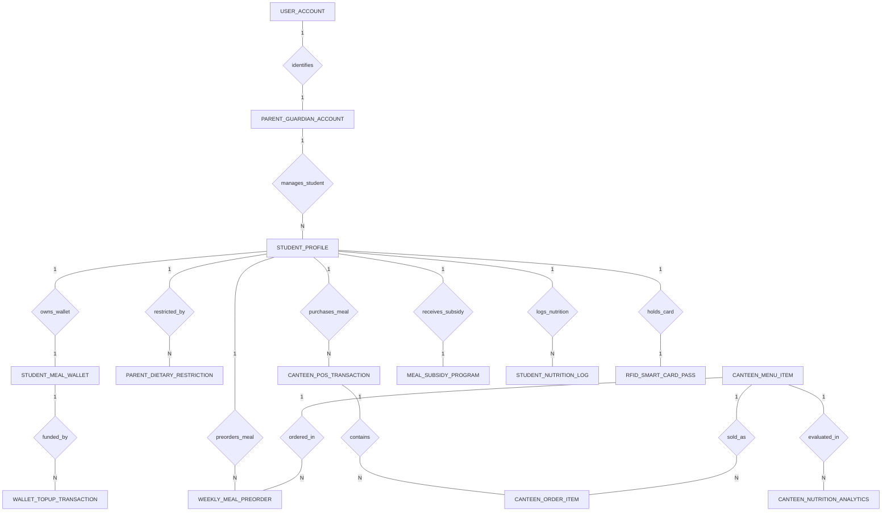

# Conceptual ERD — School Canteen Ordering System

## Mermaid Code

## Entity Description Table | Bang mo ta Entity

| # | Entity Name | Vietnamese Name | Description | Key Attributes | Main Relationships |
|---|-------------|-----------------|-------------|----------------|-------------------|
| 1 | STUDENT_PROFILE | Ho so hoc sinh | Student profile record, student code, full name, grade level, classroom, and daily spending cap limit. | student_id, parent_id, student_code, full_name, grade_level, daily_spending_cap | Belongs to PARENT_GUARDIAN_ACCOUNT; One-to-One with STUDENT_MEAL_WALLET, MEAL_SUBSIDY_PROGRAM, RFID_SMART_CARD_PASS; One-to-Many with PARENT_DIETARY_RESTRICTION, WEEKLY_MEAL_PREORDER, CANTEEN_POS_TRANSACTION, STUDENT_NUTRITION_LOG |
| 2 | PARENT_GUARDIAN_ACCOUNT | Tai khoan phụ huynh | Parent/guardian account managing linked student profiles, contact details, and auto-topup settings. | parent_id, user_id, parent_name, phone_number, email_address, auto_topup_enabled | Belongs to USER_ACCOUNT; One-to-Many with STUDENT_PROFILE |
| 3 | STUDENT_MEAL_WALLET | Vi tien an hoc sinh | Dedicated digital meal wallet holding active balance, low balance threshold, and update timestamp. | wallet_id, student_id, current_balance, low_balance_threshold, last_updated | One-to-One with STUDENT_PROFILE; One-to-Many with WALLET_TOPUP_TRANSACTION |
| 4 | WALLET_TOPUP_TRANSACTION | Giao dich nap vi | Electronic wallet top-up transaction log detailing top-up amount, payment method, transaction ref, and timestamp. | topup_id, wallet_id, topup_amount, payment_method, transaction_ref, topup_time | Belongs to STUDENT_MEAL_WALLET |
| 5 | PARENT_DIETARY_RESTRICTION | Quy tac han che an uong | Parent-configured dietary restriction rules detailing allergen names, severity levels, and junk food block flags. | restriction_id, student_id, allergen_name, severity_level, block_junk_food, is_active | Belongs to STUDENT_PROFILE |
| 6 | CANTEEN_MENU_ITEM | Mon an cang tin | Master canteen menu item record, item name, category, retail price, calories kcal, allergen flags, and junk food indicators. | item_id, item_name, category, retail_price, calories_kcal, contains_allergens, is_junk_food | One-to-Many with WEEKLY_MEAL_PREORDER, CANTEEN_ORDER_ITEM, CANTEEN_NUTRITION_ANALYTICS |
| 7 | WEEKLY_MEAL_PREORDER | Dat truoc suat an tuan | Weekly meal pre-order record placed by parents specifying order date, item price, and pre-order status. | preorder_id, student_id, item_id, order_date, item_price, preorder_status | Belongs to STUDENT_PROFILE, CANTEEN_MENU_ITEM |
| 8 | CANTEEN_POS_TRANSACTION | Giao dich ban hang POS | Cashless canteen POS transaction record, student ID, RFID card UID, total amount, subsidy applied, and timestamp. | transaction_id, student_id, rfid_card_uid, total_amount, subsidy_applied, transaction_time | Belongs to STUDENT_PROFILE; One-to-Many with CANTEEN_ORDER_ITEM |
| 9 | CANTEEN_ORDER_ITEM | Chi tiet mon hang POS | Line items within a canteen POS transaction specifying item ID, quantity, unit price, and line total. | line_id, transaction_id, item_id, quantity, unit_price, line_total | Belongs to CANTEEN_POS_TRANSACTION, CANTEEN_MENU_ITEM |
| 10 | MEAL_SUBSIDY_PROGRAM | Chuong trinh mien giam gia | Confidential government free/reduced lunch subsidy entitlement record, subsidy tier, discount %, and validity. | subsidy_id, student_id, subsidy_tier, discount_percentage, valid_until, is_active | One-to-One with STUDENT_PROFILE |
| 11 | STUDENT_NUTRITION_LOG | Nhat ky dinh duong hoc sinh | Daily nutritional log tracking total calories, protein grams, and sodium mg consumed by a student from canteen purchases. | log_id, student_id, log_date, total_calories_consumed, total_protein_grams, total_sodium_mg | Belongs to STUDENT_PROFILE |
| 12 | RFID_SMART_CARD_PASS | The RFID thong minh hoc sinh | Campus RFID smart ID card pass record storing student ID, RFID chip UID token, issued date, and active status. | card_id, student_id, rfid_chip_uid, issued_date, is_active | One-to-One with STUDENT_PROFILE |
| 13 | USER_ACCOUNT | Tai khoan he thong | Core security authentication account holding credentials, password hashes, and user role definitions. | user_id, username, password_hash, role_name | One-to-One with PARENT_GUARDIAN_ACCOUNT |
| 14 | CANTEEN_NUTRITION_ANALYTICS | Thong ke dinh duong va doanh thu | Executive daily analytics tracking total meals served, total canteen revenue, average student calories, and allergen blocks. | analytics_id, metric_date, total_meals_served, total_canteen_revenue, avg_student_calories | Evaluates CANTEEN_MENU_ITEM |

## Relationship Description | Mo ta Quan he

| # | From Entity | Cardinality | To Entity | Relationship Label | Business Explanation |
|---|-------------|-------------|-----------|-------------------|----------------------|
| 1 | USER_ACCOUNT | One-to-One | PARENT_GUARDIAN_ACCOUNT | identifies | Tai khoan he thong dinh danh ho so phu huynh hoc sinh. |
| 2 | PARENT_GUARDIAN_ACCOUNT | One-to-Many | STUDENT_PROFILE | manages_student | Tai khoan phu huynh quan ly va lien ket voi mot hoac nhieu ho so con em. |
| 3 | STUDENT_PROFILE | One-to-One | STUDENT_MEAL_WALLET | owns_wallet | Moi hoc sinh so huu mot vi tien an ky thuat so de thanh toan tai cang tin. |
| 4 | STUDENT_MEAL_WALLET | One-to-Many | WALLET_TOPUP_TRANSACTION | funded_by | Vi tien an duoc nap tien nhieu lan qua the ngan hang hoac vi dien tu tu phu huynh. |
| 5 | STUDENT_PROFILE | One-to-Many | PARENT_DIETARY_RESTRICTION | restricted_by | Ho so hoc sinh duoc thiet lap cac quy tac han che di ung va do an khong lanh manh. |
| 6 | STUDENT_PROFILE | One-to-Many | WEEKLY_MEAL_PREORDER | preorders_meal | Hoc sinh duoc phu huynh dat truoc cac suat an trua theo tuan. |
| 7 | CANTEEN_MENU_ITEM | One-to-Many | WEEKLY_MEAL_PREORDER | ordered_in | Mon an cang tin duoc phu huynh chon trong cac don dat truoc. |
| 8 | STUDENT_PROFILE | One-to-Many | CANTEEN_POS_TRANSACTION | purchases_meal | Hoc sinh thuc hien cac giao dich mua suat an qua the RFID tai quay POS. |
| 9 | CANTEEN_POS_TRANSACTION | One-to-Many | CANTEEN_ORDER_ITEM | contains | Giao dich POS chua nhieu mon an va do uong duoc hoc sinh chon. |
| 10 | CANTEEN_MENU_ITEM | One-to-Many | CANTEEN_ORDER_ITEM | sold_as | Mon an cang tin duoc ban duoi dang cac dong chi tiet trong don hang. |
| 11 | STUDENT_PROFILE | One-to-One | MEAL_SUBSIDY_PROGRAM | receives_subsidy | Hoc sinh co the duoc huong chuong trinh miên giam gia suat an tro cap. |
| 12 | STUDENT_PROFILE | One-to-Many | STUDENT_NUTRITION_LOG | logs_nutrition | Ho so hoc sinh ghi nhan nhat ky dinh duong va calo thu nhap hang ngay. |
| 13 | STUDENT_PROFILE | One-to-One | RFID_SMART_CARD_PASS | holds_card | Moi hoc sinh duoc phat mot the RFID thong minh de quet thanh toan. |
| 14 | CANTEEN_MENU_ITEM | One-to-Many | CANTEEN_NUTRITION_ANALYTICS | evaluated_in | Cac mon an duoc thong ke va danh gia gia tri dinh duong va doanh thu hang ngay. |
