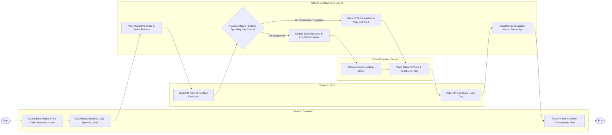

# Swimlane Diagram — School Canteen Ordering System

## Mermaid Code

## Flow Description | Mo ta luong

| Lane | Actor | Role in Flow |
|------|-------|-------------|
| **Lane 1** | Parent / Guardian | Tops up student meal wallet, pre-orders weekly lunches, configures allergen restriction rules, sets daily spending caps, and receives meal consumption alerts. |
| **Lane 2** | Student / Pupil | Taps RFID student ID card at canteen fast-lane counters, collects pre-ordered lunch trays, and selects safe counter snacks. |
| **Lane 3** | School Canteen Server | Receives daily batch cooking sheets, verifies student photos on POS screens, and hands meal trays to students. |
| **Lane 4** | School Canteen Core Engine | Validates RFID card taps, checks parent allergen and spending cap rules, deducts wallet balances, logs caloric intake, and dispatches parent notifications. |

### Process Execution Steps | Cac buoc thuc hien quy trinh

1. **Pre-Ordering & Rule Setup**: Parent tops up wallet, pre-orders weekly lunches (`C1`), and configures allergen/spending cap rules (`C2`). Core Engine validates wallet funds (`S1`).
2. **RFID Card Tap & Rule Check**: Student taps RFID card at canteen counter (`K1`). Core Engine evaluates allergen restrictions and daily spending caps (`S2`).
   - If **No (Restriction Triggered)**: Core Engine blocks transaction and plays red alert (`S3`). Server assists student with an alternative (`B2`).
   - If **Yes (Approved)**: Core Engine deducts wallet balance and logs caloric intake (`S4`).
3. **Meal Serving & Pickup**: Kitchen Chef batch cooks lunches (`B1`). Server verifies student photo and hands tray (`B2`). Student collects lunch tray (`K2`).
4. **Parent Notification & Logging**: Core Engine dispatches meal consumption alert to parent app (`S5`), and Parent receives evening summary (`C3`), completing execution (`Finish`).
