# Action Tree — School Canteen Ordering System

## Mermaid Code

```mermaid
graph TD
    Root["School Canteen Ordering System"]

    Root --> M1["Parent Meal Wallet & Pre-Ordering"]
    Root --> M2["RFID Smart Card Tap & Canteen POS"]
    Root --> M3["Dietary Restrictions & Junk Food Rules"]
    Root --> M4["School Subsidies & Free Lunch Programs"]
    Root --> M5["Daily Batch Cooking & Fast-Lane Pickup"]
    Root --> M6["Parent Notifications & SIS Roster Sync"]
    Root --> M7["Nutrition Analytics & System Security"]

    M1 --> A11["Browse Monthly School Canteen Menus"]
    M1 --> A12["Pre-Order Weekly Student Hot Lunch Plans"]
    M1 --> A13["Top-Up Student Meal Wallet Balances"]
    M1 --> A14["Configure Auto-Top-Up Balance Triggers"]

    M2 --> A21["Process RFID Smart ID Card Taps at POS"]
    M2 --> A22["Verify Student Photo ID on Server Screen"]
    M2 --> A23["Deduct Wallet Balances in Under 1 Second"]
    M2 --> A24["Handle Split-Tender Payment Exceptions"]

    M3 --> A31["Configure Parent Allergen & Medical Blocks"]
    M3 --> A32["Set Daily Student Spending Allowance Caps"]
    M3 --> A33["Restrict Junk Food & High-Sugar Beverages"]
    M3 --> A34["Enforce Grade-Level Item Purchasing Rules"]

    M4 --> A41["Manage Free & Reduced-Price Lunch Subsidies"]
    M4 --> A42["Apply Confidential Subsidy Billing Discounts"]
    M4 --> A43["Track USDA School Meal Program Compliance"]
    M4 --> A44["Generate Government Subsidy Audit Logs"]

    M5 --> A51["Compile Daily Batch Cooking Headcounts"]
    M5 --> A52["Operate Recess Fast-Lane Pickup Lines"]
    M5 --> A53["Print Boxed Lunch Label Barcodes"]
    M5 --> A54["Manage Class Party Catering Orders"]

    M6 --> A61["Send Evening Meal Consumption Push Alerts"]
    M6 --> A62["Sync Student Rosters from School SIS APIs"]
    M6 --> A63["Notify Parents on Low Wallet Balances"]
    M6 --> A64["Manage Classroom Teacher Account Permissions"]

    M7 --> A71["Monitor Student Caloric & Nutrient Intake"]
    M7 --> A72["Analyze Canteen Revenue & Pre-Order Ratios"]
    M7 --> A73["Manage User Roles & Security Access Levels"]
    M7 --> A74["Manage RFID Reader Hardware IP Settings"]
```

## Module Description | Mo ta Module

| # | Module | Description | Actions |
|---|--------|-------------|---------|
| 1 | Parent Meal Wallet & Pre-Ordering | Controls monthly menu browsing, weekly hot lunch pre-ordering, parent digital wallet top-ups, and automated low-balance recharge triggers. | Browse Monthly School Canteen Menus, Pre-Order Weekly Student Hot Lunch Plans, Top-Up Student Meal Wallet Balances, Configure Auto-Top-Up Balance Triggers |
| 2 | RFID Smart Card Tap & Canteen POS | Handles fast cashless student RFID ID card tap deductions at canteen counters, student photo ID verification, and payment processing. | Process RFID Smart ID Card Taps at POS, Verify Student Photo ID on Server Screen, Deduct Wallet Balances in Under 1 Second, Handle Split-Tender Payment Exceptions |
| 3 | Dietary Restrictions & Junk Food Rules | Configures parent allergen blocks, medical diet rules, daily spending allowance caps, junk food bans, and grade-level purchasing limits. | Configure Parent Allergen & Medical Blocks, Set Daily Student Spending Allowance Caps, Restrict Junk Food & High-Sugar Beverages, Enforce Grade-Level Item Purchasing Rules |
| 4 | School Subsidies & Free Lunch Programs | Manages confidential free and reduced-price meal subsidies, automated checkout discounts, USDA program compliance, and subsidy audit reporting. | Manage Free & Reduced-Price Lunch Subsidies, Apply Confidential Subsidy Billing Discounts, Track USDA School Meal Program Compliance, Generate Government Subsidy Audit Logs |
| 5 | Daily Batch Cooking & Fast-Lane Pickup | Compiles daily kitchen batch prep sheets from pre-orders, operates recess fast-lane pickup stations, and manages class party catering. | Compile Daily Batch Cooking Headcounts, Operate Recess Fast-Lane Pickup Lines, Print Boxed Lunch Label Barcodes, Manage Class Party Catering Orders |
| 6 | Parent Notifications & SIS Roster Sync | Dispatches daily meal consumption alerts to parents, syncs student rosters from school SIS APIs, and sends low balance notifications. | Send Evening Meal Consumption Push Alerts, Sync Student Rosters from School SIS APIs, Notify Parents on Low Wallet Balances, Manage Classroom Teacher Account Permissions |
| 7 | Nutrition Analytics & System Security | Provides executive reporting on student caloric intake averages, canteen revenue, pre-order fulfillment ratios, RFID settings, and security roles. | Monitor Student Caloric & Nutrient Intake, Analyze Canteen Revenue & Pre-Order Ratios, Manage User Roles & Security Access Levels, Manage RFID Reader Hardware IP Settings |
