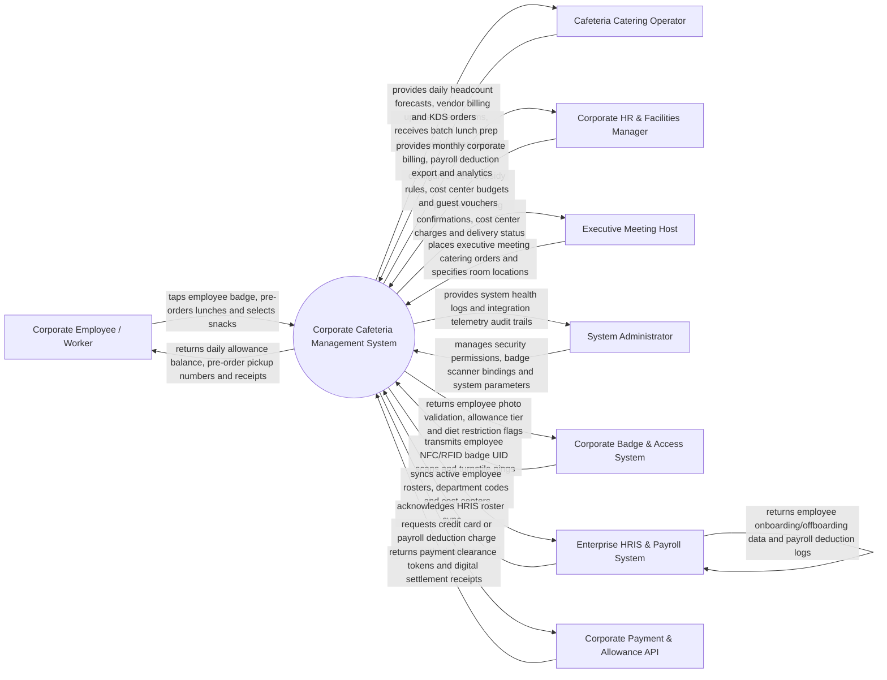

# Context Diagram — Corporate Cafeteria Management System

## Mermaid Code

## Actor & Interaction Table | Bang Actor & Tuong tac

| # | Actor | Actor Type | Data Sent TO System | Data Received FROM System | Notes |
|---|-------|------------|---------------------|---------------------------|-------|
| 1 | Corporate Employee / Worker | Primary | NFC badge tap events, meal pre-orders, self-checkout item selections, personal payment top-ups | Daily allowance balance, order pickup numbers, digital receipts, caloric totals | Interacts via corporate mobile app, self-checkout kiosks, or badge readers. |
| 2 | Cafeteria Catering Operator | Primary | Daily menu catalog items, 86 item sold-out triggers, batch prep confirmations | Daily lunch headcount forecasts, vendor billing statements, KDS prep tickets | Operates commercial cafeteria kitchens and serving stations. |
| 3 | Executive Meeting Host | Primary | Boardroom catering orders, meeting room locations, guest counts, cost center codes | Catering order confirmations, cost center billing receipts, delivery status | Administrative assistant or executive booking meeting catering. |
| 4 | Corporate HR & Facilities Manager | Primary | Company meal subsidy policies (e.g., $10/day credit), department cost center budgets, guest voucher codes | Monthly corporate subsidy invoices, payroll deduction export CSVs, occupancy analytics | Oversees corporate employee benefits, cafeteria vendor contracts, and facilities. |
| 5 | System Administrator | Primary | User credentials, security role policies, badge scanner hardware IP bindings, system settings | Integration health metrics, API usage telemetry, security audit logs | Manages IT platform infrastructure, hardware integrations, and permissions. |
| 6 | Corporate Badge & Access System | Supporting | Employee NFC/RFID badge UID tokens, physical building access pings | Employee photo ID validation, meal entitlement tiers, diet restriction locks | Corporate building badge access control hardware (e.g., HID, Lenel, Software House). |
| 7 | Enterprise HRIS & Payroll System | Supporting | Employee enrollment rosters, department codes, cost centers, termination events | Payroll deduction export files (over-allowance meal charges), cost center billing logs | Corporate enterprise software (e.g., SAP SuccessFactors, Workday, ADP). |
| 8 | Corporate Payment & Allowance API | Supporting | Personal credit card charge authorizations, corporate meal allowance credit allocations | Payment clearance approvals, transaction receipts, allowance balance updates | Processes employee credit cards and corporate per-diem meal credits. |

## System Boundary Description | Mo ta Pham vi He thong

The **Corporate Cafeteria Management System** manages corporate employee dining benefits, cashless NFC badge payments, company meal subsidies, executive boardroom catering, and payroll deduction integration. Inside its boundary, the system handles employee daily meal subsidy allocations (e.g., $10.00/day company credit), cashless tap-and-go NFC employee badge self-checkout, desktop/mobile meal pre-ordering, boardroom meeting catering management, over-allowance payroll deduction calculation, multi-vendor cafeteria stall revenue settlement, and enterprise HRIS roster synchronization.

The system boundary excludes physical cooking of food, physical janitorial cleaning of cafeteria tables, enterprise payroll check generation (handled by HRIS/Payroll Systems), and physical building security turnstile manufacturing.
