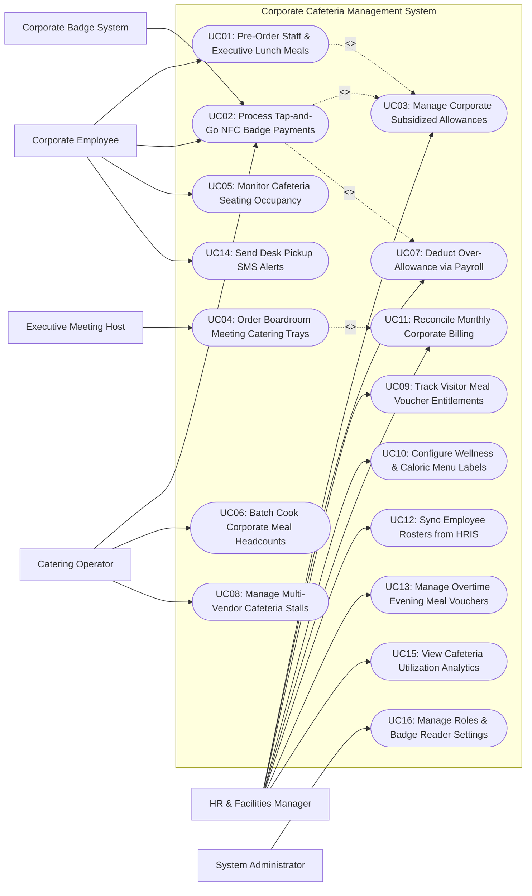

# Use Case Diagram — Corporate Cafeteria Management System

## Mermaid Code

## Actor Table | Bang Actor

| # | Actor | Actor Type | Role Description | Related Use Cases |
|---|-------|------------|------------------|-------------------|
| 1 | Corporate Badge System | Secondary System | Enterprise NFC/RFID building access control hardware sending employee badge UID tokens to cafeteria POS terminals. | UC02 |
| 2 | Corporate Employee | Primary | Company worker tapping NFC badges at self-checkout kiosks, pre-ordering daily lunches, and monitoring personal allowance credits. | UC01, UC02, UC05, UC14 |
| 3 | Executive Meeting Host | Primary | Executive assistant or department manager ordering boardroom meeting catering platters and assigning cost centers. | UC04 |
| 4 | Catering Operator | Primary | Commercial cafeteria vendor receiving batch meal prep sheets, operating serving stations, and managing food stalls. | UC02, UC06, UC08 |
| 5 | HR & Facilities Manager | Primary | Corporate manager configuring meal subsidy policies, per-diem rules, payroll deduction rules, visitor vouchers, and billing reconciliations. | UC03, UC07, UC09, UC10, UC11, UC12, UC13, UC15 |
| 6 | System Administrator | Primary | Technical manager configuring user security roles, badge reader IP bindings, HRIS integration keys, and audit logging policies. | UC16 |

## Use Case Table | Bang Use Case

| # | UC ID | Use Case Name | Primary Actor | Secondary Actor | Description | Priority |
|---|-------|---------------|---------------|-----------------|-------------|----------|
| 1 | UC01 | Pre-Order Staff & Executive Lunch Meals | Corporate Employee | None | Enables employees to pre-order hot lunch meals or executive sushi boxes via mobile app, selecting desk pickup or fast-lane collection. | High |
| 2 | UC02 | Process Tap-and-Go NFC Badge Payments | Corporate Employee | Corporate Badge System | Processes sub-second cashless self-checkout transactions by tapping corporate NFC badges, applying company meal allowances automatically. | High |
| 3 | UC03 | Manage Corporate Subsidized Allowances | HR Manager | None | Configures corporate meal subsidy policies (e.g., $10.00/day per-diem credit per employee), subsidy reset frequencies, and eligibility rules. | High |
| 4 | UC04 | Order Boardroom Meeting Catering Trays | Executive Host | None | Enables meeting organizers to order executive catering platters, coffee service, and fruit trays for boardroom meetings with cost center billing. | High |
| 5 | UC05 | Monitor Cafeteria Seating Occupancy | Corporate Employee | None | Displays real-time cafeteria dining hall seating availability and live crowd density on mobile apps to prevent lunch hour congestion. | Medium |
| 6 | UC06 | Batch Cook Corporate Meal Headcounts | Catering Operator | None | Compiles daily employee pre-orders and historical footfall algorithms to generate exact batch cooking sheets for cafeteria chefs. | High |
| 7 | UC07 | Deduct Over-Allowance via Payroll | HR Manager | None | Exports excess employee meal spend past daily company subsidy limits directly to enterprise payroll systems (Workday, SAP) for automatic salary deduction. | High |
| 8 | UC08 | Manage Multi-Vendor Cafeteria Stalls | Catering Operator | None | Manages third-party food stalls operating within corporate cafeteria spaces, routing orders and calculating monthly revenue shares. | Medium |
| 9 | UC09 | Track Visitor Meal Voucher Entitlements | HR Manager | None | Issues digital or QR code guest meal vouchers for corporate visitors, job candidates, and consultants, charging host cost centers. | Medium |
| 10 | UC10 | Configure Wellness & Caloric Menu Labels | HR Manager | None | Tags cafeteria menu items with nutritional information (Calories, Macros, Allergens) and promotes corporate wellness health incentives. | Medium |
| 11 | UC11 | Reconcile Monthly Corporate Billing | HR Manager | None | Reconciles monthly catering vendor invoices against actual employee badge subsidy usage and boardroom meeting catering charges. | High |
| 12 | UC12 | Sync Employee Rosters from HRIS | HR Manager | None | Synchronizes active employee rosters, department codes, cost center assignments, and termination events from HRIS (Workday, SAP). | High |
| 13 | UC13 | Manage Overtime Evening Meal Vouchers | HR Manager | None | Automatically issues $15.00 evening meal allowance vouchers to employees working past 7:00 PM based on time-clock data. | Medium |
| 14 | UC14 | Send Desk Pickup SMS Alerts | Corporate Employee | None | Dispatches automated SMS or Teams/Slack notifications when pre-ordered lunch boxes arrive at designated floor pickup lockers. | High |
| 15 | UC15 | View Cafeteria Utilization Analytics | HR Manager | None | Displays analytical dashboards on employee cafeteria participation %, total subsidy spend, peak hour crowd density, and vendor sales. | High |
| 16 | UC16 | Manage Roles & Badge Reader Settings | System Admin | None | Configures user security access roles, NFC badge scanner hardware IP bindings, turnstile integration keys, and audit logging. | High |

## Use Case Specification | Dac ta Use Case

---

### UC01 — Pre-Order Staff & Executive Lunch Meals

| Field | Detail |
|-------|--------|
| **UC ID** | UC01 |
| **Use Case Name** | Pre-Order Staff & Executive Lunch Meals |
| **Actor(s)** | Primary: Corporate Employee   Secondary: None |
| **Description** | Enables corporate employees to browse daily cafeteria menus, pre-order meals via mobile app or desktop portal up to 7 days in advance, and select fast-lane pickup or floor locker delivery. |
| **Precondition** | 1. Employee account is active and linked to employee NFC badge (UC12).   2. Daily cafeteria menu catalog is published by catering operator. |
| **Main Flow** | 1. Employee opens "Corporate Dining Pre-Order" on mobile app or web portal.   2. System presents daily menu options for target date (e.g., Wednesday Lunch):      - Grill Station: Flame-Grilled Sirloin Steak with Roasted Potatoes ($12.00)      - Asian Station: Chicken Teriyaki Bento Box ($10.00)      - Salad Bar: Custom Protein Grain Bowl ($9.00)      - Executive Special: Salmon Sashimi Set ($14.00).   3. Employee selects `Chicken Teriyaki Bento Box ($10.00)` and chooses Pickup Location: `Floor 4 Smart Pickup Locker #08` at 12:15 PM.   4. System checks employee's daily company meal allowance (UC03): `Daily Credit Available = $10.00`.   5. System applies $10.00 company meal credit to the order subtotal ($10.00 - $10.00 Allowance = $0.00 Net Employee Out-of-Pocket).   6. Employee confirms order placement.   7. System registers pre-order, routes ticket to Catering KDS (UC06), reserves smart pickup locker #08, and updates daily allowance ledger.   8. Employee receives calendar invite and digital order confirmation token. |
| **Alternative Flow** | **AF1** — Order exceeds daily company subsidy limit:   1. Employee orders Sirloin Steak ($12.00) with $10.00 company credit (Excess = $2.00).   2. System prompts "Charge remaining $2.00 via Payroll Deduction or Credit Card?".   3. Employee selects Payroll Deduction (UC07) and completes pre-order. |
| **Exception Flow** | **EX1** — Pre-order cutoff deadline passed:   1. Employee attempts to pre-order for today at 10:45 AM (past 10:30 AM cutoff rule).   2. System flags notification "Pre-order cutoff time passed for today. Please visit cafeteria walk-up counters." |
| **Postcondition** | Lunch meal is pre-ordered, company meal credit is applied, catering KDS receives prep order, and pickup locker is assigned. |
| **Business Rule** | **BR1**: Daily lunch pre-orders must be placed prior to 10:30 AM on the day of service to allow kitchen batch prep.   **BR2**: Pre-ordered meals take priority in company credit application over walk-up counter purchases. |

---

### UC02 — Process Tap-and-Go NFC Badge Payments

| Field | Detail |
|-------|--------|
| **UC ID** | UC02 |
| **Use Case Name** | Process Tap-and-Go NFC Badge Payments |
| **Actor(s)** | Primary: Corporate Employee, Catering Operator   Secondary: Corporate Badge System |
| **Description** | Processes sub-second cashless self-checkout transactions at cafeteria counters by tapping employee NFC/RFID badges, validating active employee status, applying company subsidies, and routing overages to payroll deduction. |
| **Precondition** | 1. Cafeteria self-checkout kiosk or operator POS is online with connected NFC badge reader.   2. Active employee badge roster is synced (UC12). |
| **Main Flow** | 1. Employee places selected meal items on AI self-checkout camera tray or operator scans item barcodes (e.g., Sandwich $7.00 + Beverage $2.50 = Total $9.50).   2. Self-checkout screen prompts "Tap Corporate Badge to Pay".   3. Employee taps NFC corporate badge on reader pad.   4. Reader transmits encrypted badge UID token to System.   5. System retrieves employee profile: Employee Name (David Miller), Department (Software Engineering), Active Status (`Active`), Daily Subsidy Balance ($10.00 remaining today).   6. System calculates subsidy deduction: `$9.50 Order Total <= $10.00 Daily Subsidy Balance`.   7. System deducts $9.50 from daily subsidy credit (Remaining Daily Subsidy Balance: $0.50).   8. System displays green checkout confirmation screen: **Approved! $9.50 Covered by Company Subsidy (Out-of-Pocket: $0.00)**.   9. Kiosk displays employee photo for cashier audit, emits approval chime, prints e-receipt, and unlocks turnstile exit gate.   10. System dispatches e-receipt to employee mobile app. |
| **Alternative Flow** | **AF1** — Over-allowance split settlement:   1. Total order is $13.50; remaining daily subsidy is $10.00 (Overage: $3.50).   2. System deducts $10.00 from subsidy and routes $3.50 overage to Payroll Deduction queue (UC07).   3. Screen displays: **Approved! $10.00 Subsidy + $3.50 Payroll Deduction**. |
| **Exception Flow** | **EX1** — Terminated employee badge tap:   1. Terminated employee attempts to use old company badge.   2. System cross-references HRIS roster (`Terminated`), denies transaction, sounds red error chime **Card Inactive — Contact HR**, and keeps turnstile gate locked. |
| **Postcondition** | Cashless NFC badge payment is processed, company subsidy is applied, overage is logged, and e-receipt is generated. |
| **Business Rule** | **BR1**: Tap-and-go NFC badge transactions must execute verification and return approval in under 600 milliseconds to maintain fast cafeteria throughput.   **BR2**: Self-checkout kiosks MUST display the official employee HR photo to prevent badge sharing between workers. |

---

### UC03 — Manage Corporate Subsidized Allowances

| Field | Detail |
|-------|--------|
| **UC ID** | UC03 |
| **Use Case Name** | Manage Corporate Subsidized Allowances |
| **Actor(s)** | Primary: HR & Facilities Manager   Secondary: None |
| **Description** | Configures corporate meal subsidy policy rules, per-diem credit amounts (e.g., $10.00/day), department subsidy tiers, reset schedules, and rollover restriction parameters. |
| **Precondition** | 1. User is authenticated with HR & Facilities Manager privileges.   2. Enterprise department structure and employee job levels are loaded. |
| **Main Flow** | 1. HR Manager opens "Corporate Meal Subsidy Policy Builder" on corporate console.   2. Manager configures Policy Profile: `Standard Full-Time Employee Meal Subsidy`.   3. Manager sets Allowance Credit Amount & Frequency:      - Credit Amount: $10.00 per working day      - Allowance Reset Schedule: Daily at 12:00 AM Midnight      - Rollover Policy: `No Rollover (Unused daily credits expire at midnight)`.   4. Manager defines Eligibility Criteria & Department Tiers:      - Tier 1 (Full-Time Regular Employees): $10.00 / day      - Tier 2 (Executives / Directors): $15.00 / day      - Tier 3 (Interns / Contractors): $6.00 / day      - Tier 4 (Night Shift Workers): $12.00 / day + Free Coffee.   5. Manager configures Schedule Active Days: Monday through Friday (Excluding corporate holidays and weekends).   6. Manager saves subsidy policy settings.   7. System updates meal credit allocation engine, applying updated daily subsidy balances to all active employee badge accounts (UC02). |
| **Alternative Flow** | **AF1** — Monthly cumulative subsidy allowance:   1. Manager configures "Monthly Lump-Sum Allowance = $200.00 / month" instead of daily resets.   2. System manages cumulative monthly credit balance. |
| **Exception Flow** | **EX1** — Policy conflict error:   1. Manager attempts to assign multiple conflicting subsidy tiers to a single employee ID.   2. System flags validation error "Employee assigned to multiple tiers. Select single primary tier." |
| **Postcondition** | Corporate meal subsidy policies, per-diem credit tiers, and reset schedules are published across employee badge accounts. |
| **Business Rule** | **BR1**: Daily subsidized meal credits do NOT roll over to subsequent days unless explicitly configured as a cumulative monthly allowance policy.   **BR2**: Subsidy allowances apply strictly on official working days and automatically pause during employee paid time off (PTO) or leaves. |

---

### UC04 — Order Boardroom Meeting Catering Trays

| Field | Detail |
|-------|--------|
| **UC ID** | UC04 |
| **Use Case Name** | Order Boardroom Meeting Catering Trays |
| **Actor(s)** | Primary: Executive Meeting Host   Secondary: None |
| **Description** | Enables executive meeting organizers to order high-end catering platters, coffee service, and fruit trays for corporate boardroom meetings, assigning charges directly to department cost centers. |
| **Precondition** | 1. User has Executive Host or Administrative Assistant permissions.   2. Corporate meeting room booking calendar and catering menu are loaded. |
| **Main Flow** | 1. Executive Host opens "Boardroom Meeting Catering Portal".   2. Host selects Meeting Event Details:      - Meeting Name: Q3 Executive Board Meeting      - Meeting Room Location: Executive Boardroom 10A (Floor 10)      - Meeting Date & Delivery Time: July 25th at 8:30 AM      - Number of Guests: 15 Attendees.   3. Host selects Executive Catering Menu Items:      - Item 1: Executive Continental Breakfast Platter (15 Person) — $180.00      - Item 2: Premium Fresh Juice & Espresso Service Bar — $90.00      - Item 3: Artisan Fruit & Cheese Platter — $75.00.   4. System calculates Catering Order Total: `$180.00 + $90.00 + $75.00 = $345.00`.   5. Host inputs Department Cost Center Code: `Cost Center #CC-4099 (Finance Dept)` and inputs Manager Approval PIN.   6. System validates Cost Center budget availability and verifies meeting room reservation in calendar.   7. Host clicks "Confirm Catering Order".   8. System generates Catering Order Ticket (Order #CAT-9022), dispatches prep instructions to Catering Operator KDS (UC06), schedules delivery runner dispatch, and emails confirmation invoice to Host. |
| **Alternative Flow** | **AF1** — Special dietary requirement catering:   1. Host specifies "3 Guests require Vegan Gluten-Free Meals".   2. System flags dietary modification instructions on kitchen prep ticket. |
| **Exception Flow** | **EX1** — Invalid cost center code:   1. At step 5, Host inputs invalid or inactive Cost Center Code.   2. System flags error "Cost Center Invalid or Budget Exceeded", requiring corrected cost center entry before order submission. |
| **Postcondition** | Boardroom catering order is confirmed, cost center is billed, and catering operator receives delivery schedule. |
| **Business Rule** | **BR1**: Executive boardroom catering orders require a valid corporate Cost Center Code for internal inter-departmental billing.   **BR2**: Catering orders exceeding $200.00 require a minimum 24-hour advance booking notice prior to delivery time. |

---

### UC07 — Deduct Over-Allowance Meals via Payroll

| Field | Detail |
|-------|--------|
| **UC ID** | UC07 |
| **Use Case Name** | Deduct Over-Allowance Meals via Payroll |
| **Actor(s)** | Primary: HR & Facilities Manager   Secondary: Enterprise HRIS & Payroll System |
| **Description** | Aggregates employee meal purchases exceeding daily company subsidy limits, formatting and exporting net out-of-pocket balances to enterprise payroll systems for automatic salary deduction. |
| **Precondition** | 1. Employee badge transactions with over-allowance balances (UC02) are recorded.   2. HRIS payroll export schema integration is active. |
| **Main Flow** | 1. System automatically tracks all employee meal transactions where total spend exceeds daily company subsidy credits during the pay period.   2. For each employee, System aggregates over-allowance out-of-pocket amounts (e.g., Employee David Miller: 8 over-allowance meals @ $2.50 average overage = Total $20.00 Payroll Deduction).   3. At pay period close (e.g., Bi-weekly Payroll Cutoff), HR Manager opens "Payroll Deduction Batch Export" module.   4. System displays Payroll Deduction Summary Table:      - Total Employees with Over-Allowance Spend: 142 Staff      - Total Subsidized Spend Covered by Company: $14,200.00      - Total Over-Allowance Balance to Deduct from Salary: $1,850.00.   5. Manager reviews summary and clicks "Generate Payroll Deduction File".   6. System generates formatted payroll deduction file matching enterprise HRIS schema (e.g., Workday Deduction Code: `MEAL_OVERAGE_DEDUCT` / SAP Wage Type: `4099`).   7. Manager clicks "Transmit to Payroll System".   8. System transmits file to Enterprise HRIS & Payroll System via secure SFTP / API integration endpoint.   9. HRIS acknowledges payroll file ingestion; System marks payroll deduction batch status `Exported & Locked` and resets pay period employee overage accumulators. |
| **Alternative Flow** | **AF1** — Direct credit card payment fallback:   1. Employee prefers NOT to use payroll deduction.   2. Employee links personal credit card in mobile app; System charges credit card instantly for over-allowance amounts instead of queuing for payroll. |
| **Exception Flow** | **EX1** — Terminated employee uncollected overage:   1. System detects an employee with $15.00 uncollected meal overage was terminated prior to payroll run.   2. System flags exception "Terminated Employee Overage", routing balance to final settlement payroll payout deduction. |
| **Postcondition** | Over-allowance meal balances are aggregated, exported to enterprise payroll systems for salary deduction, and pay period balances reset. |
| **Business Rule** | **BR1**: Over-allowance payroll deductions must be supported by signed employee authorization agreements upon corporate onboarding.   **BR2**: Payroll deduction export files must be permanently locked against modification once transmitted to HRIS payroll systems. |
