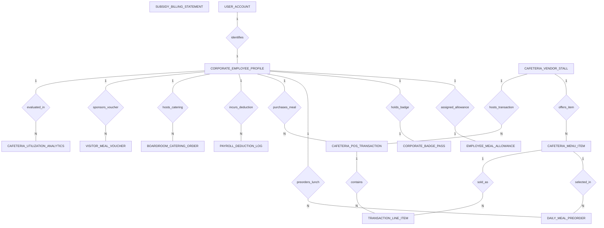

# Conceptual ERD — Corporate Cafeteria Management System

## Mermaid Code

## Entity Description Table | Bang mo ta Entity

| # | Entity Name | Vietnamese Name | Description | Key Attributes | Main Relationships |
|---|-------------|-----------------|-------------|----------------|-------------------|
| 1 | CORPORATE_EMPLOYEE_PROFILE | Ho so nhan vien doanh nghiep | Active corporate employee profile, employee code, full name, department code, cost center ID, and HRIS status. | employee_id, user_id, employee_code, full_name, department_code, cost_center_id, hris_status | Belongs to USER_ACCOUNT; One-to-One with EMPLOYEE_MEAL_ALLOWANCE, CORPORATE_BADGE_PASS; One-to-Many with DAILY_MEAL_PREORDER, CAFETERIA_POS_TRANSACTION, PAYROLL_DEDUCTION_LOG, BOARDROOM_CATERING_ORDER, VISITOR_MEAL_VOUCHER, CAFETERIA_UTILIZATION_ANALYTICS |
| 2 | EMPLOYEE_MEAL_ALLOWANCE | Han muc phu cap tien an | Subsidized meal allowance policy record, daily credit amount, remaining daily balance, policy tier name, and last reset date. | allowance_id, employee_id, daily_credit_amount, remaining_daily_balance, policy_tier_name, last_reset_date | One-to-One with CORPORATE_EMPLOYEE_PROFILE |
| 3 | CORPORATE_BADGE_PASS | The NFC nhan vien | Corporate NFC/RFID building badge pass record, binding employee ID, badge NFC UID token, issued date, and active status. | badge_id, employee_id, badge_nfc_uid, issued_date, is_active | One-to-One with CORPORATE_EMPLOYEE_PROFILE |
| 4 | CAFETERIA_MENU_ITEM | Mon an cang tin | Master cafeteria menu item, stall ID, item name, category, retail price, calories kcal, and active status. | item_id, stall_id, item_name, category, retail_price, calories_kcal, is_active | Belongs to CAFETERIA_VENDOR_STALL; One-to-Many with DAILY_MEAL_PREORDER, TRANSACTION_LINE_ITEM |
| 5 | DAILY_MEAL_PREORDER | Dat truoc suat an hang ngay | Daily lunch meal pre-order record placed by employees, specifying service date, pickup location, subsidy applied, and status. | preorder_id, employee_id, item_id, service_date, pickup_location, subsidy_applied, preorder_status | Belongs to CORPORATE_EMPLOYEE_PROFILE, CAFETERIA_MENU_ITEM |
| 6 | CAFETERIA_POS_TRANSACTION | Giao dich ban hang POS | Cashless cafeteria POS transaction record, employee ID, stall ID, badge NFC UID, grand total, subsidy covered, payroll overage, and timestamp. | transaction_id, employee_id, stall_id, badge_nfc_uid, grand_total, subsidy_amount_covered, payroll_deduction_overage | Belongs to CORPORATE_EMPLOYEE_PROFILE, CAFETERIA_VENDOR_STALL; One-to-Many with TRANSACTION_LINE_ITEM |
| 7 | TRANSACTION_LINE_ITEM | Chi tiet mon hang POS | Line items within a cafeteria POS transaction specifying item ID, quantity, unit price, and total line price. | line_id, transaction_id, item_id, quantity, unit_price, total_line_price | Belongs to CAFETERIA_POS_TRANSACTION, CAFETERIA_MENU_ITEM |
| 8 | PAYROLL_DEDUCTION_LOG | Nhat ky khau tru luong | Export log aggregating employee meal spend exceeding daily company subsidies, total overage amount, batch ref, and HRIS sync status. | deduction_id, employee_id, pay_period_end, total_overage_amount, export_batch_ref, hris_sync_status | Belongs to CORPORATE_EMPLOYEE_PROFILE |
| 9 | BOARDROOM_CATERING_ORDER | Don hang tiec phong hop | Executive boardroom meeting catering order placed by meeting hosts, room location, delivery datetime, total order, and cost center. | order_id, host_employee_id, meeting_name, room_location, delivery_datetime, order_total, cost_center_code | Belongs to CORPORATE_EMPLOYEE_PROFILE |
| 10 | VISITOR_MEAL_VOUCHER | Phieu an khach tham quan | Digital QR code meal voucher issued for corporate visitors/candidates, host employee ID, credit value, valid date, and redemption status. | voucher_id, host_employee_id, visitor_name, qr_voucher_code, credit_value, valid_date, is_redeemed | Belongs to CORPORATE_EMPLOYEE_PROFILE |
| 11 | CAFETERIA_VENDOR_STALL | Gian hang nha thiet phuc vu | Third-party commercial food stall vendor operating within corporate cafeteria spaces, stall code, vendor name, and revenue share %. | stall_id, stall_code, stall_name, vendor_company_name, revenue_share_percent, stall_status | One-to-Many with CAFETERIA_MENU_ITEM, CAFETERIA_POS_TRANSACTION |
| 12 | SUBSIDY_BILLING_STATEMENT | Bao cao quyet toan phu cap | Monthly corporate billing statement calculating total subsidy paid by company, catering spend, payroll deductions, and status. | statement_id, billing_period_start, total_subsidy_paid_by_company, total_catering_spend, statement_status | Enterprise accounting log |
| 13 | USER_ACCOUNT | Tai khoan he thong | Core security authentication account holding credentials, password hashes, and user role definitions. | user_id, username, password_hash, role_name | One-to-One with CORPORATE_EMPLOYEE_PROFILE |
| 14 | CAFETERIA_UTILIZATION_ANALYTICS | Thong ke hieu suat cang tin | Executive daily analytics tracking total employees dined, participation %, total daily subsidy spent, and peak occupancy. | analytics_id, metric_date, total_employees_dined, employee_participation_rate, total_daily_subsidy_spent | Evaluates CORPORATE_EMPLOYEE_PROFILE |

## Relationship Description | Mo ta Quan he

| # | From Entity | Cardinality | To Entity | Relationship Label | Business Explanation |
|---|-------------|-------------|-----------|-------------------|----------------------|
| 1 | USER_ACCOUNT | One-to-One | CORPORATE_EMPLOYEE_PROFILE | identifies | Tai khoan he thong dinh danh ho so nhan vien doanh nghiep. |
| 2 | CORPORATE_EMPLOYEE_PROFILE | One-to-One | EMPLOYEE_MEAL_ALLOWANCE | assigned_allowance | Nhan vien duoc cap han muc tro cap tien an hang ngay theo quy dinh cong ty. |
| 3 | CORPORATE_EMPLOYEE_PROFILE | One-to-One | CORPORATE_BADGE_PASS | holds_badge | Moi nhan vien so huu mot the NFC nhan vien de quet thanh toan tai cang tin. |
| 4 | CORPORATE_EMPLOYEE_PROFILE | One-to-Many | DAILY_MEAL_PREORDER | preorders_lunch | Nhan vien thuc hien dat truoc cac suat an trua hang ngay. |
| 5 | CAFETERIA_MENU_ITEM | One-to-Many | DAILY_MEAL_PREORDER | selected_in | Mon an cang tin duoc chon trong cac don hang dat truoc. |
| 6 | CORPORATE_EMPLOYEE_PROFILE | One-to-Many | CAFETERIA_POS_TRANSACTION | purchases_meal | Nhan vien quet the NFC mua suat an tai quay POS hoac kiosk tu thanh toan. |
| 7 | CAFETERIA_POS_TRANSACTION | One-to-Many | TRANSACTION_LINE_ITEM | contains | Giao dich POS chua nhieu mon an va do uong duoc nhan vien chon. |
| 8 | CAFETERIA_MENU_ITEM | One-to-Many | TRANSACTION_LINE_ITEM | sold_as | Mon an duoc ban va ghi nhan duoi dang chi tiet trong don hang. |
| 9 | CAFETERIA_VENDOR_STALL | One-to-Many | CAFETERIA_MENU_ITEM | offers_item | Gian hang phuc vu cung cap cac mon an trong danh muc cang tin. |
| 10 | CAFETERIA_VENDOR_STALL | One-to-Many | CAFETERIA_POS_TRANSACTION | hosts_transaction | Gian hang thuc hien cac giao dich ban hang va tinh hoa hong voi doanh nghiep. |
| 11 | CORPORATE_EMPLOYEE_PROFILE | One-to-Many | PAYROLL_DEDUCTION_LOG | incurs_deduction | Nhan vien bi khau tru luong neu chi tieu vuot qua han muc tro cap cong ty. |
| 12 | CORPORATE_EMPLOYEE_PROFILE | One-to-Many | BOARDROOM_CATERING_ORDER | hosts_catering | Nhan vien cap quan ly dat tiec phong hop va tinh chi phi vao trung tam chi phi. |
| 13 | CORPORATE_EMPLOYEE_PROFILE | One-to-Many | VISITOR_MEAL_VOUCHER | sponsors_voucher | Nhan vien bao ro phieu an QR cho khach tham quan va doi tac. |
| 14 | CORPORATE_EMPLOYEE_PROFILE | One-to-Many | CAFETERIA_UTILIZATION_ANALYTICS | evaluated_in | Ho so nhan vien va luot an duoc thong ke ty le tham gia va chi phi tro cap. |
