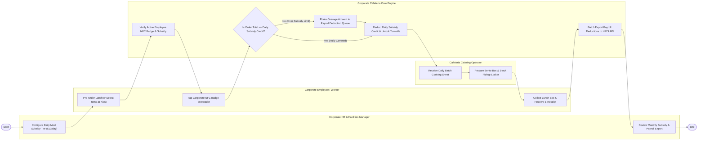

# Swimlane Diagram — Corporate Cafeteria Management System

## Mermaid Code

## Flow Description | Mo ta luong

| Lane | Actor | Role in Flow |
|------|-------|-------------|
| **Lane 1** | Corporate Employee / Worker | Pre-orders lunch via app or selects items at self-checkout kiosks, taps NFC corporate badge, collects lunch boxes from smart lockers, and receives e-receipts. |
| **Lane 2** | Cafeteria Catering Operator | Receives daily batch cooking sheets, prepares bento boxes, stocks smart pickup lockers, and operates walk-up serving lines. |
| **Lane 3** | Corporate HR & Facilities Manager | Configures company meal subsidy tiers ($10/day per-diem credit), monitors utilization, and reviews monthly vendor subsidy billing and payroll exports. |
| **Lane 4** | Corporate Cafeteria Core Engine | Validates NFC badge UIDs, applies daily company meal subsidies, routes overages to payroll deduction queues, unlocks turnstiles, and exports HRIS payroll batches. |

### Process Execution Steps | Cac buoc thuc hien quy trinh

1. **Policy Setup & Pre-Order**: HR Manager configures daily meal subsidy rules ($10/day) (`M1`). Employee pre-orders lunch via app (`C1`). Core Engine validates employee status (`S1`).
2. **NFC Badge Tap & Subsidy Audit**: Employee taps NFC badge on self-checkout reader (`C2`). Core Engine checks order total against remaining daily subsidy (`S2`).
   - If **No (Over Subsidy Limit)**: Core Engine deducts available subsidy and routes excess overage to Payroll Deduction Queue (`S3`).
   - If **Yes (Fully Covered)**: Core Engine fully covers order using company credit (`S4`).
3. **Meal Preparation & Pickup**: Catering Operator receives batch prep sheet (`B1`), prepares lunch box, and stocks pickup locker (`B2`). Employee collects lunch box (`C3`).
4. **Payroll Export & Billing**: Core Engine exports overage balances to HRIS payroll APIs (`S5`), and HR Manager reviews monthly corporate billing statements (`M2`), completing execution (`Finish`).
