# Action Tree — Corporate Cafeteria Management System

## Mermaid Code

```mermaid
graph TD
    Root["Corporate Cafeteria Management System"]

    Root --> M1["Employee Subsidy Allowances & Meal Wallets"]
    Root --> M2["NFC Employee Badge Tap & Self-Checkout POS"]
    Root --> M3["Daily Pre-Ordering & Executive Meeting Catering"]
    Root --> M4["Payroll Deduction & Monthly Corporate Billing"]
    Root --> M5["Multi-Vendor Stall Management & Kitchen Batching"]
    Root --> M6["Visitor Vouchers & HRIS Roster Integration"]
    Root --> M7["Utilization Analytics & System Security"]

    M1 --> A11["Configure Corporate Daily Meal Subsidy Tiers"]
    M1 --> A12["Set Department Cost Center Per-Diem Credits"]
    M1 --> A13["Manage Daily Subsidy Balance Reset Rules"]
    M1 --> A14["Process Employee Credit Card Wallet Top-Ups"]

    M2 --> A21["Process Tap-and-Go NFC Badge Self-Checkout"]
    M2 --> A22["Verify Employee HR Photo on Kiosk Display"]
    M2 --> A23["Apply Company Subsidy Credits Automatically"]
    M2 --> A24["Unlock Turnstile Exit Gates upon Approval"]

    M3 --> A31["Pre-Order Daily Staff Bento Box Lunches"]
    M3 --> A32["Order Executive Boardroom Meeting Catering Platters"]
    M3 --> A33["Assign Meeting Orders to Cost Center Codes"]
    M3 --> A34["Reserve Smart Floor Pickup Locker Slots"]

    M4 --> A41["Aggregate Over-Allowance Meal Out-of-Pocket Spend"]
    M4 --> A42["Export Payroll Deduction Files to Workday and SAP"]
    M4 --> A43["Reconcile Monthly Vendor Subsidy Billing Invoices"]
    M4 --> A44["Audit Overtime Evening Meal Allowance Claims"]

    M5 --> A51["Compile Daily Batch Cooking Headcount Sheets"]
    M5 --> A52["Manage Third-Party Cafeteria Food Stalls"]
    M5 --> A53["Calculate Vendor Revenue Share Commissions"]
    M5 --> A54["Route KDS Orders to Vendor Kitchen Stations"]

    M6 --> A61["Sync Employee Active Rosters from HRIS APIs"]
    M6 --> A62["Issue Digital QR Code Visitor Meal Vouchers"]
    M6 --> A63["Auto-Deactivate Terminated Employee Badges"]
    M6 --> A64["Send Desk Pickup SMS & Teams Push Alerts"]

    M7 --> A71["Monitor Cafeteria Participation & Occupancy"]
    M7 --> A72["Analyze Total Corporate Subsidy Spending"]
    M7 --> A73["Manage User Roles & Security Access Levels"]
    M7 --> A74["Manage Badge Reader Hardware IP Settings"]
```

## Module Description | Mo ta Module

| # | Module | Description | Actions |
|---|--------|-------------|---------|
| 1 | Employee Subsidy Allowances & Meal Wallets | Configures corporate meal subsidy tiers ($10/day credit), department cost center per-diems, daily balance reset schedules, and personal top-ups. | Configure Corporate Daily Meal Subsidy Tiers, Set Department Cost Center Per-Diem Credits, Manage Daily Subsidy Balance Reset Rules, Process Employee Credit Card Wallet Top-Ups |
| 2 | NFC Employee Badge Tap & Self-Checkout POS | Processes cashless self-checkout transactions via NFC corporate badge taps, validates employee photo IDs, applies subsidies, and unlocks turnstiles. | Process Tap-and-Go NFC Badge Self-Checkout, Verify Employee HR Photo on Kiosk Display, Apply Company Subsidy Credits Automatically, Unlock Turnstile Exit Gates upon Approval |
| 3 | Daily Pre-Ordering & Executive Meeting Catering | Enables desktop/mobile daily lunch pre-orders, boardroom meeting catering orders with cost center billing, and smart pickup locker assignments. | Pre-Order Daily Staff Bento Box Lunches, Order Executive Boardroom Meeting Catering Platters, Assign Meeting Orders to Cost Center Codes, Reserve Smart Floor Pickup Locker Slots |
| 4 | Payroll Deduction & Monthly Corporate Billing | Aggregates over-allowance meal spend, exports salary deduction files to HRIS (Workday, SAP), reconciles monthly vendor billing, and audits overtime claims. | Aggregate Over-Allowance Meal Out-of-Pocket Spend, Export Payroll Deduction Files to Workday and SAP, Reconcile Monthly Vendor Subsidy Billing Invoices, Audit Overtime Evening Meal Allowance Claims |
| 5 | Multi-Vendor Stall Management & Kitchen Batching | Compiles daily kitchen batch prep sheets, manages third-party food stalls within cafeteria spaces, routes KDS orders, and calculates revenue shares. | Compile Daily Batch Cooking Headcount Sheets, Manage Third-Party Cafeteria Food Stalls, Calculate Vendor Revenue Share Commissions, Route KDS Orders to Vendor Kitchen Stations |
| 6 | Visitor Vouchers & HRIS Roster Integration | Syncs active employee rosters from HRIS APIs, deactivates terminated badges, issues QR code visitor meal vouchers, and sends desk pickup alerts. | Sync Employee Active Rosters from HRIS APIs, Issue Digital QR Code Visitor Meal Vouchers, Auto-Deactivate Terminated Employee Badges, Send Desk Pickup SMS & Teams Push Alerts |
| 7 | Utilization Analytics & System Security | Displays analytical dashboards on cafeteria employee participation rates, total subsidy spend, peak occupancy, NFC badge reader settings, and security roles. | Monitor Cafeteria Participation & Occupancy, Analyze Total Corporate Subsidy Spending, Manage User Roles & Security Access Levels, Manage Badge Reader Hardware IP Settings |
