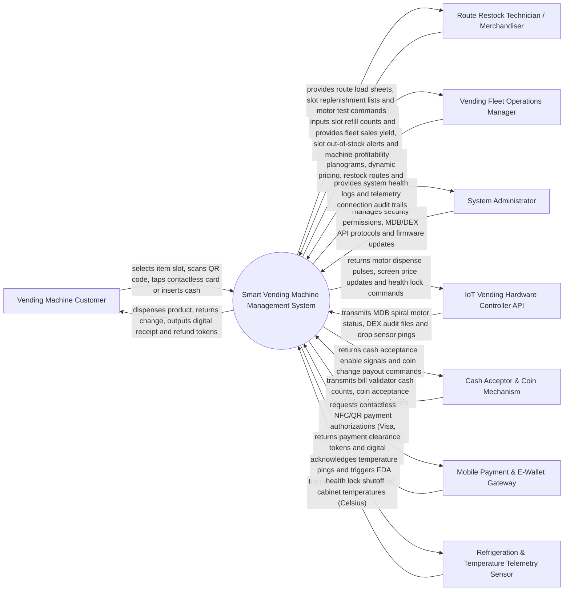

# Context Diagram — Smart Vending Machine Management System

## Mermaid Code

## Actor & Interaction Table | Bang Actor & Tuong tac

| # | Actor | Actor Type | Data Sent TO System | Data Received FROM System | Notes |
|---|-------|------------|---------------------|---------------------------|-------|
| 1 | Vending Machine Customer | Primary | Item slot selections (e.g., Slot A1), contactless credit card taps, e-wallet QR scans, cash bills | Product dispense execution, change coins, touchscreen UI updates, digital receipts | Interacts via 21-inch touchscreen, contactless card reader, or mobile app. |
| 2 | Route Restock Technician | Primary | Restock arrival check-ins, slot refill counts, door open/close events, cash collection bag IDs | Route truck load sheets, slot planogram refill targets, motor diagnostic commands | Drives route trucks to restock snacks/drinks and clear cash boxes. |
| 3 | Vending Fleet Manager | Primary | Slot planogram configurations, product pricing, route schedules, location contracts | Real-time fleet sales yield, slot depletion alerts, machine profitability, DEX reports | Oversees network of smart vending machines across airports, malls, and offices. |
| 4 | System Administrator | Primary | User credentials, security role policies, MDB/DEX protocol configurations, OTA firmware | Platform health metrics, hardware connection logs, telemetry audit trails | Manages IoT cloud infrastructure, vending hardware protocols, and security. |
| 5 | IoT Vending Controller API | Supporting | MDB bus status, spiral motor rotation counts, laser drop sensor pings, DEX audit files | Motor dispense pulse triggers, price update payloads, emergency health lock signals | Main Board Controller (MBC) managing spiral motors and DEX telemetry. |
| 6 | Cash Acceptor & Coin Mechanism | Supporting | Inserted bill validation signals, coin acceptor counts, coin tube inventory levels | Bill validator enable/disable signals, coin change payout pulse commands | Hardware bill validator (e.g., MEI/CPI) and coin mechanism for physical cash. |
| 7 | Mobile Payment & E-Wallet Gateway | Supporting | Contactless NFC card authorizations, Apple Pay, MoMo/ZaloPay QR code tokens | Payment clearance approvals, transaction receipts, refund tokens | Processes wireless credit card taps and e-wallet payments over 4G/5G. |
| 8 | Temperature Telemetry Sensor | Supporting | Continuous cabinet internal temperature readings (Celsius), compressor status | Temperature telemetry acknowledgments, FDA health lock threshold limits | IoT probe measuring food/beverage cabinet temperatures (FDA 4.4°C / 10°C rules). |

## System Boundary Description | Mo ta Pham vi He thong

The **Smart Vending Machine Management System** manages IoT-connected smart vending machine fleets, touchscreen item selections, multi-tender payments (NFC, QR e-wallets, cash), motor spiral dispense validation via laser drop sensors, dynamic planogram pricing, automated restock route optimization, refrigeration health safety locks, and DEX audit file financial reconciliation. Inside its boundary, the system handles real-time slot inventory tracking, MDB motor control, laser optical drop verification, automated refund triggers on drop failure, remote cabinet temperature monitoring, FDA health lock shutoff enforcement, restock truck load sheet generation, and DEX audit cash reconciliation.

The system boundary excludes physical mechanical motor manufacturing, physical driving of restock trucks, physical refrigeration compressor repair, and raw credit card clearance (handled by Mobile Payment Gateways).
