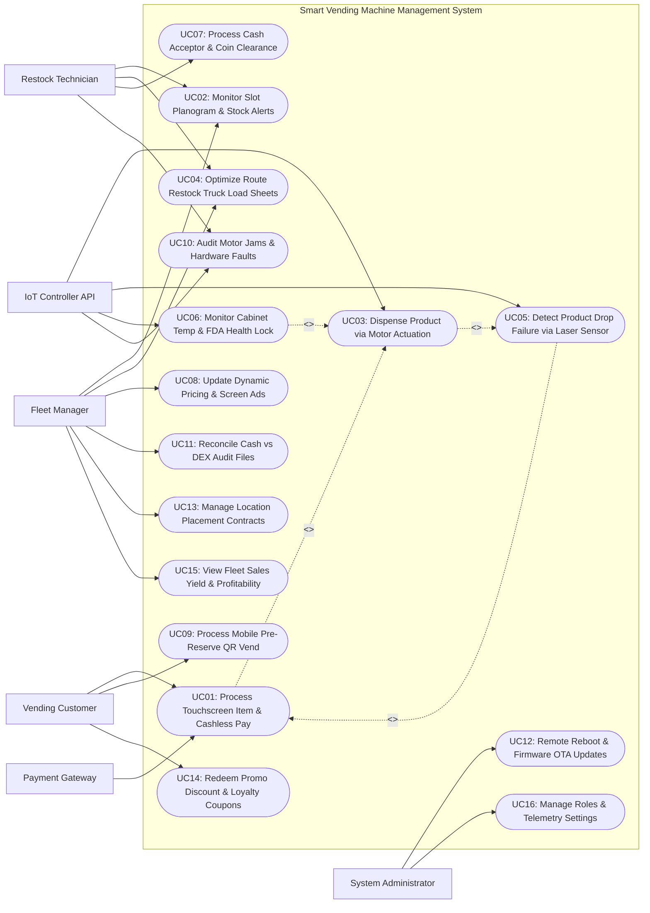

# Use Case Diagram — Smart Vending Machine Management System

## Mermaid Code

## Actor Table | Bang Actor

| # | Actor | Actor Type | Role Description | Related Use Cases |
|---|-------|------------|------------------|-------------------|
| 1 | Payment Gateway | Secondary System | Cellular payment processing network clearing contactless credit cards (Visa/MC) and e-wallets (Apple Pay, MoMo). | UC01 |
| 2 | IoT Controller API | Secondary System | Vending Main Board Controller (MBC) operating MDB spiral motors, laser optical drop sensors, and temperature probes. | UC03, UC05, UC06, UC10 |
| 3 | Vending Customer | Primary | Consumer selecting items on touchscreen, paying via contactless card/QR/cash, and picking up dispensed items. | UC01, UC09, UC14 |
| 4 | Restock Technician | Primary | Field merchandiser driving route trucks, refilling slot planograms, clearing cash boxes, and resolving motor jams. | UC02, UC04, UC07, UC10 |
| 5 | Fleet Manager | Primary | Operations manager configuring slot planograms, setting prices, scheduling restock routes, auditing DEX files, and analyzing sales yield. | UC02, UC04, UC08, UC11, UC13, UC15 |
| 6 | System Administrator | Primary | Technical manager issuing OTA firmware updates, configuring MDB/DEX parameters, user roles, and security policies. | UC12, UC16 |

## Use Case Table | Bang Use Case

| # | UC ID | Use Case Name | Primary Actor | Secondary Actor | Description | Priority |
|---|-------|---------------|---------------|-----------------|-------------|----------|
| 1 | UC01 | Process Touchscreen Item & Cashless Pay | Customer | Payment Gateway | Processes item selection on interactive touchscreen, authorizing contactless card, QR code, or cash payments. | High |
| 2 | UC02 | Monitor Slot Planogram & Stock Alerts | Fleet Manager | Restock Tech | Tracks real-time slot item inventory balances per machine, triggering low-stock alerts when slots fall below threshold. | High |
| 3 | UC03 | Dispense Product via Motor Actuation | System | IoT Controller API | Triggers MDB spiral motor rotation (360° turn) to advance the selected product toward the delivery bin. | High |
| 4 | UC04 | Optimize Route Restock Truck Load Sheets | Fleet Manager | Restock Tech | Generates optimized restock driving routes and consolidated truck load sheets based on real-time slot depletion data. | High |
| 5 | UC05 | Detect Product Drop Failure via Laser Sensor | System | IoT Controller API | Validates product drop into delivery bin using laser optical sensors (e.g., DropSensor / iVend); auto-refunds on failure. | High |
| 6 | UC06 | Monitor Cabinet Temp & FDA Health Lock | System | IoT Controller API | Monitors cabinet temperature in real time, triggering mandatory FDA Health Locks (shutting off vending) if temp exceeds 10°C for > 15 mins. | High |
| 7 | UC07 | Process Cash Acceptor & Coin Clearance | Restock Tech | None | Logs physical cash bag collection from bill validators and coin mechanisms, recording expected vs cleared cash totals. | High |
| 8 | UC08 | Update Dynamic Pricing & Screen Ads | Fleet Manager | None | Remotely updates slot prices (e.g., Happy Hour discounts) and updates promotional video advertising on machine touchscreens. | Medium |
| 9 | UC09 | Process Mobile Pre-Reserve QR Vend | Customer | None | Enables customers to pre-reserve a drink via mobile app and scan QR code at the machine screen to trigger instant contactless vending. | Medium |
| 10 | UC10 | Audit Motor Jams & Hardware Faults | Restock Tech | IoT Controller API | Logs mechanical spiral motor jams, bill acceptor jams, and temperature sensor faults, dispatching repair alerts to technicians. | High |
| 11 | UC11 | Reconcile Cash vs DEX Audit Files | Fleet Manager | None | Reconciles physical cash collection counts against electronic DEX (Data Exchange Standard) audit files downloaded from machines. | High |
| 12 | UC12 | Remote Reboot & Firmware OTA Updates | System Admin | None | Executes Over-The-Air (OTA) software and firmware updates to vending machine controllers and triggers remote hardware reboots. | Medium |
| 13 | UC13 | Manage Location Placement Contracts | Fleet Manager | None | Manages location leasing contracts for machine placements in airports, offices, and malls, calculating monthly utility and rent fees. | Medium |
| 14 | UC14 | Redeem Promo Discount & Loyalty Coupons | Customer | None | Validates promotional QR discount coupons and loyalty reward codes at the machine screen, deducting product prices. | Medium |
| 15 | UC15 | View Fleet Sales Yield & Profitability | Fleet Manager | None | Displays analytical dashboards on fleet total revenue, high-yielding machine locations, top-selling SKUs, and gross margins. | High |
| 16 | UC16 | Manage Roles & Telemetry Settings | System Admin | None | Configures user security access roles, MDB controller protocol parameters, sensor alert thresholds, and audit logging. | High |

## Use Case Specification | Dac ta Use Case

---

### UC01 — Process Touchscreen Item & Cashless Pay

| Field | Detail |
|-------|--------|
| **UC ID** | UC01 |
| **Use Case Name** | Process Touchscreen Item & Cashless Pay |
| **Actor(s)** | Primary: Vending Customer   Secondary: Payment Gateway |
| **Description** | Enables a customer to browse products on an interactive 21-inch touchscreen, select an item slot, view nutritional/allergen info, and complete payment via contactless NFC card, QR e-wallet, or physical cash. |
| **Precondition** | 1. Vending machine is online and operating in `Normal` mode.   2. Selected slot item has active inventory (> 0) and cabinet temperature is normal (UC06). |
| **Main Flow** | 1. Customer approaches machine and browses product catalog on 21-inch touchscreen.   2. Customer selects a product (e.g., Slot B3 — Cold Brew Coffee @ $3.50).   3. Screen displays product details: Item Name, Price ($3.50), Volume (330ml), Calories (120 kcal), Allergen Warnings (Contains Dairy).   4. Customer taps "Purchase Item".   5. Screen displays Payment Options: `Contactless Card / Apple Pay`, `QR E-Wallet (MoMo / ZaloPay)`, `Cash / Coins`.   6. Customer selects `Contactless Card` and taps Visa contactless card on reader pad.   7. System sends wireless authorization request over 4G cellular data to Payment Gateway.   8. Payment Gateway approves transaction ($3.50) and returns HTTP 200 Authorization Token.   9. Screen displays "Payment Approved! Dispensing Product...".   10. System triggers Product Motor Dispense Actuation (UC03) and Laser Drop Sensor Validation (UC05).   11. Customer retrieves cold brew coffee from delivery bin; Screen displays QR code for digital e-receipt. |
| **Alternative Flow** | **AF1** — Cash payment execution:   1. Customer inserts $5.00 bill into bill acceptor.   2. System validates bill, dispenses $3.50 product, and pays out $1.50 in change coins from coin mechanism. |
| **Exception Flow** | **EX1** — Card decline:   1. At step 8, Payment Gateway returns card decline error.   2. Screen displays error "Payment Declined — Select Alternative Payment Method", resetting checkout timer. |
| **Postcondition** | Payment is cleared, product is dispensed, inventory is decremented, and digital receipt QR is displayed. |
| **Business Rule** | **BR1**: Cashless payment transactions at vending machines MUST complete authorization within 2.5 seconds.   **BR2**: If a slot product is out of stock, the touchscreen MUST gray out the slot image and block selection attempts. |

---

### UC02 — Monitor Slot Planogram & Stock Alerts

| Field | Detail |
|-------|--------|
| **UC ID** | UC02 |
| **Use Case Name** | Monitor Slot Planogram & Stock Alerts |
| **Actor(s)** | Primary: Vending Fleet Manager   Secondary: Restock Technician |
| **Description** | Tracks real-time inventory levels for every individual coil slot in every vending machine across the fleet, triggering automated low-stock and out-of-stock alerts to route technicians. |
| **Precondition** | 1. Machine slot planogram mapping (Slot ID -> Product SKU -> Max Capacity) is configured.   2. Machine telemetry pings are active. |
| **Main Flow** | 1. Vending machine processes product dispense transactions throughout the day (UC03).   2. After each successful vend, System decrements slot inventory balance (e.g., Slot A1 - Energy Drink: Capacity 10; Current Stock: 2).   3. System checks slot inventory against configured Low-Stock Threshold (e.g., Threshold = 3 items).   4. Current stock (2 items) falls below threshold (3 items).   5. System flags **Low-Stock Alert: Machine #V-409, Slot A1 at 20% Capacity (2 items left)**.   6. When stock reaches 0 items, System flags **OUT-OF-STOCK ALERT: Machine #V-409, Slot A1 EMPTY**, grays out slot on machine touchscreen, and updates telemetry status.   7. System routes low-stock data to Route Restock Optimization Engine (UC04), automatically adding Machine #V-409 to tomorrow's restock truck manifest.   8. Fleet Manager views real-time fleet planogram status map, filtering machines by stock urgency. |
| **Alternative Flow** | **AF1** — Restock technician refilling slots:   1. Technician opens machine door, scans machine QR code, and inputs refilled quantities (Slot A1 refilled to 10).   2. System resets slot inventory balance to 10 and clears out-of-stock alert. |
| **Exception Flow** | **EX1** — Inventory discrepancy during restock:   1. Technician finds 0 items in Slot A1, but system expected 2 items (un-logged vend or theft).   2. Technician logs "Inventory Shrinkage: 2 items missing", resetting stock to actual count. |
| **Postcondition** | Real-time slot inventory is tracked, out-of-stock alerts are triggered, and restock manifests are updated. |
| **Business Rule** | **BR1**: Low-stock alerts must trigger when slot inventory falls below 25% of maximum coil capacity.   **BR2**: Out-of-stock slots must instantly update touchscreen displays to prevent customer selection of empty items. |

---

### UC03 — Dispense Product via Motor Spiral Actuation

| Field | Detail |
|-------|--------|
| **UC ID** | UC03 |
| **Use Case Name** | Dispense Product via Motor Spiral Actuation |
| **Actor(s)** | Primary: System   Secondary: IoT Controller API |
| **Description** | Sends MDB protocol motor dispense commands to actuate the specific spiral coil motor assigned to the selected slot, rotating 360° to push the product forward into the drop chute. |
| **Precondition** | 1. Customer payment (UC01) is cleared and authorized.   2. Target slot motor ID (e.g., Motor #12 for Slot B3) is healthy (no motor jam fault). |
| **Main Flow** | 1. System receives payment clearance confirmation for Slot B3 ($3.50 Cold Brew Coffee).   2. System sends MDB Vend Command to IoT Vending Controller API: `MDB_VEND_REQ(Motor_ID: 12, Price: 350)`.   3. Main Board Controller (MBC) energizes 24V DC spiral motor #12.   4. Motor #12 rotates 360 degrees, driving the metal spiral coil forward to advance the product over the shelf edge.   5. Product falls down the vertical drop chute toward the delivery bin.   6. System activates Laser Optical Drop Sensor (UC05) to detect product passing through the drop zone.   7. Motor reaches home position microswitch, completes 360° rotation, and de-energizes.   8. System receives MDB Vend Success status from controller.   9. System updates slot inventory balance (UC02) and records successful transaction log. |
| **Alternative Flow** | **AF1** — Conveyor belt / Elevator vending model:   1. Machine uses robotic elevator arm instead of spiral coil (e.g., fragile glass bottle vending).   2. System commands elevator arm to move to Shelf B, collect bottle, and lower smoothly to delivery bin. |
| **Exception Flow** | **EX1** — Motor jam fault (Motor over-current):   1. At step 4, spiral coil jams due to misaligned product package; Controller detects motor over-current.   2. Controller stops motor, flags Motor Jam Fault (UC10), and triggers Laser Drop Sensor check (UC05). |
| **Postcondition** | Spiral motor rotates 360°, product is pushed into drop chute, drop sensor validates delivery, and inventory decrements. |
| **Business Rule** | **BR1**: Motor actuation must complete within 6 seconds of payment authorization.   **BR2**: If a motor experiences an electrical over-current jam, the controller must immediately cut motor power to prevent motor burnout. |

---

### UC05 — Detect Product Drop Failure via Laser Optical Sensors

| Field | Detail |
|-------|--------|
| **UC ID** | UC05 |
| **Use Case Name** | Detect Product Drop Failure via Laser Optical Sensors |
| **Actor(s)** | Primary: System   Secondary: IoT Controller API, Payment Gateway |
| **Description** | Validates successful product delivery into the bottom collection bin using infrared laser optical drop sensors; if no product drop is detected, the system auto-retries or refunds the customer instantly. |
| **Precondition** | 1. Motor spiral actuation (UC03) has been triggered.   2. Infrared laser optical drop sensor array (e.g., iVend / DropSensor) is active at delivery bin throat. |
| **Main Flow** | 1. Spiral motor rotates to push product forward (UC03).   2. System monitors infrared laser beam array at the top of the delivery bin.   3. As product falls through drop chute, it breaks the infrared laser beams.   4. Drop sensor controller detects laser beam interruption, confirming physical product drop.   5. Drop sensor controller sends signal `DROP_SUCCESS` to System within 4 seconds of motor start.   6. System confirms successful vend, completes customer transaction, and displays "Enjoy Your Snack!".   7. Transaction closes normally. |
| **Alternative Flow** | **AF1** — Secondary motor nudge retry on initial drop failure:   1. Product hangs on shelf edge; Laser drop sensor receives NO beam interruption after initial 360° motor turn.   2. System automatically commands motor to execute a 90° "Nudge Rotation" to dislodge stuck item.   3. Product falls, breaks laser beam (`DROP_SUCCESS`), and vend completes. |
| **Exception Flow** | **EX1** — Total drop failure (Item stuck on coil):   1. Product remains stuck after nudge retry; Drop sensor receives NO drop signal (`DROP_FAILURE`).   2. System halts motor, flags Slot B3 as `Temporarily Out of Service / Motor Stuck` (UC10), and reverses customer payment.   3. For cashless card payments, System sends instant payment cancellation / refund request to Payment Gateway ($3.50 refunded).   4. Touchscreen displays: **Item Stuck — Payment Refunded! Select Alternative Item or Collect Refund.** |
| **Postcondition** | Product drop is verified by laser sensors, OR stuck item triggers automatic payment refund and slot out-of-service locking. |
| **Business Rule** | **BR1**: Guaranteed Vend Policy: Customers MUST NOT be charged if laser optical drop sensors do not confirm physical product delivery.   **BR2**: Slots experiencing 2 consecutive drop failures MUST be locked from selection until serviced by a restock technician. |

---

### UC06 — Monitor Cabinet Temp & FDA Health Locks

| Field | Detail |
|-------|--------|
| **UC ID** | UC06 |
| **Use Case Name** | Monitor Cabinet Temp & FDA Health Locks |
| **Actor(s)** | Primary: System   Secondary: IoT Controller API |
| **Description** | Continuously monitors internal refrigerated cabinet temperatures; if temperature exceeds health safety limits (FDA 10°C rule for perishable food) for > 15 minutes, the system engages an automated FDA Health Lock, shutting off sales to prevent food poisoning. |
| **Precondition** | 1. Machine contains perishable food items (Sandwiches, Milk, Yogurt, Salads).   2. IoT cabinet temperature sensor probe is active. |
| **Main Flow** | 1. Temperature Sensor Probe measures internal cabinet temperature every 60 seconds (e.g., Normal Temp: 3.2°C).   2. System ingests temperature telemetry and verifies health threshold limits (Perishable Food Safety Threshold = 10.0°C / 50°F).   3. Refrigeration compressor experiences a mechanical cooling failure; Cabinet temperature rises to 12.5°C.   4. System detects temperature has exceeded 10.0°C threshold and starts a 15-minute Safety Warning Timer.   5. System sends high-priority alert to Fleet Manager & Technician: **CRITICAL TEMP ALARM: Machine #V-409 at 12.5°C (Timer: 15 Mins)**.   6. Temperature remains above 10.0°C for 15 consecutive minutes without recovery.   7. System engages mandatory **FDA HEALTH LOCKOUT**:      - Machine immediately disables all perishable food item slots.      - Touchscreen displays prominent alert: **OUT OF SERVICE — Health Safety Lock Engaged**.      - System blocks all payment acceptance and motor actuation (UC01, UC03).   8. System logs Health Lockout Event and dispatches urgent dispatch ticket to technician to inspect cooling unit and discard spoiled food. |
| **Alternative Flow** | **AF1** — Automatic recovery during brief door open:   1. Temp spikes to 11.0°C for 3 minutes during technician restock door opening, then recovers to 3.5°C.   2. System resets safety timer and maintains normal vending operation. |
| **Exception Flow** | **EX1** — Manual technician override after food disposal:   1. Technician repairs compressor and discards spoiled food inventory.   2. Technician inputs security PIN and taps "Clear Health Lock & Reset Machine".   3. System unlocks machine once temperature drops below 4.0°C. |
| **Postcondition** | Cabinet temperature is monitored, and health locks engage automatically if temperature breaches safety limits > 15 minutes. |
| **Business Rule** | **BR1**: FDA Health Lock Requirement: Perishable food vending machines MUST automatically lock out sales if cabinet temperature exceeds 10°C (50°F) for longer than 15 minutes.   **BR2**: Engaged Health Locks CANNOT be cleared until internal cabinet temperature drops below 4°C and a technician logs food disposal sign-off. |
