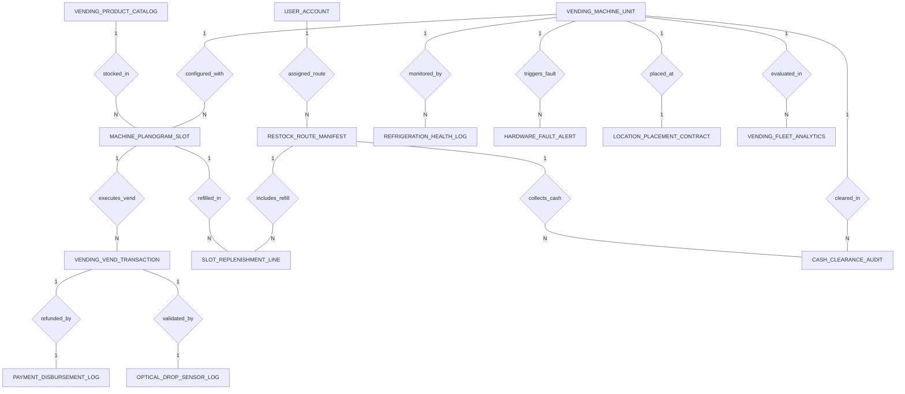

# Conceptual ERD — Smart Vending Machine Management System

## Mermaid Code

## Entity Description Table | Bang mo ta Entity

| # | Entity Name | Vietnamese Name | Description | Key Attributes | Main Relationships |
|---|-------------|-----------------|-------------|----------------|-------------------|
| 1 | VENDING_MACHINE_UNIT | May ban hang tu dong | Physical smart vending machine unit record, machine code, serial number, model type, IP address, status, and health lock flag. | machine_id, machine_code, serial_number, model_type, IP_address, machine_status, health_lock_engaged | One-to-Many with MACHINE_PLANOGRAM_SLOT, REFRIGERATION_HEALTH_LOG, HARDWARE_FAULT_ALERT, CASH_CLEARANCE_AUDIT, VENDING_FLEET_ANALYTICS; One-to-One with LOCATION_PLACEMENT_CONTRACT |
| 2 | MACHINE_PLANOGRAM_SLOT | Lo cuon ma ma hang | Individual coil/slot in a vending machine, slot code (e.g., A1), product ID, max capacity, current stock, and unit price. | slot_id, machine_id, product_id, slot_code, max_capacity, current_stock, unit_price | Belongs to VENDING_MACHINE_UNIT, VENDING_PRODUCT_CATALOG; One-to-Many with VENDING_VEND_TRANSACTION, SLOT_REPLENISHMENT_LINE |
| 3 | VENDING_PRODUCT_CATALOG | Danh muc san pham | Master product catalog item, SKU, product name, category, calories kcal, and perishable food flag. | product_id, product_sku, product_name, category, calories_kcal, is_perishable | One-to-Many with MACHINE_PLANOGRAM_SLOT |
| 4 | VENDING_VEND_TRANSACTION | Giao dich nhan hang | Individual vend transaction record, slot ID, transaction ref, amount paid, payment method, vend status, and timestamp. | transaction_id, slot_id, transaction_ref, amount_paid, payment_method, vend_status, vend_time | Belongs to MACHINE_PLANOGRAM_SLOT; One-to-One with PAYMENT_DISBURSEMENT_LOG, OPTICAL_DROP_SENSOR_LOG |
| 5 | PAYMENT_DISBURSEMENT_LOG | Nhat ky hoan tien | Refund transaction log executed when optical drop sensors detect a vend failure, recording refund amount and gateway ref. | disbursement_id, transaction_id, refund_amount, gateway_ref, disbursement_status | One-to-One with VENDING_VEND_TRANSACTION |
| 6 | RESTOCK_ROUTE_MANIFEST | Lo trinh va danh sach nhat hang | Restock route manifest assigned to a technician for a specific date, total machines count, and route status. | route_id, technician_user_id, route_date, total_machines_count, route_status | Belongs to USER_ACCOUNT; One-to-Many with SLOT_REPLENISHMENT_LINE, CASH_CLEARANCE_AUDIT |
| 7 | SLOT_REPLENISHMENT_LINE | Chi tiet nhat hang lo | Line item recording the refilled product quantity for a specific slot during a restock route run, and timestamp. | line_id, route_id, slot_id, refilled_quantity, refilled_at | Belongs to RESTOCK_ROUTE_MANIFEST, MACHINE_PLANOGRAM_SLOT |
| 8 | OPTICAL_DROP_SENSOR_LOG | Nhat ky cam bien drop laser | Laser optical drop sensor log recording whether product drop was detected, beam break duration ms, and timestamp. | drop_log_id, transaction_id, drop_detected, beam_break_duration_ms, logged_at | One-to-One with VENDING_VEND_TRANSACTION |
| 9 | REFRIGERATION_HEALTH_LOG | Nhat ky nhiet do lo lanh | Real-time cabinet temperature monitoring log recording cabinet temp °C, breach flags, breach duration minutes, and timestamp. | health_log_id, machine_id, cabinet_temp_celsius, is_temp_breached, breach_duration_minutes, logged_at | Belongs to VENDING_MACHINE_UNIT |
| 10 | HARDWARE_FAULT_ALERT | Canh bao loi phan cung | Vending machine hardware fault alert log tracking fault code (e.g., Motor Jam, Bill Acceptor Jam), description, and severity. | fault_id, machine_id, fault_code, fault_description, severity_level, triggered_at | Belongs to VENDING_MACHINE_UNIT |
| 11 | CASH_CLEARANCE_AUDIT | Kiem ke tien mat thu hoi | Cash audit log recorded during restock runs comparing expected DEX cash totals vs actual cash bagged by technician, and variance. | audit_id, machine_id, route_id, expected_cash_total, actual_cash_bagged, cash_variance | Belongs to VENDING_MACHINE_UNIT, RESTOCK_ROUTE_MANIFEST |
| 12 | LOCATION_PLACEMENT_CONTRACT | Hop dong vi tri dat may | Location leasing contract for machine placement, location name, address, monthly rent fee, and revenue share percentage. | contract_id, machine_id, location_name, street_address, monthly_rent_fee, revenue_share_percent | One-to-One with VENDING_MACHINE_UNIT |
| 13 | USER_ACCOUNT | Tai khoan he thong | Core security authentication account holding credentials, password hashes, and user role definitions. | user_id, username, password_hash, role_name | One-to-Many with RESTOCK_ROUTE_MANIFEST |
| 14 | VENDING_FLEET_ANALYTICS | Thong ke hieu suat doi may | Executive daily analytics tracking total active machines, total fleet revenue, average sales per machine, and out-of-stock rates. | analytics_id, metric_date, total_active_machines, total_fleet_revenue, avg_sales_per_machine, fleet_out_of_stock_rate | Evaluates VENDING_MACHINE_UNIT |

## Relationship Description | Mo ta Quan he

| # | From Entity | Cardinality | To Entity | Relationship Label | Business Explanation |
|---|-------------|-------------|-----------|-------------------|----------------------|
| 1 | VENDING_MACHINE_UNIT | One-to-Many | MACHINE_PLANOGRAM_SLOT | configured_with | Mot may ban hang tu dong duoc thiet lap nhieu lo cuon (slot) theo so do planogram. |
| 2 | VENDING_PRODUCT_CATALOG | One-to-Many | MACHINE_PLANOGRAM_SLOT | stocked_in | Mot san pham trong danh muc duoc xep vao nhieu lo cuon cua cac may. |
| 3 | MACHINE_PLANOGRAM_SLOT | One-to-Many | VENDING_VEND_TRANSACTION | executes_vend | Mot lo cuon thuc hien cac giao dich xoay cuon va xuat hang cho khach. |
| 4 | VENDING_VEND_TRANSACTION | One-to-One | PAYMENT_DISBURSEMENT_LOG | refunded_by | Mot giao dich xuat hang bi loi rớt hang duoc hoan tien tu dong qua cong thanh toan. |
| 5 | VENDING_VEND_TRANSACTION | One-to-One | OPTICAL_DROP_SENSOR_LOG | validated_by | Mot giao dich xuat hang duoc xac nhan thuc te qua cam bien laser drop. |
| 6 | USER_ACCOUNT | One-to-Many | RESTOCK_ROUTE_MANIFEST | assigned_route | Nhan vien ky thuat phu trách duoc phan cong cac lo trinh nhat hang va kiem ke. |
| 7 | RESTOCK_ROUTE_MANIFEST | One-to-Many | SLOT_REPLENISHMENT_LINE | includes_refill | Lo trinh nhat hang bao gom chi tiet so luong nap them cho tung lo cuon. |
| 8 | MACHINE_PLANOGRAM_SLOT | One-to-Many | SLOT_REPLENISHMENT_LINE | refilled_in | Mot lo cuon duoc nap them hang trong cac luot di tuyen cua nhan vien. |
| 9 | VENDING_MACHINE_UNIT | One-to-Many | REFRIGERATION_HEALTH_LOG | monitored_by | Mot may ban hang duoc theo doi nhat ky nhiet do tu lanh thoi gian thuc. |
| 10 | VENDING_MACHINE_UNIT | One-to-Many | HARDWARE_FAULT_ALERT | triggers_fault | Mot may ban hang ghi nhan cac canh bao loi kẹt cuon, kẹt tien hoac loi phan cung. |
| 11 | VENDING_MACHINE_UNIT | One-to-Many | CASH_CLEARANCE_AUDIT | cleared_in | Mot may ban hang duoc kiem ke va thu hoi hop tien mat theo chu ky. |
| 12 | RESTOCK_ROUTE_MANIFEST | One-to-Many | CASH_CLEARANCE_AUDIT | collects_cash | Ca di tuyen thuc hien thu hoi hop tien mat va kiem ke so voi du lieu DEX. |
| 13 | VENDING_MACHINE_UNIT | One-to-One | LOCATION_PLACEMENT_CONTRACT | placed_at | Mot may ban hang duoc dat tai mot vi tri theo hop dong thue vi tri. |
| 14 | VENDING_MACHINE_UNIT | One-to-Many | VENDING_FLEET_ANALYTICS | evaluated_in | Cac may ban hang duoc thong ke va danh gia hieu suat doanh thu hang ngay. |
