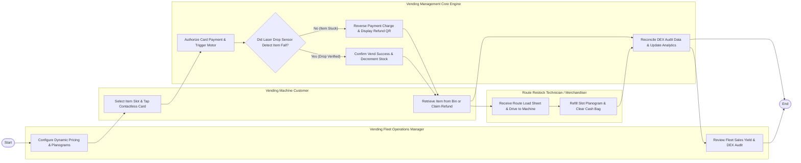

# Swimlane Diagram — Smart Vending Machine Management System

## Mermaid Code

## Flow Description | Mo ta luong

| Lane | Actor | Role in Flow |
|------|-------|-------------|
| **Lane 1** | Vending Machine Customer | Selects item slot on touchscreen, pays via contactless card or QR code, retrieves dispensed item from collection bin, or receives instant refund. |
| **Lane 2** | Route Restock Technician / Merchandiser | Receives optimized restock load sheets, drives route truck to machines, refills slot planograms, clears cash boxes, and resolves jams. |
| **Lane 3** | Vending Fleet Operations Manager | Configures dynamic slot pricing, manages planograms, schedules restock routes, and reviews DEX audit file financial reconciliations. |
| **Lane 4** | Vending Management Core Engine | Authorizes cellular payments, actuates MDB spiral motors, verifies product drops via laser sensors, auto-refunds stuck items, and logs DEX analytics. |

### Process Execution Steps | Cac buoc thuc hien quy trinh

1. **Planogram Setup & Selection**: Fleet Manager configures slot pricing and planograms (`M1`). Customer selects slot item and taps contactless card (`C1`). Core Engine authorizes payment and actuates MDB motor (`S1`).
2. **Motor Actuation & Laser Drop Check**: Core Engine monitors infrared laser drop sensor array (`S2`).
   - If **No (Item Stuck / Drop Failed)**: Core Engine halts motor, reverses card payment, and displays refund QR code (`S3`). Customer claims refund (`C2`).
   - If **Yes (Drop Verified)**: Core Engine confirms vend success, decrements slot stock (`S4`), and customer retrieves item from bin (`C2`).
3. **Route Restock & Cash Clearance**: Technician receives route load sheet (`K1`), refilling slot planograms and clearing cash boxes (`K2`).
4. **DEX Reconciliation & Analytics**: Core Engine reconciles DEX audit files (`S5`), and Fleet Manager reviews sales yield reports (`M2`), completing execution (`Finish`).
