# Action Tree — Smart Vending Machine Management System

## Mermaid Code

```mermaid
graph TD
    Root["Smart Vending Machine Management System"]

    Root --> M1["Machine Fleet IoT Telemetry & Planograms"]
    Root --> M2["Touchscreen POS & Cashless Payment Processing"]
    Root --> M3["Motor Dispense Actuation & Drop Sensor Validation"]
    Root --> M4["Refrigeration Health Locks & Temperature Alarms"]
    Root --> M5["Restock Route Manifests & Truck Load Sheets"]
    Root --> M6["Cash Collection & DEX Audit File Reconciliation"]
    Root --> M7["Fleet Yield Analytics & System Security"]

    M1 --> A11["Configure Slot Planogram Product Mapping"]
    M1 --> A12["Track Real-Time Slot Inventory Balances"]
    M1 --> A13["Trigger Automated Out-of-Stock Alerts"]
    M1 --> A14["Remotely Update Dynamic Item Prices"]

    M2 --> A21["Process Contactless Credit Card NFC Payments"]
    M2 --> A22["Process QR Code E-Wallet Payments"]
    M2 --> A23["Process Bill Acceptor Cash & Coin Change"]
    M2 --> A24["Redeem Promo Discount & Loyalty Coupons"]

    M3 --> A31["Send MDB 360 Degree Spiral Motor Vend Commands"]
    M3 --> A32["Detect Product Drop via Infrared Laser Sensors"]
    M3 --> A33["Execute Motor Nudge Retry on Stuck Items"]
    M3 --> A34["Trigger Automated Payment Refund on Vend Failure"]

    M4 --> A41["Monitor Cabinet Internal Temperature Sensors"]
    M4 --> A42["Enforce 15-Minute FDA Health Safety Locks"]
    M4 --> A43["Shut Off Perishable Food Sales on Temp Breaches"]
    M4 --> A44["Log Compressor Mechanical Failure Alerts"]

    M5 --> A51["Generate Restock Route Driving Manifests"]
    M5 --> A52["Calculate Consolidated Truck Load Sheets"]
    M5 --> A53["Scan Slot Barcodes for Refill Confirmation"]
    M5 --> A54["Record Inventory Shrinkage & Waste Disposals"]

    M6 --> A61["Log Physical Cash Bag Collections"]
    M6 --> A62["Download DEX Audit Files from Controller"]
    M6 --> A63["Reconcile Billed Cash vs DEX Audit Data"]
    M6 --> A64["Track Coin Tube Refill Adjustments"]

    M7 --> A71["Monitor Fleet Sales Yield & Gross Margins"]
    M7 --> A72["Compare Location Placement Contract Rent Fees"]
    M7 --> A73["Execute Remote Firmware OTA Software Updates"]
    M7 --> A74["Manage User Roles & Telemetry Threshold Settings"]
```

## Module Description | Mo ta Module

| # | Module | Description | Actions |
|---|--------|-------------|---------|
| 1 | Machine Fleet IoT Telemetry & Planograms | Configures slot planogram product mappings, tracks real-time coil inventory balances, triggers out-of-stock alerts, and updates dynamic prices. | Configure Slot Planogram Product Mapping, Track Real-Time Slot Inventory Balances, Trigger Automated Out-of-Stock Alerts, Remotely Update Dynamic Item Prices |
| 2 | Touchscreen POS & Cashless Payment Processing | Processes contactless credit card NFC taps, QR e-wallet payments, physical cash/coins, e-receipts, and promotional coupon redemptions. | Process Contactless Credit Card NFC Payments, Process QR Code E-Wallet Payments, Process Bill Acceptor Cash & Coin Change, Redeem Promo Discount & Loyalty Coupons |
| 3 | Motor Dispense Actuation & Drop Sensor Validation | Controls MDB 360° spiral motor rotation, validates product drop via infrared laser sensors, executes nudge retries, and auto-refunds stuck items. | Send MDB 360 Degree Spiral Motor Vend Commands, Detect Product Drop via Infrared Laser Sensors, Execute Motor Nudge Retry on Stuck Items, Trigger Automated Payment Refund on Vend Failure |
| 4 | Refrigeration Health Locks & Temperature Alarms | Monitors cabinet temperature probes, enforces 15-minute FDA Health Locks (> 10°C rule), shuts off perishable sales, and logs compressor faults. | Monitor Cabinet Internal Temperature Sensors, Enforce 15-Minute FDA Health Safety Locks, Shut Off Perishable Food Sales on Temp Breaches, Log Compressor Mechanical Failure Alerts |
| 5 | Restock Route Manifests & Truck Load Sheets | Generates optimized restock driving routes, calculates consolidated truck load sheets, scans slot barcodes, and records inventory shrinkage. | Generate Restock Route Driving Manifests, Calculate Consolidated Truck Load Sheets, Scan Slot Barcodes for Refill Confirmation, Record Inventory Shrinkage & Waste Disposals |
| 6 | Cash Collection & DEX Audit File Reconciliation | Logs physical cash bag collections from bill validators, downloads DEX audit files, reconciles cash variances, and tracks coin tube levels. | Log Physical Cash Bag Collections, Download DEX Audit Files from Controller, Reconcile Billed Cash vs DEX Audit Data, Track Coin Tube Refill Adjustments |
| 7 | Fleet Yield Analytics & System Security | Displays executive analytics on machine sales yield, location rent fees, executes remote OTA firmware updates, and manages MDB settings. | Monitor Fleet Sales Yield & Gross Margins, Compare Location Placement Contract Rent Fees, Execute Remote Firmware OTA Software Updates, Manage User Roles & Telemetry Threshold Settings |
