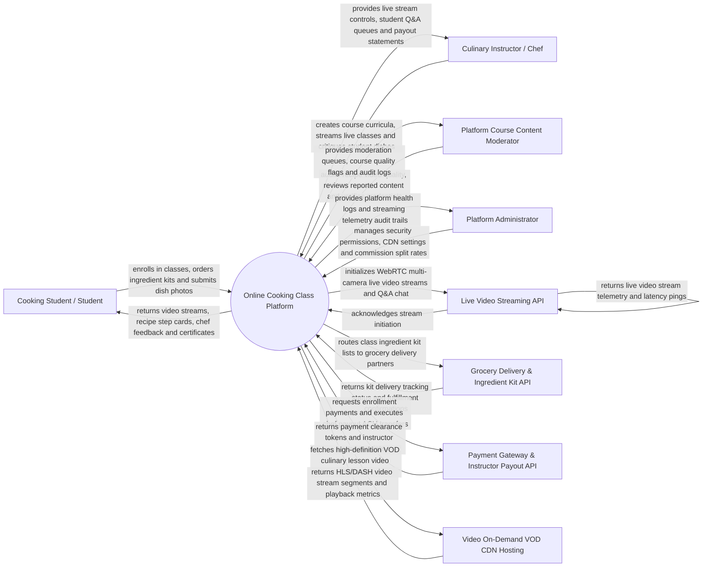

# Context Diagram — Online Cooking Class Platform

## Mermaid Code

## Actor & Interaction Table | Bang Actor & Tuong tac

| # | Actor | Actor Type | Data Sent TO System | Data Received FROM System | Notes |
|---|-------|------------|---------------------|---------------------------|-------|
| 1 | Cooking Student / Student | Primary | Course enrollment choices, ingredient kit orders, live stream chat questions, dish photo submissions | Interactive video streams, step recipe cards, chef feedback ratings, certificates | Interacts via web portal, tablet kitchen stand, or smart TV app. |
| 2 | Culinary Instructor / Chef | Primary | Course curricula, recipe step guides, live multi-cam video broadcasts, dish critique ratings | Live Q&A chat queue, student headcount, dish submission queues, payout reports | Professional chefs, bakers, and culinary educators hosting online classes. |
| 3 | Content Moderator | Primary | Course approval decisions, video quality audit flags, instructor credential verifications | Course moderation queue, video quality metrics, user reporting tickets | Ensures course video production quality and recipe accuracy. |
| 4 | Platform Administrator | Primary | User security roles, CDN streaming configurations, platform commission rates (e.g., 20%), API keys | System health metrics, video bandwidth logs, revenue audit trails | Manages platform infrastructure, video streaming CDN, and settings. |
| 5 | Live Video Streaming API | Supporting | Real-time WebRTC stream pings, video resolution logs, live chat message payloads | Stream session initialization tokens, multi-camera angle switching triggers | External low-latency streaming infrastructure (e.g., Agora, WebRTC, Zoom SDK). |
| 6 | Grocery Delivery & Ingredient Kit API | Supporting | Delivery tracking numbers, door-step delivery status, kit fulfillment confirmations | Ingredient kit dispatch manifests, student shipping address details | Integrates with delivery partners (e.g., Instacart, DoorDash Drive) to ship prep kits. |
| 7 | Payment Gateway & Payout API | Supporting | Course fee clearance tokens, instructor bank ACH payout confirmations | Course enrollment payment authorizations, net instructor payout receipts | Processes student course fees (Stripe/PayPal) and chef payouts (Stripe Connect). |
| 8 | Video On-Demand VOD CDN Hosting | Supporting | HLS/DASH video stream segment manifests, CDN playback bandwidth logs | High-definition pre-recorded culinary lesson video files, video transcoding jobs | Cloud CDN hosting pre-recorded VOD cooking courses (e.g., AWS CloudFront, Vimeo). |

## System Boundary Description | Mo ta Pham vi He thong

The **Online Cooking Class Platform** manages interactive online culinary education, live stream broadcasting, pre-recorded video-on-demand (VOD) courses, door-step ingredient kit delivery, dish photo submission feedback, and culinary certification. Inside its boundary, the system handles course curriculum creation, multi-camera live stream switching, interactive step recipe cards, ingredient kit grocery dispatching, AI-assisted and chef dish photo grading, student skill badge progression, instructor revenue payout split calculations, and VOD CDN streaming.

The system boundary excludes physical cooking of food in students' homes, physical grocery picking in warehouses, credit card processing (handled by Payment Gateways), and video hardware camera manufacturing.
