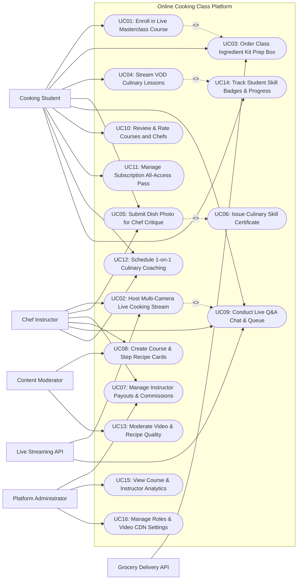

# Use Case Diagram — Online Cooking Class Platform

## Mermaid Code

## Actor Table | Bang Actor

| # | Actor | Actor Type | Role Description | Related Use Cases |
|---|-------|------------|------------------|-------------------|
| 1 | Live Streaming API | Secondary System | WebRTC low-latency streaming infrastructure handling multi-camera video feeds and live Q&A chat. | UC02, UC09 |
| 2 | Grocery Delivery API | Secondary System | Fulfillment API routing ingredient kit order manifests to local grocery delivery partners (Instacart, DoorDash). | UC03 |
| 3 | Cooking Student | Primary | Learner enrolling in live masterclasses, ordering ingredient kits, streaming VOD lessons, and submitting dish photos. | UC01, UC03, UC04, UC05, UC09, UC10, UC11, UC12, UC14 |
| 4 | Chef Instructor | Primary | Professional chef building course curricula, hosting live cooking streams, answering student questions, and grading dish submissions. | UC02, UC05, UC07, UC08, UC09, UC12 |
| 5 | Content Moderator | Primary | Quality assurance moderator reviewing course video quality, auditing recipe accuracy, and checking instructor credentials. | UC08, UC13 |
| 6 | Platform Administrator | Primary | System admin managing platform commission splits, instructor payouts, CDN video parameters, user roles, and analytics. | UC07, UC15, UC16 |

## Use Case Table | Bang Use Case

| # | UC ID | Use Case Name | Primary Actor | Secondary Actor | Description | Priority |
|---|-------|---------------|---------------|-----------------|-------------|----------|
| 1 | UC01 | Enroll in Live Masterclass Course | Student | None | Enables students to browse live cooking masterclasses, purchase enrollment tickets, and reserve stream slots. | High |
| 2 | UC02 | Host Multi-Camera Live Cooking Stream | Chef Instructor | Live Streaming API | Broadcasts low-latency multi-camera live video streams (Overhead Knife Cam, Stove Cam, Chef Face Cam) for interactive classes. | High |
| 3 | UC03 | Order Class Ingredient Kit Prep Box | Student | Grocery Delivery API | Bundles exact pre-portioned raw ingredient kits for enrolled courses and dispatches them to student homes via grocery delivery. | High |
| 4 | UC04 | Stream VOD Culinary Lessons | Student | None | Streams pre-recorded high-definition video-on-demand (VOD) cooking lessons with interactive step-by-step recipe overlays. | High |
| 5 | UC05 | Submit Dish Photo for Chef Critique | Student | Chef Instructor | Allows students to upload photos/videos of their finished dish for chef review, receiving personalized video/audio feedback and grades. | High |
| 6 | UC06 | Issue Culinary Skill Certificate | System | None | Generates verifiable digital culinary certificates and micro-credentials (e.g., French Sauce Certification) upon course completion. | High |
| 7 | UC07 | Manage Instructor Payouts & Commissions | Chef Instructor | Platform Admin | Calculates net instructor earnings (e.g., 80% course fee split) and dispatches automated direct bank ACH payouts. | High |
| 8 | UC08 | Create Course & Step Recipe Cards | Chef Instructor | Content Moderator | Enables chefs to build course curricula, upload lesson videos, and create interactive step-by-step recipe cards with timers. | High |
| 9 | UC09 | Conduct Live Q&A Chat & Queue | Student | Chef Instructor | Manages real-time student Q&A chat, allowing students to raise virtual hands and ask live voice/text questions during stream. | High |
| 10 | UC10 | Review & Rate Courses and Chefs | Student | None | Allows enrolled students to publish ratings (1-5 stars) and written reviews for completed cooking courses and chefs. | High |
| 11 | UC11 | Manage Subscription All-Access Pass | Student | None | Manages monthly/annual all-access subscription passes granting unlimited access to VOD culinary lesson libraries. | High |
| 12 | UC12 | Schedule 1-on-1 Culinary Coaching | Student | Chef Instructor | Schedules private 1-on-1 virtual video coaching sessions with celebrity chefs for personalized culinary guidance. | Medium |
| 13 | UC13 | Moderate Video & Recipe Quality | Content Moderator | None | Audits uploaded course video production quality, recipe safety compliance, and verifies instructor professional credentials. | Medium |
| 14 | UC14 | Track Student Skill Badges & Progress | Student | None | Tracks student course completion progress, recipe mastery meters, and awards gamification badges (e.g., Pasta Master). | Medium |
| 15 | UC15 | View Course & Instructor Analytics | Platform Admin | None | Displays analytical dashboards on total enrollment revenue, course completion rates, active streams, and top chefs. | High |
| 16 | UC16 | Manage Roles & Video CDN Settings | Platform Admin | None | Configures user security access roles, WebRTC streaming server parameters, AWS CloudFront CDN keys, and audit logs. | High |

## Use Case Specification | Dac ta Use Case

---

### UC01 — Enroll in Live Masterclass Course

| Field | Detail |
|-------|--------|
| **UC ID** | UC01 |
| **Use Case Name** | Enroll in Live Masterclass Course |
| **Actor(s)** | Primary: Cooking Student   Secondary: None |
| **Description** | Enables a student to search upcoming live interactive cooking masterclasses (e.g., "Authentic Italian Pasta Making with Chef Marco"), select stream dates, purchase enrollment tickets, and optionally add an ingredient kit. |
| **Precondition** | 1. Student has an active user account.   2. Live masterclass schedule and ticket seat capacity (e.g., Max 30 students) are published by chef. |
| **Main Flow** | 1. Student opens "Live Cooking Masterclasses" catalog on app or web portal.   2. Student selects a live course: `Handmade Pasta & Artisan Sauces Masterclass`.   3. System displays course details: Chef Profile (Chef Marco Rossi), Date & Time (Saturday at 5:00 PM EST), Class Duration (2.0 Hours), Seat Ticket Price ($35.00), Equipment Required (Pasta Roller, Rolling Pin).   4. System prompts: "Add Official Pre-Portioned Ingredient Kit for $25.00 (Includes Semolina Flour, Organic Eggs, Parmigiano-Reggiano, Fresh Basil)?".   5. Student checks "Add Ingredient Kit (Doorstep Delivery)" (UC03).   6. System calculates total charge: `$35.00 Class Ticket + $25.00 Ingredient Kit = $60.00 Total`.   7. Student inputs credit card details; System authorizes payment via Payment Gateway.   8. System registers student enrollment record, reserves seat ticket, routes ingredient kit dispatch manifest to grocery delivery partner (UC03), and sends calendar invite with WebRTC stream access link. |
| **Alternative Flow** | **AF1** — Enrolling using Subscription All-Access Pass (UC11):   1. Student holds active VIP Subscription Pass.   2. System applies 100% ticket discount ($0.00 ticket fee), charging only for optional ingredient kit. |
| **Exception Flow** | **EX1** — Class capacity sold out:   1. Masterclass has reached maximum student capacity (30/30 seats filled).   2. System displays "Class Sold Out", prompting student to join Waitlist or enroll in upcoming session. |
| **Postcondition** | Student is enrolled in live masterclass, seat is reserved, ingredient kit order is dispatched, and stream link is delivered. |
| **Business Rule** | **BR1**: Live interactive masterclass seats are capped per session (max 30 students) to ensure interactive chef-student ratio.   **BR2**: Live class enrollments with doorstep ingredient kits must be booked at least 72 hours prior to stream time. |

---

### UC02 — Host Multi-Camera Live Cooking Stream

| Field | Detail |
|-------|--------|
| **UC ID** | UC02 |
| **Use Case Name** | Host Multi-Camera Live Cooking Stream |
| **Actor(s)** | Primary: Chef Instructor   Secondary: Live Streaming API |
| **Description** | Enables a chef instructor to broadcast a high-definition, low-latency multi-camera live video stream (Overhead Cutting Board Cam, Stove Cam, Chef Face Cam) with real-time camera angle switching and interactive Q&A. |
| **Precondition** | 1. Chef is logged into Instructor Studio console 15 minutes prior to scheduled stream time.   2. WebRTC Live Streaming API hardware cameras are connected. |
| **Main Flow** | 1. Chef opens "Instructor Studio" and selects scheduled session: `Handmade Pasta Masterclass (15 Enrolled Students)`.   2. Chef verifies connected video camera feeds on preview monitor:      - Camera 1: Chef Main Angle (Face & Prep Counter)      - Camera 2: Overhead Cutting Board Cam (Close-Up Kneading)      - Camera 3: Stove / Boiling Pot Cam.   3. Chef clicks "Go Live".   4. System initializes low-latency WebRTC stream session via Live Streaming API, broadcasting stream to all enrolled student apps.   5. During class, Chef switches camera angles using studio video switcher (e.g., Switching to Camera 2 Overhead to demonstrate pasta dough rolling technique).   6. System overlays Interactive Step Recipe Cards (UC08) on student screens corresponding to current cooking step (e.g., Step 3: "Knead Dough for 10 Minutes — Timer: 10:00").   7. Chef monitors real-time student Q&A chat queue (UC09) and answers student questions live on stream.   8. Upon class completion, Chef clicks "End Broadcast"; System saves stream recording to VOD library (UC04) and opens Dish Submission Queue (UC05). |
| **Alternative Flow** | **AF1** — Co-hosted duo chef stream:   1. Chef invites guest pastry chef to join stream remotely.   2. System splits screen into side-by-side duo broadcast. |
| **Exception Flow** | **EX1** — Chef internet connection drop:   1. Chef cellular/broadband drops connection mid-stream.   2. System holds stream session for 60 seconds displaying "Reconnecting Chef Feed...", and auto-resumes once connection restores. |
| **Postcondition** | Multi-camera live stream is broadcasted, step recipe cards overlay, Q&A is conducted, and recording is archived to VOD. |
| **Business Rule** | **BR1**: Live streams must maintain sub-second video latency (< 800ms) to enable real-time verbal chef guidance.   **BR2**: Completed live class streams must automatically transcode and archive into the VOD course library within 2 hours. |

---

### UC03 — Order Class Ingredient Kit Prep Box

| Field | Detail |
|-------|--------|
| **UC ID** | UC03 |
| **Use Case Name** | Order Class Ingredient Kit Prep Box |
| **Actor(s)** | Primary: Cooking Student   Secondary: Grocery Delivery API |
| **Description** | Bundles exact pre-portioned raw ingredient kits required for an enrolled cooking class and routes the order to local grocery delivery partners for doorstep delivery prior to class time. |
| **Precondition** | 1. Course recipe ingredient Bill of Materials (BOM) is configured in system.   2. Student is enrolling in a course (UC01) or ordering kit separately. |
| **Main Flow** | 1. During course enrollment (UC01), Student checks "Add Ingredient Kit Prep Box ($25.00)".   2. System retrieves recipe ingredient BOM for the course:      - 500g Semolina Flour (Grade AA)      - 4 Organic Pasture-Raised Eggs      - 100g Parmigiano-Reggiano Wedge      - 1 Bunch Fresh Sweet Basil      - 50ml Extra Virgin Olive Oil (Italy).   3. Student inputs Delivery Shipping Address and selects Target Delivery Window (e.g., Friday between 2:00 PM - 5:00 PM, 1 day before Saturday class).   4. System verifies address coverage and transmits order dispatch manifest via Grocery Delivery API (e.g., Instacart / DoorDash Drive API).   5. Delivery partner acknowledges order manifest and assigns local grocery fulfillment store.   6. On delivery day, Grocery partner packs cold-insulated prep box, attaches QR shipment tag, and delivers kit to student doorstep.   7. Delivery API sends delivery confirmation webhook to System; System dispatches SMS alert to student: "Your Pasta Masterclass Ingredient Kit has arrived! Keep eggs & cheese refrigerated." |
| **Alternative Flow** | **AF1** — Self-shopping digital grocery list export:   1. Student opts OUT of prep kit delivery.   2. System exports interactive digital shopping list to student's Instacart or Amazon Fresh cart for self-checkout. |
| **Exception Flow** | **EX1** — Out-of-stock specialty ingredient:   1. Grocery partner is out of stock of Fresh Basil.   2. Grocery API sends substitution alert: "Substituting Fresh Organic Oregano". System sends notification to student. |
| **Postcondition** | Ingredient kit order is generated, dispatched to grocery delivery partner, delivered to student, and SMS alert is sent. |
| **Business Rule** | **BR1**: Ingredient prep boxes containing perishable items (Dairy, Meat, Seafood) MUST be shipped in cold-pack insulated thermal boxes.   **BR2**: Delivery windows must be scheduled at least 24 hours prior to the scheduled live class stream start time. |

---

### UC05 — Submit Dish Photo for Chef Critique

| Field | Detail |
|-------|--------|
| **UC ID** | UC05 |
| **Use Case Name** | Submit Dish Photo for Chef Critique |
| **Actor(s)** | Primary: Cooking Student, Chef Instructor   Secondary: None |
| **Description** | Enables students to upload photos or short video clips of their finished dish after completing a class, receiving personalized ratings, voice notes, and culinary feedback from the chef instructor. |
| **Precondition** | 1. Student has completed a live or VOD cooking lesson.   2. Dish submission window is open for the course. |
| **Main Flow** | 1. Student opens "Submit My Finished Dish" on course completion page.   2. Student uploads 2 High-Resolution Dish Photos (Plating View & Cross-Section Cut View) and optional 15-second video clip.   3. Student inputs self-assessment notes: "Pasta dough was supple, but sauce felt slightly thick. Plated with fresh basil garnish."   4. Student clicks "Submit for Chef Critique".   5. System queues dish submission in Chef Instructor's "Critique Review Workbench".   6. Chef Instructor receives notification, opens submission, and evaluates dish across 3 culinary criteria:      - Plating & Presentation (Score: 5/5)      - Technique & Doneness (Score: 4/5 — "Dough rolled evenly, great color")      - Sauce Emulsification (Score: 4/5).   7. Chef records a 30-second personalized audio voice note: "Bravo Sarah! Great pasta thickness. Next time, add 2 tablespoons of pasta starchy water to loosen the sauce..."   8. Chef submits critique evaluation.   9. System notifies student, publishes critique score card on student profile, and triggers Culinary Skill Certificate issuance (UC06). |
| **Alternative Flow** | **AF1** — Community peer review feedback:   1. Student marks submission "Public to Class Gallery".   2. Classmate students view dish photo, leave encouraging comments, and vote "Chef Worthy!". |
| **Exception Flow** | **EX1** — Inappropriate non-food photo upload:   1. Student uploads non-food image by mistake.   2. System AI photo screening detects non-food content, blocks submission, and prompts valid food photo re-upload. |
| **Postcondition** | Finished dish photo is uploaded, chef evaluates plating/technique, audio voice critique is attached, and certificate triggers. |
| **Business Rule** | **BR1**: Chef instructors must complete student dish critiques within 48 hours of photo submission.   **BR2**: Passing dish submission score (overall >= 70%) is mandatory for earning verifiable culinary skill certificates. |

---

### UC06 — Issue Culinary Skill Certificate

| Field | Detail |
|-------|--------|
| **UC ID** | UC06 |
| **Use Case Name** | Issue Culinary Skill Certificate |
| **Actor(s)** | Primary: System   Secondary: None |
| **Description** | Generates verifiable digital culinary skill certificates and micro-credential badges upon successful course completion and chef dish critique approval, allowing students to share achievements. |
| **Precondition** | 1. Student has completed all course lessons and received passing dish critique score (UC05).   2. Certificate template for the course is configured. |
| **Main Flow** | 1. Chef Instructor approves passing score on student dish submission (UC05).   2. System triggers Automated Certificate Generation Engine.   3. System compiles certificate metadata:      - Student Full Name: Sarah Jenkins      - Certificate Title: `Certified Artisan Pasta Maker — Level 1`      - Instructor Name & Signature: Chef Marco Rossi      - Issue Date: July 19, 2026      - Unique Verification ID: `CERT-PASTA-88192`      - Skill Micro-Credentials Earned: `[Hand-Rolled Dough, Emulsified Sauces, Pasta Extrusion]`.   4. System renders high-resolution PDF certificate with embedded QR verification code and cryptographic digital signature.   5. System archives certificate record in student profile and issues digital badge to student's skill portfolio (UC14).   6. System dispatches congratulations email to student with download link and "Share to LinkedIn / Instagram" buttons.   7. Third parties scanning certificate QR code are directed to public verification URL confirming certificate authenticity. |
| **Alternative Flow** | **AF1** — Digital badge export to LinkedIn / Credly:   1. Student clicks "Add Micro-Credential to LinkedIn Profile".   2. System exports verified Open Badge JSON payload to student's LinkedIn certifications section. |
| **Exception Flow** | **EX1** — Certificate revocation for fraud:   1. Moderator discovers student uploaded plagiarized stock photo for dish critique.   2. System revokes Certificate ID #CERT-PASTA-88192 and marks verification link `Revoked / Invalid`. |
| **Postcondition** | Verifiable digital certificate PDF is generated, skill badge is awarded, and public verification QR code is active. |
| **Business Rule** | **BR1**: Culinary certificates MUST contain a cryptographic verification ID and QR code to prevent forgery.   **BR2**: Certificates are issued ONLY upon chef instructor approval of student dish photo submission (UC05). |
