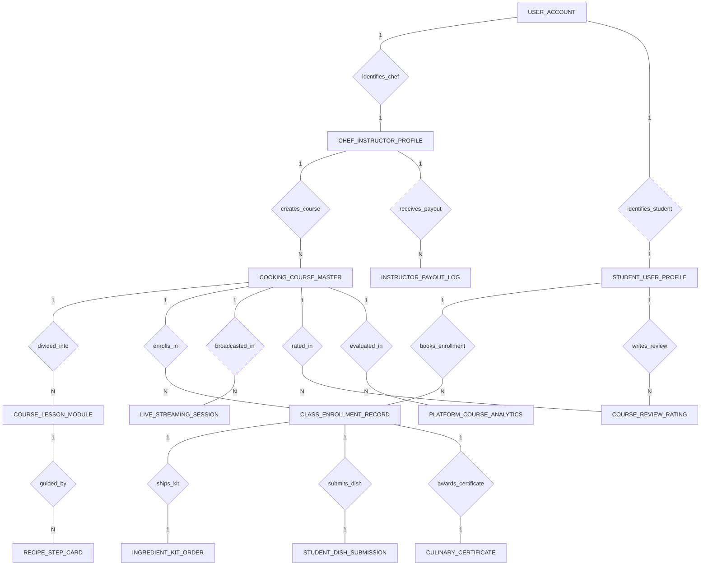

# Conceptual ERD — Online Cooking Class Platform

## Mermaid Code

## Entity Description Table | Bang mo ta Entity

| # | Entity Name | Vietnamese Name | Description | Key Attributes | Main Relationships |
|---|-------------|-----------------|-------------|----------------|-------------------|
| 1 | COOKING_COURSE_MASTER | Khoa hoc nau an master | Master cooking course record, instructor ID, course title, cuisine category, course fee, type (Live/VOD), and published status. | course_id, instructor_id, course_title, cuisine_category, course_fee, course_type, is_published | Belongs to CHEF_INSTRUCTOR_PROFILE; One-to-Many with COURSE_LESSON_MODULE, CLASS_ENROLLMENT_RECORD, LIVE_STREAMING_SESSION, COURSE_REVIEW_RATING, PLATFORM_COURSE_ANALYTICS |
| 2 | CHEF_INSTRUCTOR_PROFILE | Ho so dau bếp giang vien | Chef instructor profile, user ID, chef name, bio credentials, commission share %, and overall chef star rating. | instructor_id, user_id, chef_name, bio_credentials, commission_share_percent, overall_chef_rating | Belongs to USER_ACCOUNT; One-to-Many with COOKING_COURSE_MASTER, INSTRUCTOR_PAYOUT_LOG |
| 3 | STUDENT_USER_PROFILE | Ho so hoc vien nau an | Student user profile, user ID, full name, total courses completed, skill points earned, and VIP subscription flag. | student_id, user_id, full_name, total_courses_completed, skill_points_earned, is_vip_subscriber | Belongs to USER_ACCOUNT; One-to-Many with CLASS_ENROLLMENT_RECORD, COURSE_REVIEW_RATING |
| 4 | COURSE_LESSON_MODULE | Bai hoc trong khoa hoc | Individual lesson module within a course, lesson order, lesson title, VOD video URL, and duration in minutes. | lesson_id, course_id, lesson_order, lesson_title, vod_video_url, duration_minutes | Belongs to COOKING_COURSE_MASTER; One-to-Many with RECIPE_STEP_CARD |
| 5 | RECIPE_STEP_CARD | The huong dan tung buoc | Interactive step-by-step recipe card for a lesson, step number, text instruction, timer in seconds, and ingredient tags. | step_id, lesson_id, step_number, step_instruction, timer_seconds, ingredient_tags | Belongs to COURSE_LESSON_MODULE |
| 6 | CLASS_ENROLLMENT_RECORD | Nhat ky dang ky khoa hoc | Course enrollment transaction record, course ID, student ID, enrollment date, amount paid, and status (Active/Completed). | enrollment_id, course_id, student_id, enrollment_date, amount_paid, enrollment_status | Belongs to COOKING_COURSE_MASTER, STUDENT_USER_PROFILE; One-to-One with INGREDIENT_KIT_ORDER, STUDENT_DISH_SUBMISSION, CULINARY_CERTIFICATE |
| 7 | INGREDIENT_KIT_ORDER | Don hang bo nguyen lieu | Doorstep ingredient kit order bound to an enrollment, shipping address, kit price, tracking number, and delivery status. | kit_order_id, enrollment_id, shipping_address, kit_price, tracking_number, delivery_status | One-to-One with CLASS_ENROLLMENT_RECORD |
| 8 | STUDENT_DISH_SUBMISSION | Nhat ky nop bai mon an | Finished dish photo/video submission uploaded by a student, plating score, technique score, chef audio feedback URL, and status. | submission_id, enrollment_id, dish_photo_url, plating_score, technique_score, chef_audio_feedback_url | One-to-One with CLASS_ENROLLMENT_RECORD |
| 9 | CULINARY_CERTIFICATE | Chung chi ky nang nau an | Verifiable digital culinary certificate issued upon course completion, certificate code, skill credential name, and issue timestamp. | certificate_id, enrollment_id, certificate_code, skill_credential_name, issued_at | One-to-One with CLASS_ENROLLMENT_RECORD |
| 10 | INSTRUCTOR_PAYOUT_LOG | Nhat ky thanh toan giang vien | Net earnings payout disbursement log for a chef instructor, period end date, gross course revenue, net payout amount, and status. | payout_id, instructor_id, payout_period_end, gross_course_revenue, net_payout_amount, payout_status | Belongs to CHEF_INSTRUCTOR_PROFILE |
| 11 | LIVE_STREAMING_SESSION | Phien phat truc tiep | Live stream session record for a course, scheduled start, WebRTC channel token, max capacity seats, and stream status. | stream_id, course_id, scheduled_start, webrtc_channel_token, max_capacity_seats, stream_status | Belongs to COOKING_COURSE_MASTER |
| 12 | COURSE_REVIEW_RATING | Danh gia khoa hoc | Course rating and written review published by an enrolled student, star rating (1-5), review text, and review timestamp. | review_id, course_id, student_id, star_rating, review_text, reviewed_at | Belongs to COOKING_COURSE_MASTER, STUDENT_USER_PROFILE |
| 13 | USER_ACCOUNT | Tai khoan he thong | Core security authentication account holding credentials, password hashes, and user role definitions. | user_id, username, password_hash, role_name | One-to-One with CHEF_INSTRUCTOR_PROFILE, STUDENT_USER_PROFILE |
| 14 | PLATFORM_COURSE_ANALYTICS | Thong ke hieu qua khoa hoc | Executive daily analytics tracking enrolled student counts, total revenue generated, average completion rates, and views. | analytics_id, course_id, metric_date, total_enrolled_count, total_revenue_generated, average_completion_rate | Belongs to COOKING_COURSE_MASTER |

## Relationship Description | Mo ta Quan he

| # | From Entity | Cardinality | To Entity | Relationship Label | Business Explanation |
|---|-------------|-------------|-----------|-------------------|----------------------|
| 1 | USER_ACCOUNT | One-to-One | CHEF_INSTRUCTOR_PROFILE | identifies_chef | Tai khoan he thong dinh danh ho so giang vien dau bếp. |
| 2 | USER_ACCOUNT | One-to-One | STUDENT_USER_PROFILE | identifies_student | Tai khoan he thong dinh danh ho so hoc vien nau an. |
| 3 | CHEF_INSTRUCTOR_PROFILE | One-to-Many | COOKING_COURSE_MASTER | creates_course | Giang vien dau bếp tao va giang day nhieu khoa hoc nau an. |
| 4 | COOKING_COURSE_MASTER | One-to-Many | COURSE_LESSON_MODULE | divided_into | Khoa hoc nau an duoc chia thanh nhieu bai hoc video. |
| 5 | COURSE_LESSON_MODULE | One-to-Many | RECIPE_STEP_CARD | guided_by | Bai hoc duoc huong dan bang cac the quy trinh cong thuc tung buoc. |
| 6 | COOKING_COURSE_MASTER | One-to-Many | CLASS_ENROLLMENT_RECORD | enrolls_in | Khoa hoc nhan nhieu luot dang ky tu cac hoc vien. |
| 7 | STUDENT_USER_PROFILE | One-to-Many | CLASS_ENROLLMENT_RECORD | books_enrollment | Hoc vien dang ky tham gia nhieu khoa hoc nau an. |
| 8 | CLASS_ENROLLMENT_RECORD | One-to-One | INGREDIENT_KIT_ORDER | ships_kit | Luot dang ky khoa hoc co the di kem mot don hang bo nguyen lieu van chuyen den nha. |
| 9 | CLASS_ENROLLMENT_RECORD | One-to-One | STUDENT_DISH_SUBMISSION | submits_dish | Luot dang ky khoa hoc cho phep hoc vien nop anh/video mon an de dau bếp cham diem. |
| 10 | CLASS_ENROLLMENT_RECORD | One-to-One | CULINARY_CERTIFICATE | awards_certificate | Luot dang ky hoan thanh xuat sắc duoc cap mot chung chi ky nang ky thuat so. |
| 11 | CHEF_INSTRUCTOR_PROFILE | One-to-Many | INSTRUCTOR_PAYOUT_LOG | receives_payout | Giang vien nhan cac luot thanh toan thu nhap chi tra dinh ky. |
| 12 | COOKING_COURSE_MASTER | One-to-Many | LIVE_STREAMING_SESSION | broadcasted_in | Khoa hoc co the duoc phat truc tiep qua cac phien live WebRTC multi-cam. |
| 13 | COOKING_COURSE_MASTER | One-to-Many | COURSE_REVIEW_RATING | rated_in | Khoa hoc nhan cac luot danh gia va binh chon sao tu hoc vien. |
| 14 | COOKING_COURSE_MASTER | One-to-Many | PLATFORM_COURSE_ANALYTICS | evaluated_in | Khoa hoc duoc thong ke va danh gia doanh thu, ty le hoan thanh hang ngay. |
