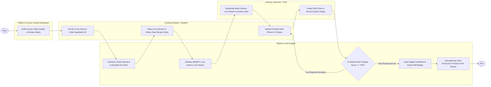

# Swimlane Diagram — Online Cooking Class Platform

## Mermaid Code

## Flow Description | Mo ta luong

| Lane | Actor | Role in Flow |
|------|-------|-------------|
| **Lane 1** | Cooking Student / Student | Enrolls in live masterclass, orders door-step ingredient kit, watches multi-camera stream following step recipe cards, and uploads finished dish photos. |
| **Lane 2** | Culinary Instructor / Chef | Broadcasts multi-camera live video streams, answers student Q&A chat, grades student dish photo submissions, and records audio critiques. |
| **Lane 3** | Platform Course Content Moderator | Audits uploaded course video production quality, verifies instructor professional credentials, and checks recipe safety compliance. |
| **Lane 4** | Platform Core Engine | Processes enrollment payments, dispatches ingredient kit orders to grocery delivery APIs, manages WebRTC streams, issues certificates, and calculates payouts. |

### Process Execution Steps | Cac buoc thuc hien quy trinh

1. **Course Audit & Enrollment**: Content Moderator audits course video quality (`M1`). Student enrolls in live masterclass and orders ingredient kit (`C1`). Core Engine clears payment and dispatches kit (`S1`).
2. **Live Broadcast & Cooking**: Student watches stream following step recipe cards (`C2`). Chef Instructor broadcasts multi-camera live stream and answers Q&A chat (`K1`). Core Engine manages WebRTC stream (`S2`).
3. **Dish Submission & Chef Critique**: Student uploads finished dish photo (`C3`). Chef grades dish and records audio critique (`K2`). Core Engine evaluates critique score (`S3`).
   - If **No (Requires Remake)**: Student receives feedback notes and re-submits dish photo (`C3`).
   - If **Yes (Passing Score >= 70%)**: Core Engine issues verifiable digital certificate and awards skill badge (`S4`).
4. **Instructor Payout & Settlement**: Core Engine calculates net chef commission share and processes bank ACH payout (`S5`), completing execution (`Finish`).
