# Action Tree — Online Cooking Class Platform

## Mermaid Code

```mermaid
graph TD
    Root["Online Cooking Class Platform"]

    Root --> M1["Course Catalog & Curriculum Management"]
    Root --> M2["Live Interactive Streaming & Multi-Cam Broadcasting"]
    Root --> M3["Ingredient Kit Delivery & Grocery Integration"]
    Root --> M4["Dish Submission & Chef Critique System"]
    Root --> M5["Culinary Certification & Gamification Badges"]
    Root --> M6["Subscription Pass & Instructor Payouts"]
    Root --> M7["Platform Analytics & System Administration"]

    M1 --> A11["Create Course Curricula & Video Lessons"]
    M1 --> A12["Build Interactive Step Recipe Cards & Timers"]
    M1 --> A13["Stream Pre-Recorded High-Definition VOD Courses"]
    M1 --> A14["Schedule Private 1-on-1 Culinary Coaching"]

    M2 --> A21["Broadcast WebRTC Low-Latency Live Video Streams"]
    M2 --> A22["Switch Multi-Camera Angles Overhead & Stove Cams"]
    M2 --> A23["Manage Student Real-Time Q&A Chat Queue"]
    M2 --> A24["Transcode & Archive Live Streams to VOD Library"]

    M3 --> A31["Bundle Exact Pre-Portioned Recipe Ingredient BOMs"]
    M3 --> A32["Dispatch Ingredient Kits to Grocery Delivery APIs"]
    M3 --> A33["Track Cold-Pack Shipment Delivery Notifications"]
    M3 --> A34["Export Interactive Digital Shopping Lists"]

    M4 --> A41["Upload Finished Dish Photos & Videos"]
    M4 --> A42["Grade Plating Technique & Sauce Emulsification"]
    M4 --> A43["Record Chef Audio Voice Note Feedback"]
    M4 --> A44["Publish Student Dish Photo Community Galleries"]

    M5 --> A51["Generate Cryptographic Digital Culinary Certificates"]
    M5 --> A52["Award Skill Badges Pasta Master French Sauces"]
    M5 --> A53["Export Verified Credentials to LinkedIn Profiles"]
    M5 --> A54["Verify Certificate Authenticity via QR Scans"]

    M6 --> A61["Manage Monthly Subscription All-Access Passes"]
    M6 --> A62["Calculate Net Instructor Commission Share Splits"]
    M6 --> A63["Process Automated Bank ACH Chef Payouts"]
    M6 --> A64["Process Course Ticket Refund Dispute Claims"]

    M7 --> A71["Monitor Total Enrollment Revenue & Course GMV"]
    M7 --> A72["Analyze Course Completion & Retention Rates"]
    M7 --> A73["Manage User Roles & Security Permissions"]
    M7 --> A74["Manage WebRTC Server & AWS CloudFront CDN Keys"]
```

## Module Description | Mo ta Module

| # | Module | Description | Actions |
|---|--------|-------------|---------|
| 1 | Course Catalog & Curriculum Management | Controls course curriculum creation, interactive step recipe cards with timers, pre-recorded VOD video lesson streaming, and 1-on-1 coaching bookings. | Create Course Curricula & Video Lessons, Build Interactive Step Recipe Cards & Timers, Stream Pre-Recorded High-Definition VOD Courses, Schedule Private 1-on-1 Culinary Coaching |
| 2 | Live Interactive Streaming & Multi-Cam Broadcasting | Manages WebRTC low-latency live video streaming, multi-camera switching (Overhead, Stove, Face Cams), live Q&A chat queues, and automated VOD archiving. | Broadcast WebRTC Low-Latency Live Video Streams, Switch Multi-Camera Angles Overhead & Stove Cams, Manage Student Real-Time Q&A Chat Queue, Transcode & Archive Live Streams to VOD Library |
| 3 | Ingredient Kit Delivery & Grocery Integration | Bundles exact pre-portioned recipe ingredient BOMs, dispatches prep boxes to local grocery delivery APIs (Instacart), and tracks cold-pack shipments. | Bundle Exact Pre-Portioned Recipe Ingredient BOMs, Dispatch Ingredient Kits to Grocery Delivery APIs, Track Cold-Pack Shipment Delivery Notifications, Export Interactive Digital Shopping Lists |
| 4 | Dish Submission & Chef Critique System | Enables students to upload finished dish photos, allowing chef instructors to grade plating/technique, record audio voice notes, and publish class galleries. | Upload Finished Dish Photos & Videos, Grade Plating Technique & Sauce Emulsification, Record Chef Audio Voice Note Feedback, Publish Student Dish Photo Community Galleries |
| 5 | Culinary Certification & Gamification Badges | Issues verifiable digital culinary skill certificates, micro-credentials (Pasta Master), LinkedIn badge exports, and QR code verification links. | Generate Cryptographic Digital Culinary Certificates, Award Skill Badges Pasta Master French Sauces, Export Verified Credentials to LinkedIn Profiles, Verify Certificate Authenticity via QR Scans |
| 6 | Subscription Pass & Instructor Payouts | Manages monthly all-access VIP subscription passes, calculates chef commission split earnings (80/20), and dispatches automated bank ACH payouts. | Manage Monthly Subscription All-Access Passes, Calculate Net Instructor Commission Share Splits, Process Automated Bank ACH Chef Payouts, Process Course Ticket Refund Dispute Claims |
| 7 | Platform Analytics & System Administration | Provides executive reporting on enrollment revenue, course completion rates, active video streams, CDN keys, user security roles, and platform settings. | Monitor Total Enrollment Revenue & Course GMV, Analyze Course Completion & Retention Rates, Manage User Roles & Security Access Levels, Manage WebRTC Server & AWS CloudFront CDN Keys |
