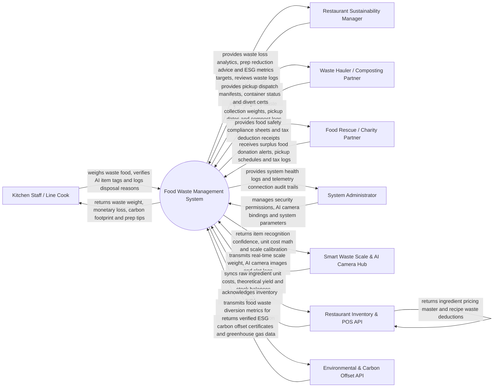

# Context Diagram — Food Waste Management System

## Mermaid Code

## Actor & Interaction Table | Bang Actor & Tuong tac

| # | Actor | Actor Type | Data Sent TO System | Data Received FROM System | Notes |
|---|-------|------------|---------------------|---------------------------|-------|
| 1 | Kitchen Staff / Line Cook | Primary | Food waste weigh-ins, AI image classification confirmations, waste reason selections (Over-prep, Trimming, Expiry) | Instant weight display, financial cost of waste item, carbon footprint, prep reduction tips | Interacts via kitchen smart scale touchscreen or mobile tablet. |
| 2 | Sustainability Manager | Primary | Food waste reduction targets, food donation approvals, prep adjustment policies | Waste financial loss analytics, AI prep reduction advice, ESG carbon metrics, team leaderboards | Oversees kitchen waste reduction, ESG sustainability goals, and cost savings. |
| 3 | Waste Hauler / Composting Partner | Primary | Commercial pickup timestamps, organic compost weights, bin contamination alerts | Scheduled pickup manifests, waste bin fullness alerts, landfill diversion certificates | Commercial waste management vendor hauling food scraps for industrial composting. |
| 4 | Food Rescue / Charity Partner | Primary | Food donation pickup confirmations, temperature safety logs upon arrival | Surplus food donation alerts, food safety sheets, tax deduction receipts | Local food banks and soup kitchens receiving safe surplus edible food. |
| 5 | System Administrator | Primary | User credentials, security role policies, AI camera device bindings, system settings | System health metrics, scale calibration logs, hardware telemetry audit trails | Manages software infrastructure, AI camera hardware, and permissions. |
| 6 | Smart Waste Scale & AI Camera Hub | Supporting | Real-time scale weight (grams), top-down AI camera food images, bin RFID pings | AI image classification results, unit cost math, scale zero-calibration pings | Smart scale hardware (e.g., Leanpath / Winnow Vision) with integrated AI camera. |
| 7 | Restaurant Inventory & POS API | Supporting | Ingredient master cost per kg, recipe BOM yield percentages, sales velocity data | Waste inventory deductions, updated ingredient cost baselines | Enterprise inventory system providing raw ingredient cost calculations. |
| 8 | Environmental & Carbon Offset API | Supporting | Third-party ESG audit validation tokens, greenhouse gas emission factors | Verified carbon offset metrics, landfill methane prevention equivalents | Environmental API converting food waste weight into CO2e and ESG metrics. |

## System Boundary Description | Mo ta Pham vi He thong

The **Food Waste Management System** manages commercial kitchen food waste tracking, AI-driven waste image recognition, monetary loss calculation, surplus food rescue donation, organic composting logistics, and ESG carbon footprint reporting. Inside its boundary, the system handles smart scale weight capture, top-down AI image food classification, waste cause categorization (Pre-Prep Trimming, Over-Production, Expiration, Plate Scraping), monetary waste cost conversion, AI prep quantity reduction recommendations, food rescue charity dispatching, and landfill diversion ESG analytics.

The system boundary excludes physical hauling of waste bins, physical composting in soil, physical cooking of food, and raw financial banking transactions.
