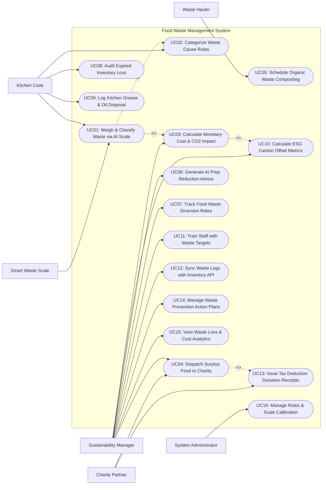

# Use Case Diagram — Food Waste Management System

## Mermaid Code

## Actor Table | Bang Actor

| # | Actor | Actor Type | Role Description | Related Use Cases |
|---|-------|------------|------------------|-------------------|
| 1 | Smart Waste Scale | Secondary System | Integrated kitchen weighing scale and top-down AI camera hardware recognizing food items and measuring waste weights. | UC01 |
| 2 | Kitchen Cook | Primary | Line cook weighing discarded food scraps, confirming AI food recognition, and categorizing waste reasons on scale touchscreens. | UC01, UC02, UC08, UC09 |
| 3 | Sustainability Manager | Primary | Restaurant manager configuring waste reduction targets, reviewing AI prep recommendations, managing food donations, and reporting ESG carbon metrics. | UC03, UC04, UC06, UC07, UC10, UC11, UC12, UC14, UC15 |
| 4 | Waste Hauler | Primary | Commercial waste collection partner accepting scheduled organic compost bin pickups and providing landfill diversion certificates. | UC05 |
| 5 | Charity Partner | Primary | Food rescue partner receiving surplus edible food alerts, confirming temperature safety, and issuing tax donation receipts. | UC04, UC13 |
| 6 | System Administrator | Primary | Technical manager configuring smart scale IP bindings, AI camera confidence thresholds, user roles, and system settings. | UC16 |

## Use Case Table | Bang Use Case

| # | UC ID | Use Case Name | Primary Actor | Secondary Actor | Description | Priority |
|---|-------|---------------|---------------|-----------------|-------------|----------|
| 1 | UC01 | Weigh & Classify Waste via AI Scale | Kitchen Cook | Smart Waste Scale | Captures waste food weight (in grams) using smart scales while top-down AI cameras auto-classify discarded food items. | High |
| 2 | UC02 | Categorize Waste Cause Rules | Kitchen Cook | None | Assigns specific root cause tags to discarded food items (e.g., Over-Production, Pre-Prep Trimming, Expired Stock, Plate Waste). | High |
| 3 | UC03 | Calculate Monetary Cost & CO2 Impact | Sustainability Manager | None | Dynamically converts discarded food weight into monetary financial loss ($) and greenhouse gas carbon footprint (kg CO2e). | High |
| 4 | UC04 | Dispatch Surplus Food to Charity | Sustainability Manager | Charity Partner | Identifies unserved, safe surplus food and dispatches pickup notifications to certified local food rescue partners. | High |
| 5 | UC05 | Schedule Organic Waste Composting | Waste Hauler | None | Schedules automated organic waste bin pickups with commercial composting haulers, preventing food scraps from reaching landfills. | High |
| 6 | UC06 | Generate AI Prep Reduction Advice | Sustainability Manager | None | Analyzes historical waste patterns using ML algorithms to generate daily ingredient prep reduction recommendations for chefs. | High |
| 7 | UC07 | Track Food Waste Diversion Rates | Sustainability Manager | None | Tracks the percentage of total food waste diverted away from landfills (Landfill vs Compost vs Animal Feed vs Food Rescue). | High |
| 8 | UC08 | Audit Expired Inventory Loss | Kitchen Cook | None | Logs inventory spoilage and expired raw ingredient discards directly at the waste scale, updating inventory depletion ledgers. | High |
| 9 | UC09 | Log Kitchen Grease & Oil Disposal | Kitchen Cook | None | Tracks yellow grease and fryer cooking oil waste disposal volume, scheduling recycling pickups with yellow grease collectors. | Medium |
| 10 | UC10 | Calculate ESG Carbon Offset Metrics | Sustainability Manager | None | Calculates ESG environmental metrics (GHG emissions avoided, water saved, energy offset) for corporate sustainability reporting. | High |
| 11 | UC11 | Train Staff with Waste Targets | Sustainability Manager | None | Displays gamified kitchen waste reduction leaderboards and shift targets on smart scale displays to train line cooks. | Medium |
| 12 | UC12 | Sync Waste Logs with Inventory API | Sustainability Manager | None | Synchronizes waste log transactions with enterprise inventory and POS systems to adjust theoretical vs actual food cost variances. | High |
| 13 | UC13 | Issue Tax Deduction Donation Receipts | Charity Partner | None | Generates official IRS 501(c)(3) tax deduction receipts and Good Samaritan Food Donation protection logs for donated surplus food. | Medium |
| 14 | UC14 | Manage Waste Prevention Action Plans | Sustainability Manager | None | Tracks corrective action plans created by managers to address recurring high-loss waste items (e.g., trimming waste on ribeye steaks). | Medium |
| 15 | UC15 | View Waste Loss & Cost Analytics | Sustainability Manager | None | Displays analytical dashboards on total monetary waste loss, top wasted ingredients by cost, loss by station, and trend graphs. | High |
| 16 | UC16 | Manage Roles & Scale Calibration | System Admin | None | Configures user security roles, AI camera image confidence parameters, smart scale zero-calibration pings, and system audit logs. | High |

## Use Case Specification | Dac ta Use Case

---

### UC01 — Weigh & Classify Waste via AI Scale

| Field | Detail |
|-------|--------|
| **UC ID** | UC01 |
| **Use Case Name** | Weigh & Classify Waste via AI Scale |
| **Actor(s)** | Primary: Kitchen Cook   Secondary: Smart Waste Scale |
| **Description** | Captures the physical weight of discarded food items placed on a smart scale while an integrated top-down AI camera automatically recognizes the food item image, logging the entry in under 3 seconds. |
| **Precondition** | 1. Smart waste scale is powered on and zero-calibrated.   2. AI food item image recognition model is loaded. |
| **Main Flow** | 1. Kitchen Cook dumps a tray of discarded food (e.g., Roasted Salmon Fillets) into the waste container sitting on the smart scale platform.   2. Smart Scale measures net weight change: `Net Weight = 1.450 kg (1,450 grams)`.   3. Top-down AI camera captures high-resolution image of the discarded food item.   4. AI Image Recognition Engine analyzes image features, classifying item: `Item: Baked Salmon Fillet (Confidence: 94%)`.   5. Touchscreen on scale displays recognized item: **Detected: Baked Salmon Fillet (1.45 kg)**.   6. Cook confirms item match on touchscreen (or taps alternative item from quick-pick menu).   7. System prompts for Waste Cause Categorization (executing UC02).   8. System calculates Monetary Cost ($26.10) and CO2e Footprint (11.6 kg CO2e) (executing UC03).   9. Touchscreen displays instant feedback: **Logged: 1.45kg Salmon | Cost: $26.10 | Carbon: 11.6kg CO2e**, and plays positive logging tone.   10. System posts waste transaction log to cloud server. |
| **Alternative Flow** | **AF1** — Manual item selection (AI low confidence):   1. AI confidence is 45% due to mixed food scraps.   2. Touchscreen displays 3 top candidate suggestions (e.g., "Mashed Potatoes", "Cauliflower Puree", "Mixed Trimmings").   3. Cook taps "Mashed Potatoes" on touchscreen to confirm. |
| **Exception Flow** | **EX1** — Un-calibrated scale error:   1. Scale platform experiences negative tare weight.   2. Touchscreen displays "Scale Tare Required", automatically executing zero-tare calibration before allowing logging. |
| **Postcondition** | Waste weight is captured, food item is classified by AI, monetary/carbon impact is calculated, and transaction is logged. |
| **Business Rule** | **BR1**: Waste weigh-in and classification logging MUST complete in under 5 seconds per transaction to avoid disrupting kitchen prep workflow.   **BR2**: High-value ingredient discards (> $10.00 single entry) MUST require mandatory waste cause confirmation on the scale screen. |

---

### UC02 — Categorize Waste Cause Rules

| Field | Detail |
|-------|--------|
| **UC ID** | UC02 |
| **Use Case Name** | Categorize Waste Cause Rules |
| **Actor(s)** | Primary: Kitchen Cook   Secondary: None |
| **Description** | Prompts the cook to assign a specific root cause category to every discarded food entry (e.g., Over-Production, Pre-Prep Trimming, Expired Inventory, Over-Cooked, Plate Scraping) to identify actionable prevention steps. |
| **Precondition** | 1. Waste item weight and AI classification (UC01) are confirmed.   2. Master waste cause taxonomy is configured. |
| **Main Flow** | 1. Following food item classification on the smart scale touchscreen (UC01), System displays "Select Waste Cause Category".   2. System presents 4 primary waste stage categories:      - Stage 1: `Pre-Prep Trimming & Peeling` (Skin, bones, vegetable ends, fat trim)      - Stage 2: `Over-Production / Unserved` (Batch cooked items remaining in buffet/line pans)      - Stage 3: `Cooking Error / Burned` (Over-cooked, dropped on floor, spoiled prep)      - Stage 4: `Inventory Spoilage / Expired` (Spoiled raw ingredients past shelf-life).   3. Cook taps `Over-Production / Unserved`.   4. System presents secondary root cause options: `Buffet Over-Batch`, `Rainy Day Low Sales`, `Inaccurate Prep Sheet`.   5. Cook selects `Buffet Over-Batch`.   6. System saves complete waste classification tag: `Item: Baked Salmon; Stage: Over-Production; Root Cause: Buffet Over-Batch`.   7. System routes root cause data to AI Prep Reduction Engine (UC06) to adjust future buffet prep quantities. |
| **Alternative Flow** | **AF1** — Customer plate waste categorization:   1. Busser weighs uneaten food scraped from guest plates.   2. Busser selects `Stage 5: Customer Plate Waste` (enabling portion size reduction analysis). |
| **Exception Flow** | **EX1** — Unassigned cause timeout default:   1. Cook walks away without selecting a cause category for 15 seconds.   2. System logs entry as `Unassigned Waste Cause` and flags for manager review. |
| **Postcondition** | Waste cause stage and root cause tags are assigned to the waste transaction log. |
| **Business Rule** | **BR1**: Every waste entry MUST be tagged with a primary waste stage (Pre-Prep, Over-Production, Cooking Error, Expired, Plate Waste) to enable root cause analysis.   **BR2**: Over-production waste entries must automatically link to corresponding shift prep sheets to evaluate chef batch accuracy. |

---

### UC03 — Calculate Monetary Cost & CO2 Impact

| Field | Detail |
|-------|--------|
| **UC ID** | UC03 |
| **Use Case Name** | Calculate Monetary Cost & CO2 Impact |
| **Actor(s)** | Primary: Sustainability Manager   Secondary: None |
| **Description** | Dynamically calculates the exact monetary financial cost ($) and greenhouse gas carbon footprint (kg CO2e) of discarded food items using live POS ingredient cost baselines and EPA environmental impact factors. |
| **Precondition** | 1. Waste item weight and classification (UC01) are logged.   2. Raw ingredient unit cost master ($/kg) from POS/inventory system (UC12) is synced. |
| **Main Flow** | 1. System receives raw waste log: `Item: Baked Salmon Fillet; Weight: 1.450 kg`.   2. System retrieves raw ingredient unit cost baseline from inventory database: `Raw Salmon Fillet Cost = $18.00 / kg`.   3. System calculates Direct Ingredient Monetary Cost: `1.450 kg * $18.00/kg = $26.10`.   4. System calculates Fully Loaded Waste Cost (including labor & utility overhead factor 1.25x): `$26.10 * 1.25 = $32.63 Fully Loaded Loss`.   5. System retrieves Environmental EPA Food Waste Carbon Emission Factor for Salmon: `8.0 kg CO2e / kg of salmon waste`.   6. System calculates Total Carbon Footprint Impact: `1.450 kg * 8.0 kg CO2e/kg = 11.60 kg CO2e`.   7. System calculates Water Waste Impact: `1.450 kg * 1,200 Liters/kg = 1,740 Liters of Water Embedded Loss`.   8. System appends financial cost ($26.10) and carbon impact (11.60 kg CO2e) to the transaction record.   9. System updates real-time store waste loss dashboard and ESG sustainability metrics (UC10). |
| **Alternative Flow** | **AF1** — Prepared recipe composite cost math:   1. Discarded item is a pre-cooked dish (Beef Stew).   2. System calculates composite cost by exploding recipe BOM ingredients and multiplying respective unit costs. |
| **Exception Flow** | **EX1** — Missing ingredient unit cost in database:   1. Discarded item unit cost is missing ($0.00).   2. System uses category average cost ($5.00/kg default), flags "Cost Estimated", and prompts manager to update item unit price. |
| **Postcondition** | Monetary financial loss, fully loaded cost, embedded carbon footprint, and water loss metrics are calculated and posted. |
| **Business Rule** | **BR1**: Monetary waste calculations MUST update automatically whenever raw ingredient unit costs change in the inventory system.   **BR2**: Carbon footprint calculations must utilize official EPA WARM (Waste Reduction Model) emission factors per food category. |

---

### UC04 — Dispatch Surplus Food to Charity

| Field | Detail |
|-------|--------|
| **UC ID** | UC04 |
| **Use Case Name** | Dispatch Surplus Food to Charity |
| **Actor(s)** | Primary: Sustainability Manager, Charity Partner   Secondary: None |
| **Description** | Identifies unserved, safe surplus food at the end of shifts, generates food rescue donation alerts, verifies food safety holding temperatures, and dispatches pickup notifications to certified charity food banks. |
| **Precondition** | 1. Surplus unserved food (e.g., 10 kg untouched hot catering pans) is identified by kitchen staff.   2. Certified food rescue charity partner network is active in system. |
| **Main Flow** | 1. Kitchen Staff logs surplus food on smart scale, selecting `Surplus Food — Safe for Donation`.   2. System displays Food Safety Inspection Checklist:      - `1. Food was held at safe holding temp (>= 60°C Hot or <= 4°C Cold)`      - `2. Food was NOT served to customer tables or exposed to contamination`      - `3. Food is packaged in food-grade sealed containers and labeled`.   3. Staff verifies checklist and inputs temperature probe reading: `Temp = 65.0°C (PASSED)`.   4. Sustainability Manager reviews donation request on mobile app and taps "Approve Food Donation".   5. System dispatches automated Food Rescue Alert to local Charity Partner (e.g., City Food Bank): **Food Rescue Available: 10kg Hot Chicken & Pasta at Grand Hotel Kitchen — Pickup Window: 9:00 PM - 10:00 PM**.   6. Charity Partner receives alert, accepts pickup, and dispatches refrigerated rescue van.   7. Driver arrives at kitchen loading dock, verifies food temperature, scans donation QR code tag, and signs digital receipt on tablet.   8. System updates waste diversion metrics: +10kg diverted to `Food Rescue / Charity Donation` (UC07) and issues Tax Deduction Receipt (UC13). |
| **Alternative Flow** | **AF1** — No charity partner available for immediate pickup:   1. No charity accepts pickup within 30 minutes.   2. System prompts "Chill food to <= 4°C within 2 hours for next-morning pickup", generating blast-chiller prep ticket. |
| **Exception Flow** | **EX1** — Food safety temperature breach upon pickup:   1. Driver measures food temp at 25.0°C (Temperature Danger Zone).   2. Driver rejects donation for safety reasons; System logs rejection and routes food scraps to Composting Hauler (UC05). |
| **Postcondition** | Safe surplus food is verified, charity pickup is dispatched, food safety receipt is signed, and diversion metrics update. |
| **Business Rule** | **BR1**: Donated surplus food MUST comply with Bill Emerson Good Samaritan Food Donation Act safety guidelines and temperature standards.   **BR2**: Donated food items MUST be packaged in sealed, food-grade containers labeled with item name, prep date, and allergen warnings. |

---

### UC06 — Generate AI Prep Reduction Advice

| Field | Detail |
|-------|--------|
| **UC ID** | UC06 |
| **Use Case Name** | Generate AI Prep Reduction Advice |
| **Actor(s)** | Primary: Sustainability Manager   Secondary: None |
| **Description** | Analyzes historical food waste patterns, sales velocity, weather forecasts, and day-of-week trends using machine learning algorithms to generate precise daily prep quantity reduction recommendations for chefs. |
| **Precondition** | 1. Minimum 14 days of historical waste logs (UC01) and POS sales data (UC12) are recorded.   2. AI forecasting engine is active. |
| **Main Flow** | 1. System initiates automated daily "AI Kitchen Prep Optimization Batch" at 4:00 AM prior to morning prep shift.   2. AI engine analyzes 4 data streams for upcoming shift (e.g., Wednesday Lunch Shift):      - Historical Waste Logs: Wednesdays average 4.2 kg over-production waste on Grilled Chicken.      - POS Sales Velocity: Wednesday lunch sales average 120 chicken covers.      - Weather Forecast: Rainy weather forecast (reduces outdoor footfall by 15%).      - Reservation Bookings: 85 confirmed table reservations.   3. AI engine calculates Optimal Daily Prep Target: `Prepare 105 Grilled Chicken Breasts (Down from historical chef default of 135)`.   4. System generates AI Prep Reduction Recommendation Card:      - **Recommendation: Reduce Grilled Chicken Prep by 22% (Target: 105 Portions)**      - **Projected Waste Savings: 3.8 kg ($34.20 / 30.4 kg CO2e)**      - **Confidence Score: 92%**.   5. System dispatches recommendation to Head Chef's tablet prep sheet and Sustainability Manager dashboard.   6. Chef reviews recommendation, accepts suggested prep target (105 portions), and prints adjusted station prep sheet.   7. At shift end, System compares actual waste against AI prediction, updating machine learning accuracy models. |
| **Alternative Flow** | **AF1** — Chef partial adoption / override:   1. Chef adjusts AI target from 105 to 115 portions due to large walk-in group.   2. System logs chef override and tracks final waste outcome to refine future AI models. |
| **Exception Flow** | **EX1** — Insufficient data for AI prediction:   1. New menu item introduced 2 days ago (insufficient historical data).   2. System flags "Insufficient Data for AI Recommendation — Using Standard Par Level". |
| **Postcondition** | AI prep reduction recommendations are generated, prep targets are adjusted, and waste prevention savings are achieved. |
| **Business Rule** | **BR1**: AI prep recommendations MUST integrate POS sales velocity, weather, and reservation data to avoid under-prepping during high-demand rushes.   **BR2**: Prep reduction advice must highlight specific monetary dollar savings to motivate chef adoption. |
