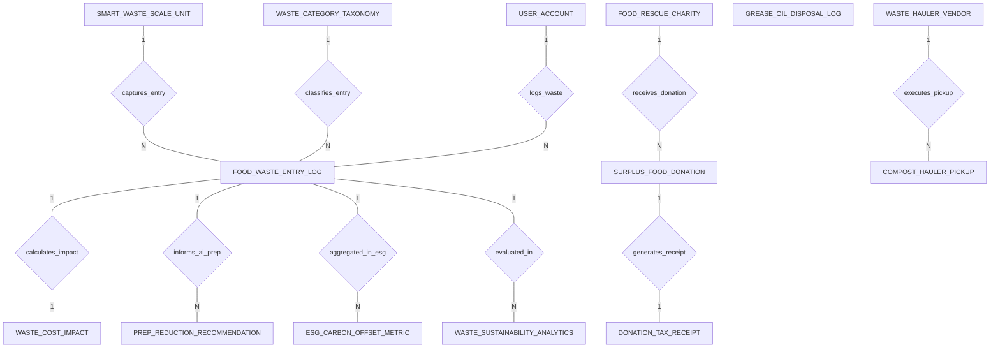

# Conceptual ERD — Food Waste Management System

## Mermaid Code

## Entity Description Table | Bang mo ta Entity

| # | Entity Name | Vietnamese Name | Description | Key Attributes | Main Relationships |
|---|-------------|-----------------|-------------|----------------|-------------------|
| 1 | SMART_WASTE_SCALE_UNIT | Thiet bi can rac thong minh | Smart waste scale hardware unit, scale code, station location (Prep, Line, Dishwasher), IP address, camera ID, and active status. | scale_id, scale_code, station_location, IP_address, camera_device_id, is_active | One-to-Many with FOOD_WASTE_ENTRY_LOG |
| 2 | FOOD_WASTE_ENTRY_LOG | Nhat ky ghi nhan rac thuc pham | Individual waste log transaction, scale ID, category ID, cook user ID, waste weight kg, stage, root cause tag, and timestamp. | entry_id, scale_id, category_id, cook_user_id, waste_weight_kg, waste_stage, root_cause_tag, logged_at | Belongs to SMART_WASTE_SCALE_UNIT, WASTE_CATEGORY_TAXONOMY, USER_ACCOUNT; One-to-One with WASTE_COST_IMPACT; One-to-Many with PREP_REDUCTION_RECOMMENDATION, ESG_CARBON_OFFSET_METRIC, WASTE_SUSTAINABILITY_ANALYTICS |
| 3 | WASTE_CATEGORY_TAXONOMY | Phân loai rac thuc pham | Master food waste item taxonomy, food item name, category group, ingredient unit cost $/kg, CO2 factor/kg, and donatable flag. | category_id, food_item_name, category_group, unit_cost_per_kg, co2_factor_per_kg, is_donatable | One-to-Many with FOOD_WASTE_ENTRY_LOG |
| 4 | WASTE_COST_IMPACT | Chi phi va tac dong carbon | Financial and environmental impact ledger for a waste entry, direct ingredient cost, fully loaded cost, CO2e emissions kg, and water loss. | impact_id, entry_id, direct_ingredient_cost, fully_loaded_cost, co2_emissions_kg, water_embedded_liters | One-to-One with FOOD_WASTE_ENTRY_LOG |
| 5 | SURPLUS_FOOD_DONATION | Don hang quyen gop thuc pham | Surplus edible food donation record, charity ID, dispatch time, total donation weight kg, food holding temp °C, and donation status. | donation_id, charity_id, dispatch_time, total_donation_weight_kg, food_holding_temp_celsius, donation_status | Belongs to FOOD_RESCUE_CHARITY; One-to-One with DONATION_TAX_RECEIPT |
| 6 | FOOD_RESCUE_CHARITY | To chuc tu thien giai cứu | Certified food rescue charity partner profile, charity name, 501(c)(3) tax ID, contact phone, address, and verification status. | charity_id, charity_name, tax_501c3_number, contact_phone, address, is_verified | One-to-Many with SURPLUS_FOOD_DONATION |
| 7 | COMPOST_HAULER_PICKUP | Luot thu gom phan compost | Organic waste pickup manifest executed by commercial composting haulers, pickup date, compost weight kg, and diversion rate %. | pickup_id, vendor_id, pickup_date, compost_weight_kg, diversion_rate_percent, pickup_status | Belongs to WASTE_HAULER_VENDOR |
| 8 | WASTE_HAULER_VENDOR | Nha thiet thu gom rac | Commercial waste hauling contractor profile, vendor name, contract number, contact email, and fee per pickup. | vendor_id, vendor_name, contract_number, contact_email, fee_per_pickup | One-to-Many with COMPOST_HAULER_PICKUP |
| 9 | PREP_REDUCTION_RECOMMENDATION | Khuyen nghi giam chuuan bi AI | AI-generated daily prep reduction recommendation card, target date, ingredient name, recommended prep qty, projected savings, and confidence score. | recommendation_id, target_date, ingredient_name, recommended_prep_qty, projected_cost_savings, ai_confidence_score | Evaluates FOOD_WASTE_ENTRY_LOG |
| 10 | GREASE_OIL_DISPOSAL_LOG | Nhat ky thu hoi dau an | Waste kitchen cooking oil and grease trap disposal log, disposal date, gallons collected, recycler name, and rebate amount. | grease_log_id, disposal_date, gallons_collected, recycler_company_name, rebate_amount_received | Independent kitchen log |
| 11 | ESG_CARBON_OFFSET_METRIC | Chi so carbon ESG | Corporate ESG environmental metric tracking total waste weight kg, CO2e avoided kg, landfill diversion %, and certification status. | esg_metric_id, metric_period, total_waste_weight_kg, total_co2e_avoided_kg, landfill_diversion_percent, certification_status | Evaluates FOOD_WASTE_ENTRY_LOG |
| 12 | DONATION_TAX_RECEIPT | Bien nhan thue quyen gop | Official tax deduction receipt issued for surplus food donations, donation ID, receipt number, fair market value $, and issued date. | receipt_id, donation_id, receipt_number, estimated_fair_market_value, issued_date | One-to-One with SURPLUS_FOOD_DONATION |
| 13 | USER_ACCOUNT | Tai khoan he thong | Core security authentication account holding credentials, password hashes, and user role definitions. | user_id, username, password_hash, role_name | One-to-Many with FOOD_WASTE_ENTRY_LOG |
| 14 | WASTE_SUSTAINABILITY_ANALYTICS | Thong ke ben vung rac thai | Executive daily analytics tracking total monetary loss $, total waste weight kg, average waste per cover, and top wasted ingredient. | analytics_id, metric_date, total_monetary_loss, total_waste_weight_kg, avg_waste_per_cover, top_wasted_ingredient | Evaluates FOOD_WASTE_ENTRY_LOG |

## Relationship Description | Mo ta Quan he

| # | From Entity | Cardinality | To Entity | Relationship Label | Business Explanation |
|---|-------------|-------------|-----------|-------------------|----------------------|
| 1 | SMART_WASTE_SCALE_UNIT | One-to-Many | FOOD_WASTE_ENTRY_LOG | captures_entry | Thiet bi can rac thong minh thu nhan cac giao dich ghi nhan rac thuc pham. |
| 2 | WASTE_CATEGORY_TAXONOMY | One-to-Many | FOOD_WASTE_ENTRY_LOG | classifies_entry | Danh muc rac thuc pham phan loai tung luot rac thai bang AI va don gia. |
| 3 | USER_ACCOUNT | One-to-Many | FOOD_WASTE_ENTRY_LOG | logs_waste | Dau bếp hoac nhan vien ky ten phan cong thuc hien ghi nhan rac thai. |
| 4 | FOOD_WASTE_ENTRY_LOG | One-to-One | WASTE_COST_IMPACT | calculates_impact | Moi giao dich rac thai duoc tinh toan thiet hai tai chinh va carbon CO2e. |
| 5 | FOOD_RESCUE_CHARITY | One-to-Many | SURPLUS_FOOD_DONATION | receives_donation | To chuc tu thien tiep nhan cac luot quyen gop thuc pham du con an duoc. |
| 6 | SURPLUS_FOOD_DONATION | One-to-One | DONATION_TAX_RECEIPT | generates_receipt | Luot quyen gop tao ra bien nhan thue khau tru theo quy dinh phap luat. |
| 7 | WASTE_HAULER_VENDOR | One-to-Many | COMPOST_HAULER_PICKUP | executes_pickup | Nha thau thu gom thuc hien cac luot thu gom phan huu co compost. |
| 8 | FOOD_WASTE_ENTRY_LOG | One-to-Many | PREP_REDUCTION_RECOMMENDATION | informs_ai_prep | Du lieu rac thai lich su duoc thuat toan AI phan tich de dua ra khuyen nghi giam so luong quy trinh so che. |
| 9 | FOOD_WASTE_ENTRY_LOG | One-to-Many | ESG_CARBON_OFFSET_METRIC | aggregated_in_esg | Du lieu rac thai duoc thong ke va quy doi thanh cac chi so carbon ESG. |
| 10 | FOOD_WASTE_ENTRY_LOG | One-to-Many | WASTE_SUSTAINABILITY_ANALYTICS | evaluated_in | Cac luot ghi nhan rac thai duoc thong ke hieu qua tiet kiem chi phi hang ngay. |
